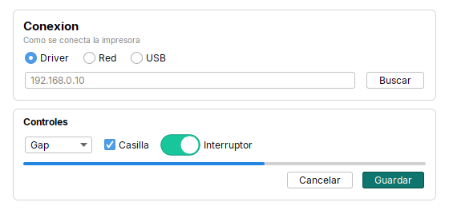

# Tessera

Libreria de UI para **Swing** (Java 8+): un kit de layout y widgets sobre **FlatLaf + MigLayout**, mas el tema,
los avisos, la bandeja del sistema y los componentes de uso comun. Pantallas armadas a mano, cortas y legibles,
sin disenador de formularios y sin escribir restricciones de layout.


```java
Theme.builder().accent("#1976D2").panelBackground("#F7F6F3").install();   // una vez, al iniciar

Page.create()
    .top(Header.create("Impresoras", "Elige como se conecta"))
    .center(Card.create("Conexion")
        .subtitle("Como se conecta la impresora")
        .children(
            Row.gap(14).children(Radio.of("Driver").selected(true), Radio.of("Red"), Radio.of("USB")),
            Row.gap(10).fill(Input.text().placeholder("192.168.0.10")).children(Button.of("Buscar"))))
    .bottom(Footer.of(Button.of("Cancelar"), Button.primary("Guardar")))
    .build();
```

## Que incluye

| Paquete | Contenido |
|---|---|
| `tessera.kit` | Contenedores `Row`, `Col`, `Stack`, `Grid`, `Form`, `Card`, `Header`, `Footer`, `Page`, `Pages`, `Scroll`, `Tabs`, `Split`, `Separator`. Widgets con metodos encadenables: `Label`, `Hint`, `Button`, `Input`, `Password`, `TextArea`, `Combo`, `Dropdown`, `Check`, `Radio`, `Toggle`, `Switch`, `Spinner`, `Table`. Paleta y utilidades en `Kit`. |
| `tessera.theme` | `Theme` (FlatLaf, fuente Inter empaquetada, acento, fondo, esquinas redondeadas) e `Icons` (SVG nitidos, interruptor estilo iOS). |
| `tessera.notify` | `Notification` (tarjetas apiladas en la esquina de la pantalla, con progreso y acciones) y `Toast` (mensaje breve sobre la ventana, con cola). |
| `tessera.app` | `TrayDock` (icono de bandeja + reapertura desde el Dock de macOS) y `WindowPrefs` (cada ventana se abre con el tamano que el usuario le dejo). |
| `tessera.components` | Modelos y renderizadores de tabla/lista (`BaseTableModel`, `CheckableListModel`, `ComboItem`, `HighlightColumnRenderer`...), bordes (`RoundedBorder`, `DashedBorder`), validacion de formularios (`ErrorProvider`, `FloatingErrorProvider`), arrastrar y soltar, deshacer/rehacer, navegacion (`InteractiveNavbar`). |

La idea: **la logica va arriba de cada clase y la pantalla se arma al final** con el kit, en una zona marcada
`// UI: widgets y construcción de la pantalla` donde cada bloque lleva sus campos justo encima del metodo que lo arma
(ver [docs/guides/screens.md](docs/guides/screens.md)).

## Dependencias

| Libreria | Version | Para que |
|---|---|---|
| [FlatLaf](https://www.formdev.com/flatlaf/) | 3.7 | look and feel |
| FlatLaf Extras | 3.7 | iconos SVG |
| [JSVG](https://github.com/weisj/jsvg) | 2.0.0 | motor de los SVG (lo pide FlatLaf Extras) |
| [MigLayout](https://www.miglayout.com/) (swing) | 4.2 o superior | layout de los contenedores |

Java 8 o superior. Nada mas: la libreria no usa JSON, logging externo ni utilidades de terceros.
`./scripts/fetch-libs.sh` las descarga de Maven Central a `lib/`; con Maven, `pom.xml` las declara.

## Compilar

```
./build.sh            # compila y deja dist/tessera-<version>.jar
./build.sh --demo     # ademas abre el Showcase (src/demo)
```

En Windows con PowerShell: `./build.ps1` (o `./build.ps1 -Demo`). Hace falta un **JDK** completo (8 o superior), con `javac` y `jar`, en el PATH
(si `jar` no se reconoce, ver la [FAQ](docs/guides/faq.md#buildsh-dice-falta-jar-o-jar-command-not-found)).
Tambien funciona con Maven: `mvn package`.

## Usarla en una app

1. Poner `tessera-<version>.jar` y las dependencias de arriba en el classpath (o `mvn install` y declarar la dependencia).
2. Instalar el tema una vez, antes de crear ventanas: `Theme.builder()...install()`.
3. Construir las pantallas con `tessera.kit`.

Con el detalle paso a paso (IDE, Maven, Gradle, linea de comandos) y una primera ventana completa: [docs/guides/getting-started.md](docs/guides/getting-started.md).
Guia para pasar una app existente (formularios NetBeans, GroupLayout) a Tessera: [docs/guides/migrating.md](docs/guides/migrating.md).
Referencia compacta de toda la API, pensada para que una IA o un dev nuevo la lea en un minuto: [AGENTS.md](AGENTS.md).

## Documentacion

Todo esta en este repositorio, en Markdown: no depende de ningun sitio web. El [indice completo](docs/README.md) tiene dos partes:

**Guias** (para aprender y resolver tareas)

| Quiero... | Leer |
|---|---|
| instalarla y ver mi primera ventana | [Primeros pasos](docs/guides/getting-started.md) |
| ver **como se coloca todo** (`Row`, `Col`, `Form`, `Card`, `Header`, `Footer`, `Stack`, `Page`...) con imagenes y 9 pantallas completas | [Como armar una pantalla](docs/guides/screens.md) |
| ejemplos completos listos para copiar (login, lista y detalle, asistente, ajustes, progreso, bandeja) | [Recetas](docs/guides/recipes.md) |
| **cambiar colores, esquinas redondeadas, fuente** | [Personalizar](docs/guides/customizing.md) |
| pasar una app NetBeans / GroupLayout a Tessera | [Migrar una app](docs/guides/migrating.md) |
| resolver un problema o una duda | [Preguntas frecuentes](docs/guides/faq.md) |
| modificar la libreria: agregar un widget, abrir un valor fijo, publicar el jar | [Contribuir](docs/guides/contributing.md) |

**Referencia por componente** (para consultar cada clase: imagen, cuando usarla, todos sus metodos y errores comunes)

| Paquete | Que hay | Empezar por |
|---|---|---|
| `tessera.kit` | **contenedores** (`Row`, `Col`, `Form`, `Grid`, `Card`, `Header`, `Footer`, `Page`, `Stack`...) y **widgets** (`Label`, `Button`, `Check`, `Radio`, `Switch`, `Input`, `Combo`, `Table`...) | [Referencia del kit](docs/reference/kit/README.md) |
| `tessera.theme` | `Theme` e `Icons` | [Theme](docs/reference/theme/theme.md) |
| `tessera.notify` | `Notification` y `Toast` | [Avisos](docs/reference/notify/README.md) |
| `tessera.app` | `TrayDock` y `WindowPrefs` | [Escritorio](docs/reference/app/README.md) |
| `tessera.components` | modelos de tabla, renderizadores, validacion, bordes, arrastrar y soltar... | [Componentes sueltos](docs/reference/components/README.md) |

Todo el indice por componente: [docs/reference/README.md](docs/reference/README.md). Para una lectura rapida de toda la API (pensada para IA y devs nuevos): [AGENTS.md](AGENTS.md).
Cada clase publica tiene ademas Javadoc corto con un ejemplo de uso. Cambios entre versiones: [CHANGELOG.md](CHANGELOG.md).

## Personalizar en 30 segundos

```java
Theme.builder()
    .accent("#1976D2")           // color de acento
    .primary("#1976D2")          // botones principales
    .panelBackground("#F7F6F3")  // fondo de las pantallas
    .arc(8)                      // esquinas de botones y campos (12 por defecto, 0 = rectas)
    .install();
```



Ojo: el radio de `Card` hoy es fijo (12) y `accent` todavia no pinta radios ni barras de progreso. Todo el detalle, con la lista de lo que se puede y no se puede cambiar, en
[docs/guides/customizing.md](docs/guides/customizing.md).

## Estructura

```
src/main/java/tessera/   la libreria (kit, theme, notify, app, components)
src/main/resources/      fuente Inter, interruptor y iconos de avisos
src/demo/java/           Showcase: ejemplo ejecutable y fuente de las capturas de docs/
docs/guides/             guias: primeros pasos, pantallas, recetas, personalizar, migrar, FAQ, contribuir
docs/reference/          referencia por componente: kit (contenedores y widgets), theme, notify, app, components
docs/img/                imagenes de la documentacion (se generan con scripts/doc-images.sh)
CHANGELOG.md             cambios entre versiones
scripts/doc-images.sh    regenera docs/img (ver docs/guides/contributing.md)
scripts/fetch-libs.sh    descarga las dependencias
build.sh | build.ps1     compilacion sin Maven ni Gradle
```

## Licencias de terceros

- **Inter** (fuente, `src/main/resources/tessera/fonts`): SIL Open Font License 1.1, texto en `Inter-LICENSE.txt`.
- **Iconos de avisos** (`info`, `warning_amber`, `success_green`, `error_red`, `arrow_down`): derivados de Material Symbols (Apache 2.0).
- FlatLaf (Apache 2.0), JSVG (MIT), MigLayout (BSD / GPL, doble licencia).

La licencia de Tessera todavia no esta definida: agregar `LICENSE` antes de publicar.
