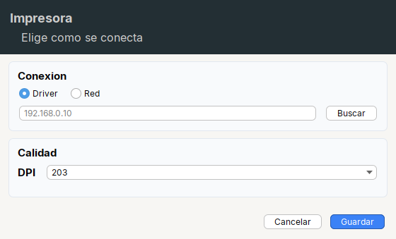

# Como armar una pantalla

Convencion para las clases de pantalla (paneles y dialogos) que usan Tessera. Es la que siguen Text2Barcode, Codaly Sync y PDFLabelCut,
y la que debe seguir cualquier app nueva. Sirve para que un dev, o una IA, encuentre en segundos donde esta la logica y donde esta la UI.

## La idea

1. **La logica va arriba** de la clase: estado, metodos, eventos, acceso a datos.
2. **La UI va al final**, en una sola zona marcada con un encabezado fijo.
3. Dentro de esa zona, **cada bloque lleva sus campos (widgets) justo encima del metodo que lo arma**. Se lee de arriba hacia abajo en el
   mismo orden en que la pantalla se construye.

## Esqueleto

```java
public class MiPanel extends JPanel {

  // ... logica arriba: campos de estado, constructor, metodos, handlers ...

  // ---------------------------------------------------------------------
  // UI: widgets y construcción de la pantalla
  // Cada bloque lleva sus campos (widgets) justo encima del método que lo arma:
  // campos del bloque -> método del bloque. Empieza en buildUI() y sigue el orden
  // en que se usan. La lógica (eventos, datos, etc.) va fuera de esta zona.
  // ---------------------------------------------------------------------

  // campos del pie: los coloca el propio buildUI()
  private final Button btnCancel = Button.of("Cancelar").onClick(this::dispose);
  private final Button btnSave = Button.primary("Guardar").onClick(this::save);

  private void buildUI() {
    setLayout(new BorderLayout());
    add(Page.create()
        .top(Header.create("Impresora", "Elige como se conecta"))
        .center(Col.gap(10).padding(10, 12, 10, 12).children(connectionBlock(), qualityBlock()))
        .bottom(Footer.of(btnCancel, btnSave))
        .build());
  }

  // campos de connectionBlock()
  private final Radio rbtnDriver = Radio.of("Driver").selected(true);
  private final Radio rbtnIp = Radio.of("Red");
  private final Input txtIp = Input.text().placeholder("192.168.0.10");
  private final Button btnScan = Button.of("Buscar").onClick(this::scan);

  private Card connectionBlock() {
    return Card.create("Conexion")
        .children(
            Row.gap(14).children(rbtnDriver, rbtnIp),
            Row.gap(10).fill(txtIp).children(btnScan));
  }

  // campos de qualityBlock()
  private final Combo<String> cbDpi = Combo.of("203", "300", "600");

  private Card qualityBlock() {
    return Card.create("Calidad").children(Form.create().row("DPI", cbDpi));
  }
}
```

Asi se ve esa pantalla (el codigo de arriba esta compilado en `src/demo/java/tessera/demo/ScreenExample.java`):



## Reglas

- **Un solo encabezado** por clase, el texto exacto de arriba. Si el método que arranca la pantalla no se llama `buildUI()`
  (por ejemplo `initUI()`), se cambia ese nombre en la frase "Empieza en ...". Buscar `UI: widgets y construcción` encuentra todas las pantallas.
- **Un campo va encima del metodo que lo coloca en el layout**, no del que solo lo configura. Si lo usan varios bloques, encima del primero.
- **Dependencias entre campos**: Java inicializa los campos en el orden en que aparecen. Si un campo usa otro (`btnMore` usa `popupMenu` en su
  lambda, un `Scroll.of(listView)` usa `listView`), el usado va **antes**; de lo contrario no compila ("illegal forward reference") o, si se accede con `this.campo`,
  queda en `null`.
- **Eventos con referencia a metodo**: `.onClick(this::guardar)`; el cuerpo del metodo vive en la zona de logica, arriba.
- **Casillas/radios que reaccionan a `setSelected` por codigo**: usa `ItemListener` (`onClick` solo atiende clics del usuario) y registralo
  despues de armar la pantalla.
- **Un solo metodo de arranque** (`buildUI()` o `initUI()`) llamado desde el constructor.
- **Si la pantalla es pequena** (un solo bloque, pocos campos) no hace falta partirla en varios metodos: los campos van juntos encima de `buildUI()`.
- Imports explicitos: `Label`, `Button`, `List`, `TextArea` chocan con `java.awt`.
- Textos de la app con el sistema de idiomas de la propia app; la libreria no trae uno.

## Que contenedor usar

| Necesito | Contenedor |
|---|---|
| widgets uno al lado del otro | `Row.gap(n).children(...)`; el que debe estirarse: `.fill(c)` |
| widgets uno debajo del otro | `Col.gap(n).children(...)`; uno que ocupe el alto sobrante: `.fillBoth(c)` |
| etiqueta + campo alineados | `Form.create().row("Nombre", txtName)` |
| tabla de celdas alineadas por columna | `Grid.gap(n).row(...)` |
| bloque con titulo y borde redondeado | `Card.create("Titulo")` / `Card.section("Titulo")` |
| ventana con cabecera, centro y pie | `Page.create().top(..).center(..).bottom(..)` |
| alternar paneles | `Pages.create()` (uno visible) o `Stack` (alternativas apiladas) |
| separar en dos zonas redimensionables | `Split.horizontal(a, b)` |
| contenido con scroll | `Scroll.of(c)` |

Los contenedores principales, con el codigo que los arma en el titulo de cada tarjeta:


La referencia completa de metodos esta en [AGENTS.md](../AGENTS.md).

## Buscar rapido (para devs e IA)

- Donde esta la UI de una pantalla: buscar `UI: widgets y construcción` en el archivo y bajar desde ahi.
- Todas las pantallas del proyecto: `grep -rl "UI: widgets y construcción" src`.
- Donde se arma un widget: el campo esta declarado en la zona de UI, justo sobre el metodo del bloque al que pertenece.
- Donde esta su comportamiento: el `.onClick(this::metodo)` apunta al metodo, que esta en la zona de logica.
