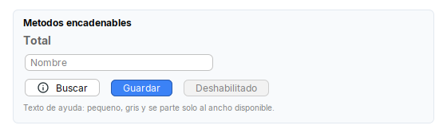
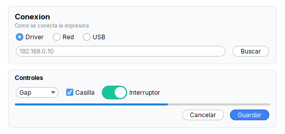

# Como cambiar el aspecto de Tessera

Guia para saber **donde se toca cada cosa**: colores, esquinas redondeadas, fuente, tamanos, iconos.
Antes de editar la libreria conviene revisar la tabla de abajo: casi todo se cambia desde la app, sin tocar Tessera.

## Resumen: que quiero cambiar y donde

| Quiero cambiar | Donde | Como |
|---|---|---|
| Color de acento (`Theme.accent()`) | `Theme.builder().accent(..)` | en el `UI.java` de la app; **ojo**: hoy no pinta radios, casillas ni barras (ver "Nota sobre el acento") |
| Color de los botones principales | `Theme.builder().primary(..)` | idem |
| Fondo de las pantallas | `Theme.builder().panelBackground(..)` | idem |
| Relleno y borde de las tarjetas (`Card`) | `Theme.builder().surface(..)` y `.cardLine(..)` | idem |
| **Radio de las esquinas de botones, campos y barras** | `Theme.builder().arc(n)` | idem (12 por defecto, 0 = esquinas rectas) |
| **Radio de las esquinas de `Card`** | **fijo en 12**: `ARC` en `kit/Card.java` | hay que editar Tessera (ver "Lo que no se puede cambiar desde la app") |
| Fuente de toda la interfaz | `Theme.builder().font("Segoe UI")` | por defecto Inter empaquetada |
| Cuanto dura un tooltip | `Theme.builder().tooltipDismissMs(ms)` | 8000 por defecto |
| Un color de la paleta (`DARK`, `MUTED`, `LINE`, filas de listas...) | `Kit.MUTED = ...` | asignacion directa, ver "Paleta del kit" |
| Algo de FlatLaf (pestanas, barra de titulo, menus...) | `UIManager.put("clave", valor)` | despues de `install()` |
| Un solo widget (negrita, color, ancho...) | metodos encadenables de `Styled` | `Label.text("x").bold().color(c)` |
| Un solo boton con otro color | `Button.primary(..)` o `Kit.makePrimary(boton)` | ver "Botones" |
| Aspecto de los avisos (`Notification`, `Toast`) | fijo en las clases | editar Tessera |

## 1. El tema (`Theme`)

Se instala **una sola vez, antes de crear cualquier ventana**. Normalmente vive en una clase `UI` de la app:

```java
Theme.builder()
    .accent("#1976D2")          // se guarda en Theme.accent() (ver "Nota sobre el acento")
    .primary("#1976D2")         // Button.primary(..)
    .panelBackground("#F7F6F3") // fondo de paneles, scrolls y viewports
    .surface("#FFFFFF")         // relleno de Card
    .cardLine("#E4E1D9")        // borde de Card
    .arc(12)                    // esquinas de botones, campos y barras
    .font("Segoe UI")           // opcional: fuente del sistema en vez de Inter
    .tooltipDismissMs(8000)
    .install();

UIManager.put("TabbedPane.selectedBackground", ...);   // lo propio de la app, despues de install()
```

Que hace `install()` por dentro (`theme/Theme.java`):

1. Guarda acento, fondo y fuente (se leen despues con `Theme.accent()`, `Theme.panelBackground()`, `Theme.fontFamily()`).
2. Asigna `Kit.PRIMARY`, `Kit.SURFACE` y `Kit.CARD_LINE` si se pidieron.
3. Registra la fuente Inter (`tessera/fonts/*.ttf`) o usa la familia pedida con `FlatLaf.setPreferredFontFamily`.
4. Instala FlatLaf (`FlatIntelliJLaf`) y escribe estas claves en `UIManager`:

| Clave de `UIManager` | Valor | Afecta |
|---|---|---|
| `Component.accentColor` | `accent` | solo los componentes que leen esta clave; no cambia radios, casillas ni barras (ver nota) |
| `Panel.background`, `ScrollPane.background`, `Viewport.background` | `panelBackground` | fondo de toda pantalla (`List.background` no se toca: listas y tablas siguen blancas) |
| `Button.arc`, `Component.arc`, `ProgressBar.arc`, `TextComponent.arc` | `arc` | esquinas de botones, combos, spinners, campos de texto, barras de progreso |
| `ScrollBar.trackArc`, `ScrollBar.thumbArc` | `999` | barras de desplazamiento totalmente redondas |


Un tema propio (`accent` y `primary` verde azulado, fondo gris, `arc(6)`); el boton principal y el fondo cambian, los radios y la barra de progreso no (ver la nota):

```java
Theme.builder().accent("#0F766E").primary("#0F766E").panelBackground("#F3F4F6")
    .surface("#FFFFFF").cardLine("#D1D5DB").arc(6).install();
```


### Nota sobre el acento

`Theme.builder().accent(..)` escribe `Component.accentColor` **despues** de instalar FlatLaf, y FlatLaf ya calculo los colores de radios, casillas
y barras de progreso a partir de su propio acento. Resultado verificado: esos tres siguen con el azul de FlatLaf aunque se pida otro color.
Mientras no se corrija en `Theme`, el acento se aplica a esos componentes si **antes** de `install()` se fija la variable de FlatLaf:

```java
FlatLaf.setGlobalExtraDefaults(Collections.singletonMap("@accentColor", "#1976D2"));
Theme.builder().accent("#1976D2")....install();
```

El interruptor `Switch` y los iconos de avisos son SVG con sus colores propios y no siguen al acento.

Si algo no esta en esa lista, se cambia con `UIManager.put(...)` **despues** de `install()`. Las claves disponibles son las de
FlatLaf: <https://www.formdev.com/flatlaf/customizing/>.

## 2. Paleta del kit (`Kit`)

Los colores del kit son campos `public static` **no finales** de `tessera.kit.Kit`, asi que se pueden asignar a mano:

| Campo | Por defecto | Se usa en |
|---|---|---|
| `Kit.PRIMARY` | `#3B82F6` | botones principales, fondo al pasar el mouse (version mas oscura) |
| `Kit.SURFACE` | `rgb(248,250,252)` | relleno de `Card` |
| `Kit.CARD_LINE` | `rgb(226,232,240)` | borde de `Card` |
| `Kit.DARK` / `Kit.ON_DARK` | `rgb(35,47,52)` / `rgb(204,204,204)` | `Header` (banner de pasos), barra lateral |
| `Kit.MUTED` | `rgb(102,102,102)` | texto secundario (`Label.muted`) |
| `Kit.LINE` | `rgb(229,229,229)` | bordes finos; hoy la libreria no lo usa, queda para las pantallas de la app |
| `Kit.ROW_ODD` / `Kit.ROW_EVEN` / `Kit.ROW_SELECTED` | `#FAFAFA` / `#FFFFFF` / `#BBDEFB` | filas alternas de listas (`LabelListCell`) y fila seleccionada |

**Cuidado con el orden**: cada widget toma el color **al crearse**. `Kit.PRIMARY` se lee dentro de `Kit.makePrimary(boton)`, asi que cambiarlo
cuando ya hay botones creados no los actualiza. Por eso el lugar correcto es `Theme.builder()` o cualquier punto antes de construir pantallas.

## 3. Un solo componente

Todos los widgets y contenedores implementan `Styled`, con metodos encadenables:

```java
Label.text("Total").bold().fontSize(14).color(Kit.MUTED).tip("Suma de todo");
Input.text().placeholder("Nombre").columns(20).width(240);
Button.of("Buscar").icon("app/img/search.svg", 16).iconGap(8).onClick(this::buscar);
```



`.width(px)` y `.height(px)` **solo** los entienden los contenedores del kit (`Row`, `Col`, `Form`, `Card`, `Stack`): se guardan como
propiedad del componente y el contenedor las convierte en restricciones de MigLayout. Todas las medidas estan en px **sin escalar**; el kit
las multiplica por el zoom de la pantalla con `Kit.px(n)`. Para medidas propias usa `Kit.px(n)`, no numeros fijos.

### Botones

- `Button.primary("Guardar")` o `boton.primary()`: color `Kit.PRIMARY` con texto blanco.
- `Kit.makePrimary(boton)` sirve para cualquier `AbstractButton` ya creado. Usa la propiedad de FlatLaf `FlatClientProperties.STYLE`
  (fondo, hover, presionado, borde); para otro color propio copia ese metodo y cambia el mapa de estilo.

### Iconos

- `Kit.icon("ruta/icono.svg", 16)` o `Icons.svg(...)`: SVG vectorial, nitido con cualquier zoom. La ruta es del classpath **de la app**.
- `Kit.icon("ruta.svg", 16, Color.WHITE)`: SVG recoloreado completo (util sobre botones oscuros).
- Los iconos propios de la libreria (`tessera/img/*.svg`: interruptor, avisos) no son para la app.

## 4. La fuente

- Por defecto se usa **Inter**, empaquetada en `tessera/fonts/` como **TTF** (no OTF: el Java 8 de Oracle escala mal los OTF y todo el texto sale al doble).
- `Theme.builder().font("Segoe UI")` usa una fuente instalada en el sistema.
- Para texto propio: `Kit.font(tamano, negrita)` devuelve la fuente de la interfaz escalada con el zoom.

## 5. Lo que no se puede cambiar desde la app

El radio de `Theme.arc` cambia botones, combos y campos, pero **no** las tarjetas (`Card`), que siguen en 12 px. Misma pantalla con
`arc(0)`, `arc(12)` (por defecto) y `arc(24)`:

| `arc(0)` | `arc(12)` | `arc(24)` |
|---|---|---|
|  |  |  |

Estas cosas estan fijas dentro de la libreria. Si el diseno las necesita distintas, se edita Tessera (ver [contributing.md](contributing.md))
y se regenera el jar.

| Cosa | Donde esta | Valor |
|---|---|---|
| Radio de las esquinas de `Card` | `kit/Card.java`, constante `ARC` en `CardBorder` | 12 (no sigue a `Theme.arc`) |
| Ancho **preferido** por defecto de `Hint` (el texto se parte al ancho real que reciba; este es el que pide) | `kit/Hint.java`, `DEFAULT_WIDTH` | 325 px (cambia por instancia con `.width(px)`) |
| Colores, radio, tamanos y animaciones de `Notification` | `notify/Notification.java` (`CARD_BG`, `SUCCESS_ACCENT`, `ERROR_ACCENT`, `WARNING_ACCENT`, `WINDOW_RADIUS`, `TEXT_WRAP_WIDTH`, `MARGIN`, `GAP`...) | tarjeta oscura de 12 px de radio |
| Duraciones de `Notification` | `Notification.LENGTH_SHORT` / `LENGTH_LONG` | 4000 / 8000 ms (se pasa otro valor en ms a `setDuration`) |
| Colores, radio y tamanos de `Toast` | `notify/Toast.java` (`MAX_RADIUS`, `MAX_TEXT_WIDTH`, `NORMAL_ACCENT`...) | radio 18 px |
| Duraciones de `Toast` | `Toast.LENGTH_SHORT` / `LENGTH_LONG` | 3000 / 6000 ms |
| Retraso al guardar el tamano de las ventanas | `app/WindowPrefs.java`, `SAVE_DELAY_MS` | 500 ms |

Una forma de abrirlo a las apps sin romper nada: agregar un metodo al `Theme.Builder` (por ejemplo `cardArc(int)`) que guarde el valor en un
campo `static` de `Kit`, y leer ese campo en lugar de la constante. Asi las apps que no lo llaman siguen igual (ver "Reglas" en
[contributing.md](contributing.md)).

## 6. Ver el resultado

```
./build.sh --demo        (Windows: ./build.ps1 -Demo)
```

Abre el `Showcase` (`src/demo/java/tessera/demo/Showcase.java`) con todos los widgets. Es el lugar mas rapido para probar un tema
nuevo: cambiar el `Theme.builder()` del Showcase y volver a ejecutar.
