# Row, Col y Stack: todo lo que se puede hacer

Las tres piezas con las que se arma casi cualquier pantalla. Esta guia es un **recetario visual**: cada seccion muestra una cosa que se puede hacer,
con la imagen de como queda y el codigo que la produce. Para el resto de contenedores (`Form`, `Grid`, `Card`, `Page`...) mira la
[guia visual de disposiciones](screens.md); para la lista corta de metodos, las paginas de referencia de [`Row`](../reference/kit/containers/row.md),
[`Col`](../reference/kit/containers/col.md) y [`Stack`](../reference/kit/containers/stack.md).

Las imagenes con borde punteado dibujan los limites del contenedor para que se vea hasta donde llega (el punteado **no** forma parte de la libreria).

## Que uso para que

| Quiero... | Uso |
|---|---|
| poner cosas **una al lado de otra** | `Row.gap(n).children(a, b, c)` |
| poner cosas **una debajo de otra** | `Col.gap(n).children(a, b, c)` |
| que **una** cosa ocupe lo que sobra a lo ancho (un campo junto a su boton) | `Row...fill(campo)` |
| que varias cosas midan **lo mismo** de ancho | `Row...fillEqual(a, b, c)` |
| que una cosa ocupe lo que sobra a lo **alto** (una tabla, un area de texto) | `Col...fillBoth(c)` · `Row...fillBoth(c)` |
| empujar algo a la **derecha** (o hacia **abajo**) | `Row...glue()` · `Col...glue()` |
| mostrar **una** de varias alternativas en el mismo lugar | `Stack.fill(a, b, c)` y mostrar solo una |
| dejar aire alrededor del contenido | `padding(n)` · `paddingVertical(n)` · `paddingHorizontal(n)` |
| fijar el ancho o el alto de un hijo | `.width(px)` · `.height(px)` |

Todos los valores estan en **px logicos**: se escalan con el zoom de la pantalla.

---

## Row: una al lado de otra

Los hijos van **de izquierda a derecha**, cada uno con su ancho natural. Todo lo demas se pide con un metodo.

### Espacio entre hijos: `gap`

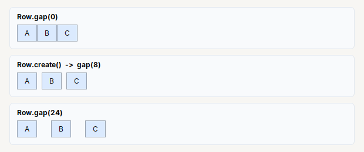

```java
Row.gap(0).children(a, b, c)         // pegados
Row.create().children(a, b, c)       // lo mismo que gap(8)
Row.gap(24).children(a, b, c)        // separados
```

`gap` es el espacio **entre** un hijo y el siguiente. El espacio entre el borde y los hijos es el [`padding`](#margen-interior-padding).

### Ocupar el ancho que sobra: `fill`

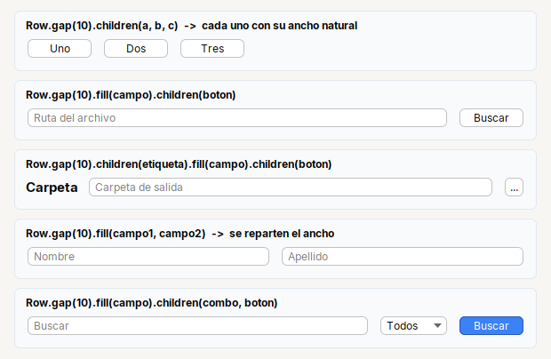

```java
Row.gap(10).children(a, b, c)                                            // cada uno con su ancho natural
Row.gap(10).fill(txtPath).children(btnBrowse)                            // campo + boton
Row.gap(10).children(lblFolder).fill(txtFolder).children(btnPick)        // etiqueta + campo + boton
Row.gap(10).fill(txtName, txtLastName)                                   // dos campos, se reparten el ancho
Row.gap(10).fill(txtSearch).children(cbStatus, btnSearch)                // campo + combo + boton
```

Lo que **no** se pasa por `fill` conserva su ancho natural: ese es el truco de un campo con su boton.

### Repartir el ancho: `fill` frente a `fillEqual`

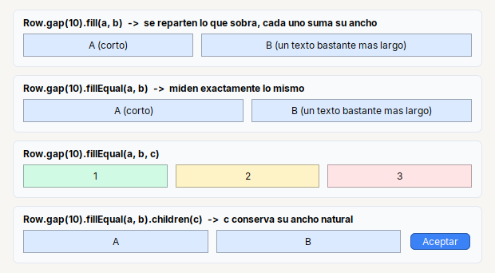

```java
Row.gap(10).fill(zoneA, zoneB)                    // se reparten lo que sobra: cada uno suma su ancho natural
Row.gap(10).fillEqual(zoneA, zoneB)               // miden exactamente lo mismo
Row.gap(10).fillEqual(a, b, c)                    // tres iguales
Row.gap(10).fillEqual(a, b).children(btnOk)       // dos iguales y un boton con su ancho natural
```

Con `fill`, un hijo con mas texto sale mas ancho. Con `fillEqual` todos miden lo mismo aunque sus textos sean distintos: es lo que se usa para dos
columnas lado a lado.

### Ocupar tambien el alto: `fillBoth`

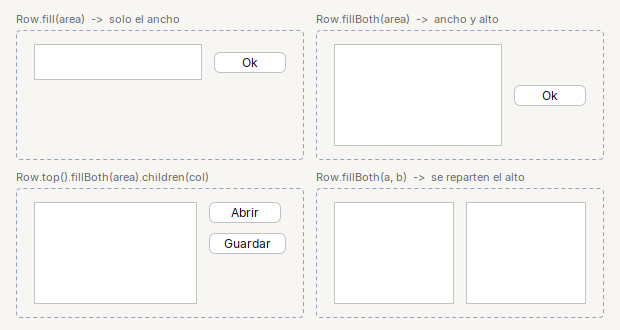

```java
Row.gap(8).padding(8).fill(scrollArea).children(btnOk)                   // solo el ancho
Row.gap(8).padding(8).fillBoth(scrollArea).children(btnOk)               // ancho y alto
Row.gap(8).padding(8).top().fillBoth(scrollArea).children(Col.gap(6).children(btnOpen, btnSave))
Row.gap(8).padding(8).fillBoth(scrollA, scrollB)                         // se reparten el ancho, los dos altos
```

El alto sobrante solo existe cuando el `Row` mide mas que sus hijos (por ejemplo, dentro de un `Col.fillBoth` o con `.height(px)`).

### Empujar con `glue`

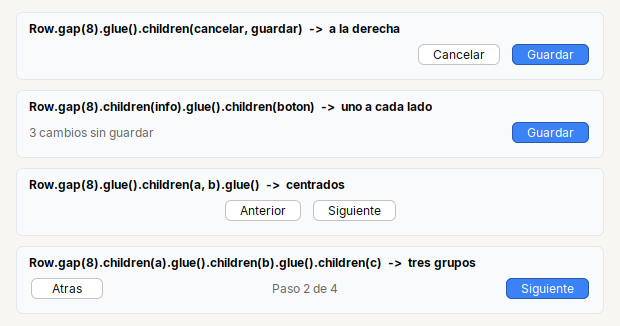

```java
Row.gap(8).glue().children(btnCancel, btnSave)                                    // a la derecha
Row.gap(8).children(lblInfo).glue().children(btnSave)                             // uno a cada lado
Row.gap(8).glue().children(btnPrev, btnNext).glue()                               // centrados
Row.gap(8).children(btnBack).glue().children(lblStep).glue().children(btnNext)    // tres grupos
```

`glue()` es un hueco elastico: lo que se agrega **despues** queda pegado al otro extremo. Dos `glue()` se reparten el espacio por igual.

### Alineacion vertical: `top` y `center`

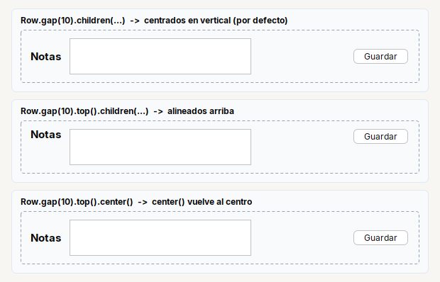

```java
Row.gap(10).children(lblNotes, scrollNotes, btnSave)               // centrados (por defecto)
Row.gap(10).top().children(lblNotes, scrollNotes, btnSave)         // arriba
Row.gap(10).top().center().children(lblNotes, scrollNotes, btnSave) // center() vuelve al centro
```

Solo se nota cuando los hijos miden distinto de alto. Una etiqueta junto a un area de texto casi siempre pide `top()`.

### Margen interior: `padding`

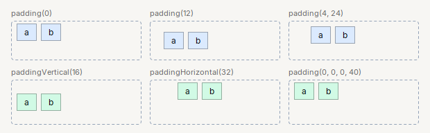

```java
Row.gap(6).children(a, b)                          // padding(0)
Row.gap(6).padding(12).children(a, b)              // igual por los cuatro lados
Row.gap(6).padding(4, 24).children(a, b)           // vertical, horizontal
Row.gap(6).paddingVertical(16).children(a, b)      // solo arriba y abajo
Row.gap(6).paddingHorizontal(32).children(a, b)    // solo izquierda y derecha
Row.gap(6).padding(0, 0, 0, 40).children(a, b)     // arriba, izquierda, abajo, derecha
```

`paddingVertical` y `paddingHorizontal` cambian **un solo eje** y conservan el otro: `padding(12).paddingHorizontal(24)` deja 12 arriba y abajo y 24 a los lados.
`padding()` sin argumentos devuelve una copia del margen actual (`Insets`).

### Anchos fijos: `width`

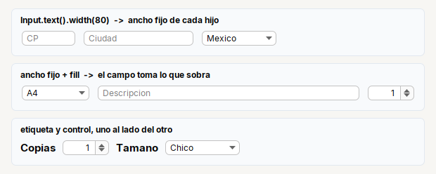

```java
Row.gap(8).children(
    Input.text().placeholder("CP").width(80),
    Input.text().placeholder("Ciudad").width(160),
    Combo.of("Mexico", "Chile").width(110))

Row.gap(8).children(Combo.of("A4", "Carta").width(100))        // ancho fijo + campo que toma el resto
    .fill(Input.text().placeholder("Descripcion"))
    .children(Spinner.integer(1, 1, 99, 1).width(70))
```

`.width(px)` y `.height(px)` piden un tamano fijo y los respetan `Row`, `Col`, `Form`, `Card` y `Stack`.

### Ocultar sin dejar hueco

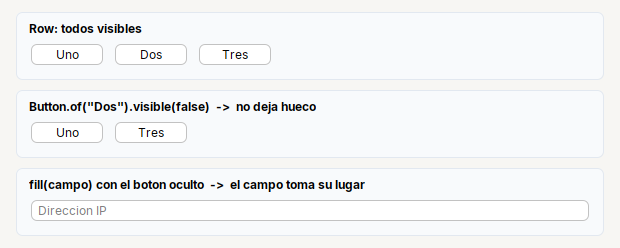

```java
Row.gap(8).children(btnOne, btnTwo, btnThree)                           // todos visibles
Row.gap(8).children(btnOne, btnTwo.visible(false), btnThree)            // Dos oculto: no deja hueco
Row.gap(8).fill(txtIp).children(btnScan.visible(false))                 // el campo toma su lugar
```

Un hijo con `setVisible(false)` (o `.visible(false)`) **no ocupa espacio ni agrega su `gap`**: en la segunda fila, `Uno` y `Tres` quedan separados por un solo `gap`.

### Patrones listos

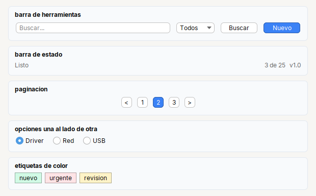

```java
// barra de herramientas
Row.gap(8).fill(txtSearch).children(cbStatus, btnSearch, btnNew)

// barra de estado
Row.gap(8).children(lblReady).glue().children(lblCount, lblVersion)

// paginacion
Row.gap(6).glue().children(btnPrev, btn1, btn2, btn3, btnNext).glue()

// opciones una al lado de otra
Row.gap(14).children(rbtnDriver, rbtnNetwork, rbtnUsb)
```

---

## Col: una debajo de otra

Los hijos van **de arriba hacia abajo**. A diferencia de `Row`, cada hijo ocupa **todo el ancho** por defecto, **excepto** los botones y las etiquetas,
que se quedan a la izquierda con su ancho natural.

### La regla del ancho

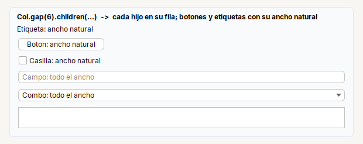

```java
Col.gap(6).children(
    Label.text("Etiqueta: ancho natural"),
    Button.of("Boton: ancho natural"),
    Check.of("Casilla: ancho natural"),
    Input.text().placeholder("Campo: todo el ancho"),
    Combo.of("Combo: todo el ancho"),
    Scroll.of(Input.area(2)))
```

### Cambiar la regla: `start` y `fill`

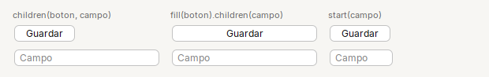

```java
Col.gap(6).children(btnSave, txtField)                                         // por defecto
Col.gap(6).fill(btnSave).children(txtField)                                    // el boton ocupa todo el ancho
Col.gap(6).children(btnSave).start(Input.text().columns(6))                    // el campo conserva su ancho natural
```

### Espacio entre hijos: `gap`

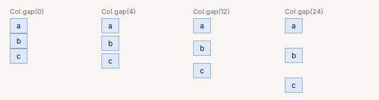

```java
Col.gap(0).children(a, b, c)
Col.gap(4).children(a, b, c)
Col.gap(12).children(a, b, c)
Col.gap(24).children(a, b, c)
```

### Empujar hacia abajo: `glue`

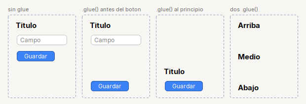

```java
Col.gap(8).padding(8).children(lblTitle, txtField, btnSave)                  // sin glue: todo arriba

Col.gap(8).padding(8).children(lblTitle, txtField).glue().children(btnSave)  // el boton, abajo
Col.gap(8).padding(8).glue().children(lblTitle, btnSave)                     // todo abajo
Col.gap(8).padding(8).children(top).glue().children(middle).glue().children(bottom)
```

Igual que en `Row`: lo que se agrega **despues** del `glue()` queda pegado al fondo, y dos `glue()` se reparten el espacio. Necesita que el `Col` mida mas
que sus hijos: en estas imagenes lo da `.height(170)`; en una pantalla real, que el `Col` este en un lugar que se estire.

### Ocupar el alto que sobra: `fillBoth`

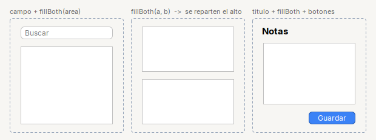

```java
Col.gap(8).padding(8).children(txtSearch).fillBoth(scrollArea)                        // campo + area que crece
Col.gap(8).padding(8).fillBoth(scrollA, scrollB)                                      // se reparten el alto
Col.gap(8).padding(8).children(lblNotes).fillBoth(scrollArea)
    .children(Row.gap(6).glue().children(btnSave))                                    // titulo + area + botones
```

`Scroll`, `Tabs` y `Split` ya vienen marcados para ocupar el espacio que sobra: dentro de un `Col` o `Row` no hace falta `fillBoth`.

### Margen interior: `padding`

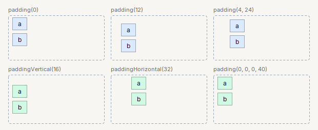

```java
Col.gap(6).children(a, b)                          // padding(0)
Col.gap(6).padding(12).children(a, b)
Col.gap(6).padding(4, 24).children(a, b)           // vertical, horizontal
Col.gap(6).paddingVertical(16).children(a, b)
Col.gap(6).paddingHorizontal(32).children(a, b)
Col.gap(6).padding(0, 0, 0, 40).children(a, b)     // arriba, izquierda, abajo, derecha
```

### Ocultar sin dejar hueco

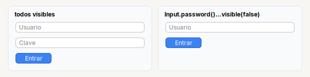

```java
Col.gap(6).children(txtUser, txtPass, btnEnter)                       // todos visibles
Col.gap(6).children(txtUser, txtPass.visible(false), btnEnter)        // la clave oculta: la columna se acorta
```

### Columnas dentro de filas y filas dentro de columnas

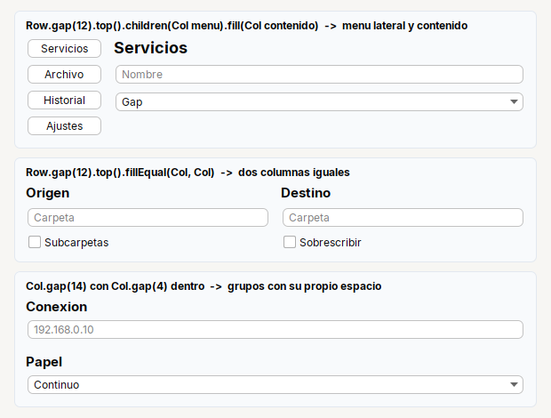

```java
// menu lateral y contenido
Row.gap(12).top()
    .children(Col.gap(4).fill(btnServices, btnFiles, btnHistory, btnSettings))
    .fill(Col.gap(6).children(lblTitle, txtName, cbType))

// dos columnas iguales
Row.gap(12).top().fillEqual(
    Col.gap(6).children(lblFrom, txtFrom, chckSubfolders),
    Col.gap(6).children(lblTo, txtTo, chckOverwrite))

// grupos con su propio espacio
Col.gap(14).children(
    Col.gap(4).children(lblConnection, txtIp),
    Col.gap(4).children(lblPaper, cbPaper))
```

Anidar es la forma normal de armar una pantalla: cada `Row` o `Col` resuelve **una** cosa (una fila de botones, una columna de campos) y se combinan.

### Patrones listos

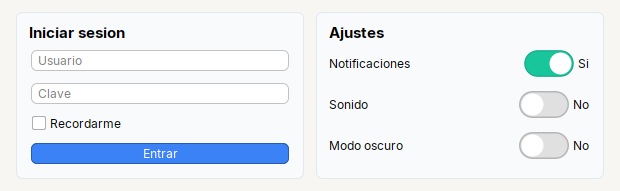

```java
// inicio de sesion
Card.create("Iniciar sesion").children(
    Col.gap(8)
        .children(txtUser, txtPass, chckRemember)
        .fill(btnEnter))                                   // el boton a todo el ancho

// lista de ajustes: nombre a la izquierda, interruptor a la derecha
Col.gap(10).children(
    Row.gap(8).children(Label.text("Notificaciones")).glue().children(Switch.of("Si").selected(true)),
    Row.gap(8).children(Label.text("Sonido")).glue().children(Switch.of("No")),
    Row.gap(8).children(Label.text("Modo oscuro")).glue().children(Switch.of("No")))
```

---

## Stack: una de varias en el mismo lugar

Pone varios componentes **en el mismo lugar**, uno encima de otro. Quien arma la pantalla decide cual se ve; los ocultos no ocupan espacio. Es la pieza para
"segun la opcion elegida, se muestra esto u aquello".

### Alineacion

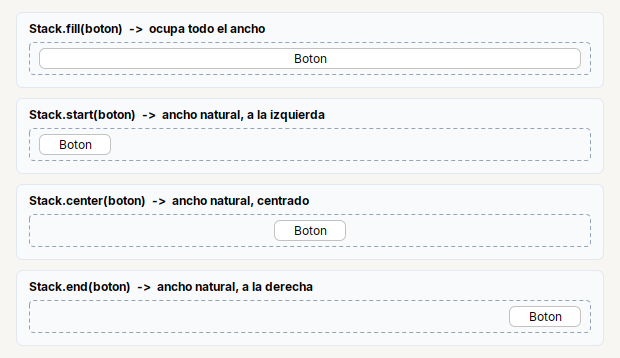

```java
Stack.fill(btn)        // ocupa todo el ancho
Stack.start(btn)       // ancho natural, a la izquierda
Stack.center(btn)      // ancho natural, centrado
Stack.end(btn)         // ancho natural, a la derecha
```

### Una alternativa a la vez

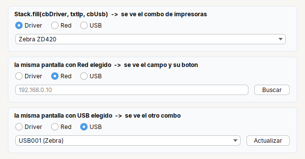

```java
final Combo<String> cbDriver = Combo.of("Zebra ZD420", "TSC TE200");
final Input txtIp = Input.text().placeholder("192.168.0.10");
final Combo<String> cbUsb = Combo.of("USB001 (Zebra)");
final Button btnScan = Button.of("Buscar");
final Button btnRefresh = Button.of("Actualizar");

Row.gap(8).children(
    Stack.fill(cbDriver, txtIp, cbUsb),          // los tres en el mismo lugar
    Stack.start(btnScan, btnRefresh))            // y su boton

// al cambiar la opcion: se muestra una, se ocultan las demas
cbDriver.setVisible(mode == 0);
txtIp.setVisible(mode == 1);   btnScan.setVisible(mode == 1);
cbUsb.setVisible(mode == 2);   btnRefresh.setVisible(mode == 2);
```

El `Stack` **no decide** cual se ve: tu codigo hace `setVisible`. Los ocultos no ocupan espacio, asi que el `Stack` mide lo que mide el visible.

### Cambiar una cosa por otra

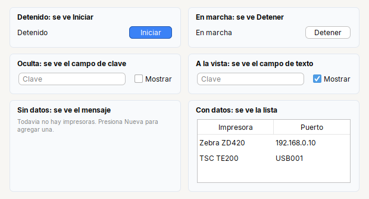

```java
// "Iniciar" o "Detener" segun el estado
Row.gap(10).children(lblState).glue().children(Stack.start(btnStart, btnStop))

// clave oculta o a la vista
Row.gap(10).children(Stack.fill(txtPasswordHidden, txtPasswordVisible), chckShow)

// mensaje de "no hay datos" o la lista
Stack.fill(hintEmpty, scrollList)
```

### Dentro de otros contenedores

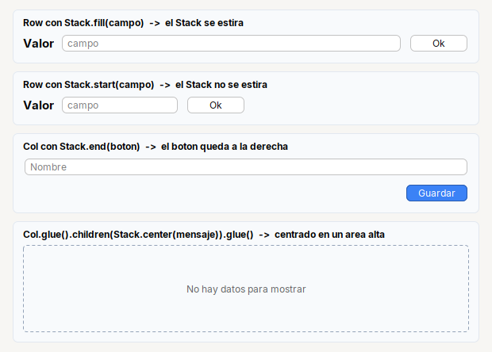

```java
Row.gap(8).children(lblValue, Stack.fill(txtField), Stack.start(btnOk))         // Stack.fill se estira
Row.gap(8).children(lblValue, Stack.start(txtField), Stack.start(btnOk))        // Stack.start, no
Col.gap(8).children(txtName, Stack.end(btnSave))                                // boton a la derecha
Col.gap(0).padding(8).glue().children(Stack.center(lblEmpty)).glue()            // centrado en un area alta
```

`Stack.center` centra **a lo ancho**. Para centrar tambien en vertical dentro de un area alta, rodealo con un `glue()` arriba y otro abajo, como en el ultimo ejemplo.

---

## Todo junto

### Formulario con acciones

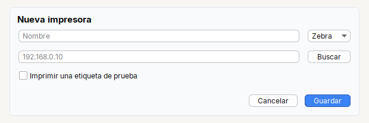

```java
Card.create("Nueva impresora").children(
    Col.gap(10)
        .children(
            Row.gap(10).fill(txtName).children(cbBrand),
            Row.gap(10).fill(txtIp).children(btnScan),
            chckTest)
        .glue()
        .children(Row.gap(8).glue().children(btnCancel, btnSave)))
```

### Barra arriba, contenido y barra abajo

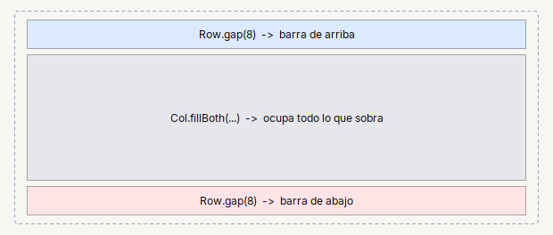

```java
Col.gap(6).padding(6)
    .fill(topBar)            // alto natural, todo el ancho
    .fillBoth(content)       // todo lo que sobra
    .fill(bottomBar)         // alto natural, todo el ancho
```

Si la ventana tiene mas piezas (menu lateral, encabezado de pasos), mira [`Page`](../reference/kit/containers/page.md): resuelve las cinco zonas de una ventana.

### Tablero

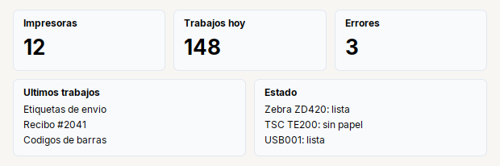

```java
Col.gap(10).children(
    Row.gap(10).fillEqual(stat("Impresoras", "12"), stat("Trabajos hoy", "148"), stat("Errores", "3")),
    Row.gap(10).top().fillEqual(
        Card.section("Ultimos trabajos").children(Col.gap(4).children(a, b, c)),
        Card.section("Estado").children(Col.gap(4).children(d, e, f))))

static Card stat(String title, String value) {
    return Card.section(title).children(Label.text(value).bold().fontSize(26));
}
```

### Busqueda, tabla y acciones

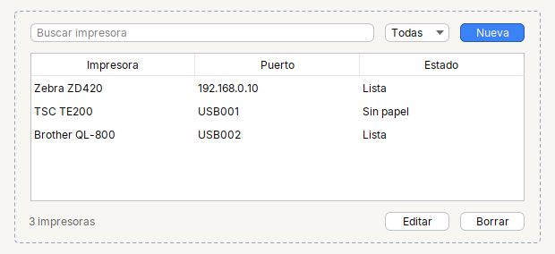

```java
Col.gap(8).padding(8)
    .children(Row.gap(8).fill(txtSearch).children(cbFilter, btnNew))       // barra de arriba
    .fillBoth(Scroll.of(table))                                            // la tabla crece
    .children(Row.gap(8).children(lblCount).glue().children(btnEdit, btnDelete))  // barra de abajo
```

---

## Errores comunes

| Pasa esto | Causa | Solucion |
|---|---|---|
| Un boton o una etiqueta en un `Col` no se estira | es la regla: en un `Col` se quedan con su ancho natural | `.fill(boton)` |
| Un campo en un `Row` no ocupa el ancho | solo lo que pasa por `fill` se estira | `Row.gap(8).fill(campo)` |
| Dos cosas en un `Row` miden distinto aunque usaste `fill` | `fill` suma el ancho natural de cada uno | `fillEqual(a, b)` |
| `glue()` no empuja nada | el contenedor mide solo lo que miden sus hijos, no sobra espacio | dale mas espacio: `.height(px)` o ponlo en un lugar que se estire (por ejemplo dentro de un `fillBoth`) |
| La tabla no muestra el encabezado o no ocupa el alto | falta `Scroll.of(table)` y/o `fillBoth` | `.fillBoth(Scroll.of(table))` |
| Se ven dos alternativas a la vez en un `Stack` | el `Stack` no decide cual se ve | `setVisible(false)` en las demas |
| Un `Stack` dentro de un `Row` no se estira | solo `Stack.fill` lo hace | `Stack.fill(...)` |
| `padding(a, b)` no es lo que esperaba | son **vertical**, **horizontal** (no izquierda, arriba) | `paddingVertical(a).paddingHorizontal(b)` o `padding(arriba, izq, abajo, der)` |

## Ver tambien

- [`Row`](../reference/kit/containers/row.md) · [`Col`](../reference/kit/containers/col.md) · [`Stack`](../reference/kit/containers/stack.md): referencia de cada metodo.
- [Como armar una pantalla](screens.md): `Form`, `Grid`, `Card`, `Page`, `Tabs`, `Split` y pantallas completas.
- [Recetas](recipes.md): ejemplos completos listos para copiar.
