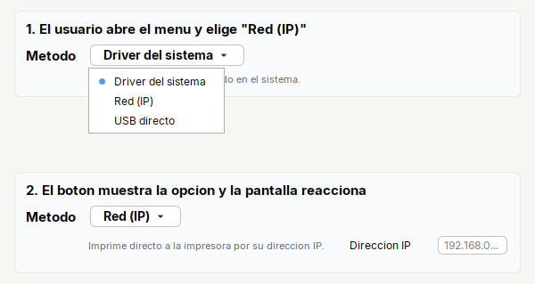
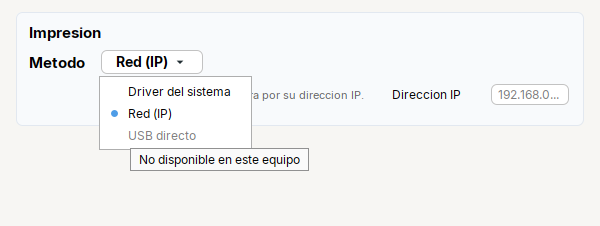
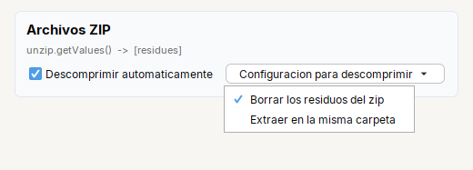
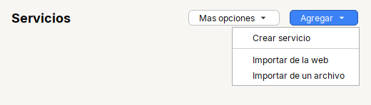
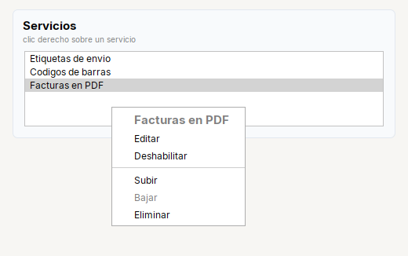
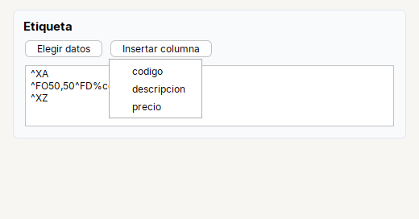

# Botones que abren un menu: elegir, marcar o hacer algo

En Swing, un boton que abre un menu se arma a mano: un `JPopupMenu`, un item por opcion, `show(boton, 0, boton.getHeight())`, y despues hay que
acordarse de que opcion quedo elegida. Tessera lo trae resuelto con **tres botones** y un **menu sin boton**. Cual usar depende de una sola
pregunta: **que debe pasar cuando el usuario elige una opcion?**


| Cuando el usuario elige una opcion... | Uso | Que queda despues | Lo lees con |
|---|---|---|---|
| **queda elegida** y el boton la muestra | [`ChoiceButton<T>`](../reference/kit/widgets/choicebutton.md) | un valor | `getValue()` |
| **queda marcada** y puede haber varias | [`MultiChoiceButton<T>`](../reference/kit/widgets/multichoicebutton.md) | un conjunto de valores | `getValues()`, `isChecked(valor)` |
| **corre una accion** (agregar, exportar, insertar) | [`MenuButton`](../reference/kit/widgets/menubutton.md) | nada: cada opcion trae su accion | no se lee: `item(texto, accion)` |
| igual que el anterior pero **sin boton** (clic derecho) | [`Menu`](../reference/kit/widgets/menu.md) | nada | no se lee: `item(texto, accion)` |

Los tres botones son un `JButton` (se pasan a `Form.row(...)`, a `ErrorProvider.setError(...)`...) y comparten el color, la flecha y el icono
(ver [`PopupButton`](../reference/kit/widgets/menubutton.md#metodos-de-popupbutton)). Los ejemplos de esta guia estan **compilados** contra la libreria: salen de
[`MenuImages.java`](../../src/demo/java/tessera/demo/MenuImages.java), que tambien dibuja las imagenes, y los fragmentos que ahi no estan (leer las
casillas, el clic derecho sobre una lista) de [`MenuExamples.java`](../../src/demo/java/tessera/demo/MenuExamples.java).

---

## 1. Elegir una opcion: `ChoiceButton`

El caso del tipo de servicio, del metodo de impresion, del formato de salida: pocas opciones, cada una con su explicacion, y el resto de la
pantalla cambia segun la que se elija.



```java
private final Label lblHint = Label.muted("").small();
private final Label lblIp = Label.text("Direccion IP");
private final Input txtIp = Input.text().placeholder("192.168.0.10");

private final ChoiceButton<Integer> method = ChoiceButton.<Integer>of()
    .placeholder("Elegir metodo")                                                       // mientras no hay nada elegido
    .option(DRIVER, "Driver del sistema", "Imprime con el driver instalado en el sistema.")   // valor, texto, ayuda
    .option(NETWORK, "Red (IP)", "Imprime directo a la impresora por su direccion IP.")
    .option(USB, "USB directo", "Imprime directo al puerto USB, sin driver.")
    .bold().fontSize(14);

// se registra antes de elegir el valor inicial: onChange tambien corre al elegir por codigo
method.onChange(() -> {
  lblHint.setText(method.getValueTip());           // la ayuda de la opcion elegida
  lblIp.setVisible(method.is(NETWORK));
  txtIp.setVisible(method.is(NETWORK));
});
method.setValue(NETWORK);

Form.gap(6).row("Metodo", method).field(lblHint).row(lblIp, txtIp);
```

Que pasa, en orden:

1. El usuario hace clic en el boton: se abre el menu debajo de el, con las opciones y su ayuda al dejar el mouse encima.
2. Elige "Red (IP)": el boton cambia su texto a **Red (IP)** solo, y se dispara `onChange`.
3. `onChange` actualiza la linea de ayuda (`getValueTip()` es la ayuda que se dio en `option(...)`) y muestra el campo de la IP.
4. En el resto del codigo no hay que preguntar por cada opcion: `method.getValue()` devuelve el valor (`NETWORK`), o `null` si no hay nada elegido
   (`getValue(-1)` devuelve `-1` en ese caso).

**Cargar y guardar un modelo** son una linea cada uno: `method.setValue(model.printerType)` y `model.printerType = method.getValue(-1)`.
`setValue` ignora un valor que no esta entre las opciones.

<details>
<summary>Lo mismo en Swing puro (para ver cuanto se ahorra)</summary>

```java
private final JPopupMenu popup = new JPopupMenu();
private final JRadioButtonMenuItem rbDriver = new JRadioButtonMenuItem("Driver del sistema");
private final JRadioButtonMenuItem rbNetwork = new JRadioButtonMenuItem("Red (IP)");
private final JRadioButtonMenuItem rbUsb = new JRadioButtonMenuItem("USB directo");
private final JButton btnMethod = new JButton("Elegir metodo");

private void buildUI() {
  final ButtonGroup group = new ButtonGroup();
  for (JRadioButtonMenuItem item : new JRadioButtonMenuItem[] {rbDriver, rbNetwork, rbUsb}) {
    group.add(item);
    popup.add(item);
    item.addItemListener(e -> {                       // un listener por opcion
      if (e.getStateChange() == ItemEvent.SELECTED) {
        btnMethod.setText(item.getText());            // el texto del boton se mantiene a mano
        updateScreen();
      }
    });
  }
  btnMethod.addActionListener(e -> popup.show(btnMethod, 0, btnMethod.getHeight()));
}

// y en cada lugar que necesita saber cual quedo: if (rbNetwork.isSelected()) ...
// guardar el modelo: una cadena de if (rbDriver.isSelected()) ... else if (rbNetwork.isSelected()) ...
```
</details>

### Una opcion que no esta disponible

Si una opcion no se puede usar en este equipo (por ejemplo el USB directo en un sistema que no lo soporta), se deshabilita **con su explicacion**:



```java
method.optionEnabled(USB, false, "No disponible en este equipo");
method.optionEnabled(USB, true);        // para volver a habilitarla (recupera su ayuda de siempre)
```

---

## 2. Marcar varias: `MultiChoiceButton`

Un boton de **ajustes** con varias casillas que no merecen una fila cada una. El texto del boton no cambia: lo que cambia son las casillas.



```java
private final MultiChoiceButton<String> unzip = MultiChoiceButton.<String>of("Configuracion para descomprimir")
    .option("residues", "Borrar los residuos del zip").checked("residues")     // empieza marcada
    .option("sameFolder", "Extraer en la misma carpeta");

private final Check chkUnzip = Check.of("Descomprimir automaticamente").selected(true);

chkUnzip.addItemListener(e -> unzip.setEnabled(chkUnzip.isSelected()));        // es un JButton: se habilita como cualquiera
```

Leer y cargar las casillas:

```java
model.removeResidues = unzip.isChecked("residues");            // una casilla
Set<String> marked = unzip.getValues();                        // todas las marcadas, en el orden de las opciones

unzip.setChecked("sameFolder", model.sameFolder);              // marcar o desmarcar una
unzip.setValues(Arrays.asList("residues", "sameFolder"));      // dejar marcadas exactamente esas
unzip.onChange(values -> save(values));                        // cada vez que cambian (tambien por codigo)
```

Con un `enum` en lugar de textos (`MultiChoiceButton<UnzipOption>`) el compilador te avisa si escribes mal una clave.

---

## 3. Hacer algo: `MenuButton`

"Agregar" con varias formas de agregar, "Mas opciones": un boton que agrupa acciones. No queda nada elegido; cada opcion trae lo que debe correr.



```java
private final MenuButton more = MenuButton.of("Mas opciones")
    .item("Establecer impresora para todos", this::setPrinterForAll)
    .item("Exportar servicios", this::export);

private final MenuButton add = MenuButton.of("Agregar")
    .color(Color.WHITE)                                   // texto y flecha
    .item("Crear servicio", this::create)
    .separator()                                          // linea entre grupos
    .item("Importar de la web", this::importFromWeb)
    .item("Importar de un archivo", this::importFromFile);

Kit.makePrimary(add);                                     // el azul de siempre, como cualquier boton
```

- Es un `JButton`: `Kit.makePrimary`, `.background(...)`, `.tip(...)`, `.enabled(false)` funcionan como siempre.
- Si el boton solo lleva un icono: `MenuButton.of("").icon("app/img/more.svg", 24)`. El icono **reemplaza** la flecha; con `.noArrow()` se quita sin poner icono.
- Un `MenuButton` sin opciones no abre nada.
- Para cambiar una opcion despues (su icono, si esta habilitada), se arma con `MenuItem` y se guarda en un campo:

```java
private final MenuItem miImport = MenuItem.of("Importar de un archivo", this::importFromFile)
    .icon("app/img/pro.svg", 16).iconRight().padding(6, 10);      // icono como insignia, margen amplio

private final MenuButton add = MenuButton.of("Agregar").item("Crear servicio", this::create).item(miImport);

miImport.setIcon(licensed ? null : proIcon);                      // mas tarde
miImport.setEnabled(false);
```

---

## 4. Un menu sin boton: el clic derecho con `Menu`

Cuando el menu no sale de un boton, sino de donde el usuario hace clic: la lista de servicios, una fila de una tabla.



```java
// las opciones que cambian despues (texto, habilitada) se guardan en un campo
private final MenuItem miTitle = MenuItem.title("").fontSize(15);        // encabezado: negrita y sin accion
private final MenuItem miToggle = MenuItem.of("Deshabilitar", this::toggleSelected);
private final MenuItem miUp = MenuItem.of("Subir", this::moveUp);
private final MenuItem miDown = MenuItem.of("Bajar", this::moveDown);

private final Menu rowMenu = Menu.create()
    .item(miTitle)
    .item("Editar", this::edit)
    .item(miToggle)
    .separator()
    .item(miUp)
    .item(miDown)
    .item("Eliminar", this::delete);
```

Y al hacer clic derecho se ajusta lo que depende de la fila y se abre **en el punto del mouse**:

```java
listView.addMouseListener(new MouseAdapter() {
  @Override
  public void mousePressed(MouseEvent evt) {
    if (!SwingUtilities.isRightMouseButton(evt)) return;
    final int index = listView.locationToIndex(evt.getPoint());
    miTitle.setText(model.getElementAt(index).name);
    miToggle.setText(model.getElementAt(index).enabled ? "Deshabilitar" : "Habilitar");
    miUp.setEnabled(index > 0);
    miDown.setEnabled(index < model.getSize() - 1);
    rowMenu.show(listView, evt.getX(), evt.getY());          // Menu es un JPopupMenu: show(componente, x, y)
  }
});
```

`menu.showBelow(componente)` lo abre debajo de un componente, como lo hace `MenuButton`. Si el menu es de un `JList` y no cambia por fila, tambien vale
`list.setComponentPopupMenu(menu)`: Swing lo abre solo con el clic derecho.

---

## 5. Un menu que se llena al momento: `onOpen`

Las opciones dependen de datos que solo se saben al hacer clic: las columnas de una consulta, los archivos de una carpeta.



```java
private final MenuButton btnInsert = MenuButton.of("Insertar columna")
    .noArrow()
    .onOpen(menu -> fillColumns(menu, columns, txtLabel));      // corre justo antes de abrir

private static void fillColumns(Menu menu, String[] columns, TextArea target) {
  menu.clear();                                                 // se vacia y se vuelve a llenar cada vez
  for (String column : columns) {
    menu.item(MenuItem.of(column, () -> target.append("%" + column + "%")).tip("Inserta %" + column + "%"));
  }
}
```

Si `onOpen` deja el menu sin opciones, no se abre (por ejemplo cuando todavia no hay columnas: pon el boton `enabled(false)` y su ayuda explicando por que).

---

## Dudas frecuentes

| Duda | Respuesta |
|---|---|
| Necesito acciones **y** casillas en el mismo menu | `Menu` es un `JPopupMenu`: `menu.add(new JCheckBoxMenuItem("Ver reglas"))` funciona junto a `item(...)`. Si solo son casillas, `MultiChoiceButton`. |
| El menu se cierra al marcar una casilla | Es el comportamiento normal de los menus de Swing: se vuelve a abrir para marcar otra. |
| `ChoiceButton.of()` no compila | Hace falta el tipo: `ChoiceButton.<Integer>of()`. Lo mismo con `MultiChoiceButton.<String>of(texto)`. |
| Mi `onChange` corre al abrir la pantalla | Tambien corre al elegir **por codigo**: registralo despues de `setValue` si no lo quieres, o antes si quieres que arme la pantalla (como en la receta 1). |
| `Menu` o `MenuItem` no compilan | Chocan con `java.awt.Menu` y `java.awt.MenuItem`: usa `import tessera.kit.Menu;`, no `java.awt.*`. |
| Quiero elegir una y **ademas** tener una accion al final ("Otro...") | Usa un `ChoiceButton` y, aparte, un boton o `MenuButton` para la accion. |

## Ver tambien

- Referencia: [`ChoiceButton`](../reference/kit/widgets/choicebutton.md) · [`MultiChoiceButton`](../reference/kit/widgets/multichoicebutton.md) · [`MenuButton`](../reference/kit/widgets/menubutton.md) · [`Menu` y `MenuItem`](../reference/kit/widgets/menu.md)
- Para una lista larga o editable: [`Combo`](../reference/kit/widgets/combo.md). Para 2 a 5 opciones siempre visibles: [`Radio`](../reference/kit/widgets/radio.md).
