# Como armar una pantalla

Convencion para las clases de pantalla (paneles y dialogos) que usan Tessera. Es la que siguen Text2Barcode, Codaly Sync y PDFLabelCut,
y la que debe seguir cualquier app nueva. Sirve para que un dev, o una IA, encuentre en segundos donde esta la logica y donde esta la UI.

Despues de la convencion hay una [guia visual de disposiciones](#guia-visual-de-disposiciones): como se coloca todo (`Row`, `Col`, `Form`, `Grid`, `Card`,
`Header`, `Footer`, `Page`...) con una imagen y el codigo de cada caso, y [pantallas completas](#pantallas-completas) listas para copiar.

## La idea

1. **La logica va arriba** de la clase: estado, metodos, eventos, acceso a datos.
2. **La UI va al final**, en una sola zona marcada con un encabezado fijo.
3. Dentro de esa zona, **cada bloque lleva sus campos (widgets) justo encima del metodo que lo arma**. Se lee de arriba hacia abajo en el
   mismo orden en que la pantalla se construye.

## Esqueleto

```java
public class MiPanel extends JPanel {

  // ... logica arriba: campos de estado, constructor, metodos, handlers ...

  // ---------------------------------------------------------------------
  // UI: widgets y construcción de la pantalla
  // Cada bloque lleva sus campos (widgets) justo encima del método que lo arma:
  // campos del bloque -> método del bloque. Empieza en buildUI() y sigue el orden
  // en que se usan. La lógica (eventos, datos, etc.) va fuera de esta zona.
  // ---------------------------------------------------------------------

  // campos del pie: los coloca el propio buildUI()
  private final Button btnCancel = Button.of("Cancelar").onClick(this::dispose);
  private final Button btnSave = Button.primary("Guardar").onClick(this::save);

  private void buildUI() {
    setLayout(new BorderLayout());
    add(Page.create()
        .top(Header.create("Impresora", "Elige como se conecta"))
        .center(Col.gap(10).padding(10, 12, 10, 12).children(connectionBlock(), qualityBlock()))
        .bottom(Footer.of(btnCancel, btnSave))
        .build());
  }

  // campos de connectionBlock()
  private final Radio rbtnDriver = Radio.of("Driver").selected(true);
  private final Radio rbtnIp = Radio.of("Red");
  private final Input txtIp = Input.text().placeholder("192.168.0.10");
  private final Button btnScan = Button.of("Buscar").onClick(this::scan);

  private Card connectionBlock() {
    return Card.create("Conexion")
        .children(
            Row.gap(14).children(rbtnDriver, rbtnIp),
            Row.gap(10).fill(txtIp).children(btnScan));
  }

  // campos de qualityBlock()
  private final Combo<String> cbDpi = Combo.of("203", "300", "600");

  private Card qualityBlock() {
    return Card.create("Calidad").children(Form.create().row("DPI", cbDpi));
  }
}
```

Asi se ve esa pantalla (el codigo de arriba esta compilado en `src/demo/java/tessera/demo/ScreenExample.java`):


## Reglas

- **Un solo encabezado** por clase, el texto exacto de arriba. Si el método que arranca la pantalla no se llama `buildUI()`
  (por ejemplo `initUI()`), se cambia ese nombre en la frase "Empieza en ...". Buscar `UI: widgets y construcción` encuentra todas las pantallas.
- **Un campo va encima del metodo que lo coloca en el layout**, no del que solo lo configura. Si lo usan varios bloques, encima del primero.
- **Dependencias entre campos**: Java inicializa los campos en el orden en que aparecen. Si un campo usa otro (`btnMore` usa `popupMenu` en su
  lambda, un `Scroll.of(listView)` usa `listView`), el usado va **antes**; de lo contrario no compila ("illegal forward reference") o, si se accede con `this.campo`,
  queda en `null`.
- **Eventos con referencia a metodo**: `.onClick(this::guardar)`; el cuerpo del metodo vive en la zona de logica, arriba.
- **Casillas/radios que reaccionan a `setSelected` por codigo**: usa `ItemListener` (`onClick` solo atiende clics del usuario) y registralo
  despues de armar la pantalla.
- **Un solo metodo de arranque** (`buildUI()` o `initUI()`) llamado desde el constructor.
- **Si la pantalla es pequena** (un solo bloque, pocos campos) no hace falta partirla en varios metodos: los campos van juntos encima de `buildUI()`.
- Imports explicitos: `Label`, `Button`, `List`, `TextArea` chocan con `java.awt`.
- Textos de la app con el sistema de idiomas de la propia app; la libreria no trae uno.

## Que contenedor usar

| Necesito | Contenedor |
|---|---|
| widgets uno al lado del otro | `Row.gap(n).children(...)`; el que debe estirarse: `.fill(c)` |
| widgets uno debajo del otro | `Col.gap(n).children(...)`; uno que ocupe el alto sobrante: `.fillBoth(c)` |
| etiqueta + campo alineados | `Form.create().row("Nombre", txtName)` |
| tabla de celdas alineadas por columna | `Grid.gap(n).row(...)` |
| bloque con titulo y borde redondeado | `Card.create("Titulo")` / `Card.section("Titulo")` |
| ventana con cabecera, centro y pie | `Page.create().top(..).center(..).bottom(..)` |
| alternar paneles | `Pages.create()` (uno visible) o `Stack` (alternativas apiladas) |
| separar en dos zonas redimensionables | `Split.horizontal(a, b)` |
| contenido con scroll | `Scroll.of(c)` |

Los contenedores principales, con el codigo que los arma en el titulo de cada tarjeta:


La referencia completa de metodos esta en [AGENTS.md](../../AGENTS.md).

## Guia visual de disposiciones

Todo lo que se puede hacer para **colocar cosas en una pantalla**, pieza por pieza y despues pantallas completas. Cada imagen esta generada con el
codigo que se muestra al lado (`src/demo/java/tessera/demo/LayoutImages.java`), asi que lo que ves es lo que obtienes.

> **Como leerla.** Primero las piezas ([Row](#row-en-fila), [Col](#col-en-columna), [Form](#form-etiqueta-y-campo), [Grid](#grid-columnas-alineadas),
> [Card](#card-bloques-con-titulo), [Header](#header-la-cabecera), [Footer](#footer-la-barra-de-botones), [Stack](#stack-alternativas-en-el-mismo-lugar),
> [Page](#page-la-estructura-de-la-ventana), [Tabs, Split y Pages](#tabs-split-y-pages)), luego [espaciado y ocultar](#espaciado-gap-y-padding) y por
> ultimo las [pantallas completas](#pantallas-completas). Si tienes prisa, salta a la tabla [Que uso para cada cosa](#que-uso-para-cada-cosa).
>
> En las imagenes de zonas, `zone("texto")` es solo un `Label` con fondo de color para **dibujar una zona**; en tu app ahi iria tu contenido:
>
> ```java
> final Label label = Label.text(text).center().background(color);   // (mas un borde fino, solo para ilustrar)
> ```

### Que uso para cada cosa

| Quiero... | Uso |
|---|---|
| varios widgets **uno al lado del otro** | `Row.gap(n).children(a, b, c)` |
| un campo que **se estire** junto a su boton | `Row.gap(10).fill(campo).children(boton)` |
| botones o texto **pegados a la derecha** | `Row.gap(8).glue().children(botones)` |
| dos bloques del **mismo ancho**, lado a lado | `Row.gap(10).fillEqual(a, b)` |
| varios widgets **uno debajo del otro** | `Col.gap(n).children(...)` |
| algo **pegado abajo** en una columna | `Col.gap(8).children(...).glue().children(boton)` |
| que un widget **ocupe el alto que sobra** (tabla, area de texto) | `Col...fillBoth(Scroll.of(widget))` |
| **etiqueta + campo** alineados | `Form.create().row("Etiqueta", campo)` |
| **dos pares** etiqueta/campo en la misma fila | `Grid.gap(8).row(lbl1, campo1, lbl2, campo2)` |
| una **tabla de celdas** alineadas por columna | `Grid.gap(6).row(...)` |
| un **bloque con titulo** y borde | `Card.create("Titulo")` / `Card.section("Titulo")` |
| una **cabecera** oscura con titulo | `Header.create("Titulo", "descripcion")` |
| botones **abajo a la derecha** | `Footer.of(botones...)` |
| **cabecera + centro + pie** en una ventana | `Page.create().top(..).center(..).bottom(..)` |
| un **menu lateral** | `Page.create().left(menu).center(contenido)` |
| **dos zonas** que el usuario puede redimensionar | `Split.horizontal(a, b)` / `Split.vertical(a, b)` |
| **pestanas** | `Tabs.create().tab("A", a).tab("B", b)` |
| **pasos** (uno visible a la vez) | `Pages.create().page("a", a).page("b", b)` + `pages.show("a")` |
| **alternativas** de las que se ve una (un campo u otro, un boton u otro) | `Stack.fill(a, b, c)` y `setVisible(..)` |
| un widget **centrado, a la izquierda o a la derecha** de su bloque | `Stack.center(c)` / `Stack.start(c)` / `Stack.end(c)` |
| un bloque **centrado** en la ventana | `Col.gap(0).glue().children(Row.gap(0).glue().children(bloque.width(320)).glue()).glue()` |
| **ocultar** algo sin dejar hueco | `widget.setVisible(false)` |

### Row: en fila

`Row` pone los hijos **de izquierda a derecha**, cada uno con su **ancho natural** y centrados en vertical. Cuatro formas de repartir el espacio que
sobra:

| Metodo | Efecto |
|---|---|
| `.children(a, b)` | ancho natural; lo que sobra queda vacio a la derecha |
| `.fill(a)` | `a` se estira hasta ocupar **lo que sobra** (si hay varios, se lo reparten) |
| `.fillEqual(a, b)` | `a` y `b` miden **siempre lo mismo**, aunque sus contenidos sean distintos |
| `.glue()` | un hueco elastico: **lo que se agregue despues** queda pegado a la derecha |


```java
Row.gap(10).children(Button.of("Uno"), Button.of("Dos"), Button.of("Tres"))
```

```java
Row.gap(10).fill(Input.text().placeholder("Ruta del archivo")).children(Button.of("Buscar"))
```

```java
Row.gap(10).fill(Input.text().placeholder("Nombre"), Input.text().placeholder("Apellido"))
```

```java
Row.gap(8).children(Label.muted("3 cambios sin guardar"))
    .glue()
    .children(Button.of("Cancelar"), Button.primary("Guardar"))
```

```java
Row.gap(10).fillEqual(zone("A (corto)"), zone("B (un texto bastante mas largo)"))
```

El **orden importa**: `fill(...)` y `children(...)` agregan en el orden en que los llamas. Un campo con su boton a la derecha es
`.fill(campo).children(boton)`; el boton antes del campo, `.children(boton).fill(campo)`.

**Alineacion vertical.** Si los hijos no miden lo mismo de alto, por defecto se **centran**; con `.top()` se alinean **arriba** (util junto a un area de texto):


```java
Row.gap(10).top().children(
    Label.field("Notas"), Scroll.of(Input.area(3).wrap()).width(260), Button.of("Guardar"))
```

`.width(px)` da un **ancho fijo** a un hijo (aqui, 260 px al area de notas). Los metodos de `Row`: `gap`, `fill`, `fillBoth`, `fillEqual`, `glue`, `top`,
`center`, `padding`, `children`; todos en [Row](../reference/kit/containers/row.md).

### Col: en columna

`Col` apila los hijos **de arriba hacia abajo**. La regla que conviene recordar: cada hijo ocupa **todo el ancho**, **menos los botones y las
etiquetas**, que se quedan a la izquierda con su ancho natural.

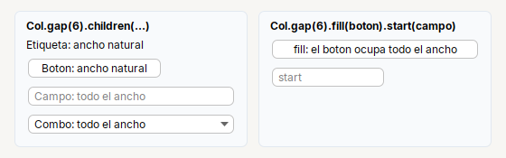

```java
Col.gap(6).children(
    Label.text("Etiqueta: ancho natural"),
    Button.of("Boton: ancho natural"),
    Input.text().placeholder("Campo: todo el ancho"),
    Combo.of("Combo: todo el ancho"))
```

```java
Col.gap(6)
    .fill(Button.of("fill: el boton ocupa todo el ancho"))
    .start(Input.text().placeholder("start").columns(10))
```

`.fill(c)` fuerza el ancho completo (un boton a todo lo ancho) y `.start(c)` fuerza el ancho natural (un campo angosto).

**Que sobra de alto.** Con `.glue()` el hueco elastico empuja lo que sigue **hacia abajo**; con `.fillBoth(c)` un hijo **ocupa el alto que sobra**. Las lineas
punteadas de la imagen son el borde de cada `Col` (de 190 px de alto):

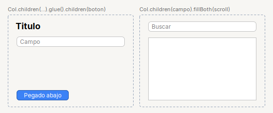

```java
Col.gap(8).padding(8)
    .children(Label.title("Titulo"), Input.text().placeholder("Campo"))
    .glue()
    .children(Button.primary("Pegado abajo"))
```

```java
Col.gap(8).padding(8)
    .children(Input.text().placeholder("Buscar"))
    .fillBoth(Scroll.of(Input.area(4)))
```

`Scroll`, `Tabs` y `Split` ya vienen marcados para ocupar el espacio que sobra (y `Hint`, solo el ancho): dentro de un `Col` o `Row` **no hace falta** `fillBoth` para ellos
(la tabla, en cambio, va **dentro** de un `Scroll`: `Scroll.of(table)`).

### Form: etiqueta y campo

`Form` son **dos columnas**: las etiquetas a la izquierda (alineadas entre si) y los campos a la derecha, que ocupan el ancho que sobra.

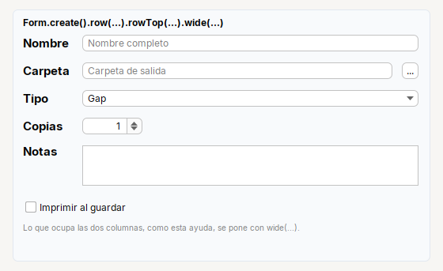

```java
Form.create()
    .row("Nombre", Input.text().placeholder("Nombre completo"))
    .row("Carpeta", Row.gap(8).fill(Input.text().placeholder("Carpeta de salida")).children(Button.of("...")))
    .row("Tipo", Combo.of("Gap", "Continuo"))
    .row("Copias", Spinner.integer(1, 1, 99, 1).width(80))
    .rowTop("Notas", Scroll.of(Input.area(3).wrap()))
    .wide(Check.of("Imprimir al guardar"), 6)
    .wide(Hint.of("Lo que ocupa las dos columnas, como esta ayuda, se pone con wide(...)."))
```

| Fila | Para que |
|---|---|
| `.row("Etiqueta", campo)` | la fila normal; el campo puede ser **otro contenedor** (`Row` con un campo y un boton) |
| `.rowTop("Etiqueta", campo)` | etiqueta alineada **arriba**, junto a un campo alto (area de texto) |
| `.wide(c)` / `.wide(c, espacioArriba)` | una fila que ocupa **las dos columnas** (casilla, ayuda, titulo); el numero suma aire encima |
| `.field(c)` | la **ultima** fila, solo en la columna de campos (un enlace bajo un area de texto) |
| `.space(px)` | un hueco fijo para separar grupos de filas |

Un campo con **ancho fijo** (`Spinner...width(80)`) no se estira; el resto, si. Y **cuidado**: un boton o una etiqueta usados como campo se quedan con su ancho natural.

**Espaciado de las etiquetas.** `labelsRight()` las pega a su campo; `labelGap(px)` cambia el espacio entre etiqueta y campo y `Form.gap(n)` el espacio entre filas:

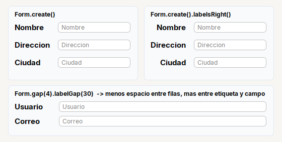

```java
Form.create().labelsRight()
    .row("Nombre", Input.text().placeholder("Nombre"))
    .row("Direccion", Input.text().placeholder("Direccion"))
    .row("Ciudad", Input.text().placeholder("Ciudad"))
```

```java
Form.gap(4).labelGap(30)
    .row("Usuario", Input.text().placeholder("Usuario"))
    .row("Correo", Input.text().placeholder("Correo"))
```

### Grid: columnas alineadas

Si necesitas **mas de dos columnas**, o varios pares etiqueta/campo por fila, usa `Grid`: cada columna mide lo que su celda mas ancha.

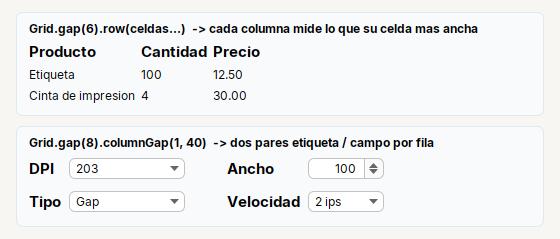

```java
Grid.gap(6)
    .row(Label.field("Producto"), Label.field("Cantidad"), Label.field("Precio"))
    .row(Label.text("Etiqueta"), Label.text("100"), Label.text("12.50"))
    .row(Label.text("Cinta de impresion"), Label.text("4"), Label.text("30.00"))
```

```java
Grid.gap(8).columnGap(1, 40)
    .row(Label.field("DPI"), Combo.of("203", "300").width(120),
        Label.field("Ancho"), Spinner.integer(100, 10, 200, 1).width(80))
    .row(Label.field("Tipo"), Combo.of("Gap", "Continuo").width(120),
        Label.field("Velocidad"), Combo.of("2 ips", "4 ips").width(80))
```

| Metodo | Efecto |
|---|---|
| `Grid.gap(n)` | `n` px entre filas (y 6 entre columnas) |
| `.row(c1, c2, c3...)` | una fila; cada componente va a la columna que le toca por su **posicion** (un `null` deja la celda vacia) |
| `.columnGap(px)` | espacio entre **todas** las columnas |
| `.columnGap(despues, px)` | espacio solo **despues** de esa columna (la primera es la 0): aqui, mas aire entre los dos pares |

### Card: bloques con titulo

`Card` agrupa contenido en un bloque con fondo suave y borde redondeado. Sus hijos siguen las reglas de `Col`.


```java
Card.create("Card.create(titulo).icon(..).subtitle(..)")
    .icon("tessera/img/info.svg")
    .subtitle("Un icono junto al titulo y un texto de ayuda debajo.")
    .children(Input.text().placeholder("Un campo"))
```

```java
Card.section("Card.section(titulo): compacto").children(
    Row.gap(10).children(Check.of("Opcion A").selected(true), Check.of("Opcion B")))
```

```java
Card.create().children(Label.text("Card.create(): sin titulo, solo el bloque"))
```

```java
Card.create(Row.gap(8).fill(Label.text("Card.create(componente): titulo propio").bold())
        .children(Switch.of("").selected(true)))
    .children(Hint.of("El titulo puede ser cualquier componente, por ejemplo un interruptor."))
```

| Fabrica | Cuando |
|---|---|
| `Card.create("Titulo")` | el bloque normal: titulo grande, con `.icon(..)` y `.subtitle(..)` opcionales |
| `Card.section("Titulo")` | para **agrupar campos** dentro de una pantalla: titulo del tamano del texto, mas compacto |
| `Card.create()` | sin titulo: solo un bloque con fondo |
| `Card.create(componente)` | titulo propio (interruptor, boton, enlace...) |

Con `.padding(...)` y `.gap(n)` ajustas el margen interior y el espacio entre hijos.

### Header: la cabecera

`Header` es el **banner oscuro** de arriba de una ventana o de cada paso de un asistente.


```java
Header.create("Header.create(titulo)")
```

```java
Header.create("Header.create(titulo, descripcion)", "Elige como se conecta")
```

```java
Header.create("Header.corner(componente)", "Un componente a la derecha del titulo")
    .corner(Label.text("Ayuda").color(Kit.ON_DARK).onClick(() -> { }))
```

Se coloca normalmente en `Page.top(...)`. Para cambiar el texto despues de armado: `header.title().setText(..)` y `header.subtitle(..)`.

### Footer: la barra de botones

`Footer.of(botones...)` pone los botones **abajo a la derecha**, con el margen de siempre. Va en `Page.bottom(...)`.


```java
Footer.of(Button.of("Cancelar"), Button.primary("Guardar"))
```

Si necesitas **algo a la izquierda** (una casilla, un boton de ayuda), `Footer` no sirve: arma tu propia fila con `glue()` en medio.

```java
Row.gap(8).padding(12, 14)
    .children(Check.of("No volver a mostrar"))
    .glue()
    .children(Button.of("Cancelar"), Button.primary("Aceptar"))
```

La convencion es que el boton de la **accion principal** (`Button.primary`) sea el **ultimo** de la derecha.

### Stack: alternativas en el mismo lugar

`Stack` apila varios componentes **en el mismo sitio** (la misma celda), uno encima de otro. Quien arma la pantalla decide **cual se ve** con `setVisible`. Tres reglas lo explican todo:

1. Un `Stack` mide lo que mida su hijo **visible mas grande**; los **ocultos no ocupan espacio**, asi que al alternar no hay saltos.
2. Si no hay ningun hijo visible, el `Stack` se encoge a nada.
3. El **como se acomoda** cada hijo dentro del `Stack` lo decide la fabrica: `fill`, `start`, `center` o `end`.

#### Alineacion: `fill`, `start`, `center` y `end`

El mismo boton dentro de cada tipo de `Stack` (que a su vez ocupa todo el ancho de su bloque):

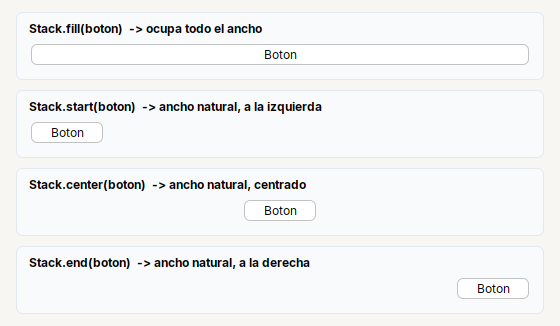

```java
return Col.gap(10).padding(12, 16, 12, 16).children(
    Card.section("Stack.fill(boton)  -> ocupa todo el ancho").children(
        Stack.fill(Button.of("Boton"))),
    Card.section("Stack.start(boton)  -> ancho natural, a la izquierda").children(
        Stack.start(Button.of("Boton"))),
    Card.section("Stack.center(boton)  -> ancho natural, centrado").children(
        Stack.center(Button.of("Boton"))),
    Card.section("Stack.end(boton)  -> ancho natural, a la derecha").children(
        Stack.end(Button.of("Boton"))));
```

| Fabrica | Los hijos... | Y el `Stack`... |
|---|---|---|
| `Stack.fill(c...)` | se **estiran** a todo el ancho | pide ocupar **lo que sobra** cuando va dentro de un `Row` |
| `Stack.start(c...)` | conservan su ancho natural, a la **izquierda** | ocupa el ancho de su contenedor |
| `Stack.center(c...)` | conservan su tamano natural, **centrados** | ocupa el ancho de su contenedor |
| `Stack.end(c...)` | conservan su ancho natural, a la **derecha** | ocupa el ancho de su contenedor |

En todos, los hijos se **centran en vertical**. Dentro de un `Row`, solo `Stack.fill` se estira; los demas toman el ancho de su hijo visible mas grande (lo que se aprovecha en el segundo caso de abajo).

#### Caso 1: un campo que cambia segun una opcion

Una opcion (`Radio`) decide si se ve un combo, un campo de texto u otro combo, **todos en el mismo lugar** y con el mismo boton al lado:

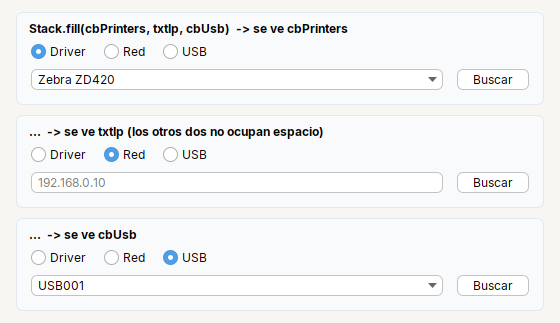

```java
private static JComponent stackState(String title, int visible) {
  final Combo<String> cbPrinters = Combo.of("Zebra ZD420", "TSC TE200");
  final Input txtIp = Input.text().placeholder("192.168.0.10");
  final Combo<String> cbUsb = Combo.of("USB001", "USB002");
  cbPrinters.setVisible(visible == 0);
  txtIp.setVisible(visible == 1);
  cbUsb.setVisible(visible == 2);

  return Card.section(title).children(
      Row.gap(14).children(
          Radio.of("Driver").selected(visible == 0),
          Radio.of("Red").selected(visible == 1),
          Radio.of("USB").selected(visible == 2)),
      Row.gap(10).children(
          Stack.fill(cbPrinters, txtIp, cbUsb),
          Button.of("Buscar")));
}
```

Para cambiar de alternativa en tiempo de ejecucion, haz `setVisible(true)` en una y `setVisible(false)` en las demas (por ejemplo, desde el `onClick` de cada `Radio`):

```java
rbtnDriver.onClick(() -> showOnly(cbPrinters));
rbtnIp.onClick(() -> showOnly(txtIp));
rbtnUsb.onClick(() -> showOnly(cbUsb));

private void showOnly(JComponent visible) {
  for (JComponent c : new JComponent[] {cbPrinters, txtIp, cbUsb}) {
    c.setVisible(c == visible);
  }
}
```

#### Caso 2: un boton que cambia por otro

"Iniciar" y "Detener" ocupan **el mismo sitio** y solo se ve el que corresponde al estado. Como el `Stack` mide su hijo visible, el boton no deja hueco ni mueve lo demas:

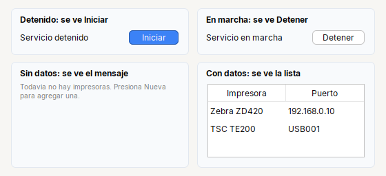

```java
private static JComponent stackToggle(String title, boolean running) {
  final Button start = Button.primary("Iniciar").visible(!running);
  final Button stop = Button.of("Detener").visible(running);
  return Card.section(title).children(
      Row.gap(10)
          .children(Label.text(running ? "Servicio en marcha" : "Servicio detenido"))
          .glue()
          .children(Stack.start(start, stop)));
}
```

```java
private void setRunning(boolean running) {
  btnStart.setVisible(!running);
  btnStop.setVisible(running);
}
```

#### Caso 3: mensaje de "no hay datos" o lista

La parte de abajo de la imagen: un texto de ayuda y la lista en el mismo lugar; se ve el mensaje cuando no hay datos y la lista cuando los hay. Se actualiza igual:
`emptyMessage.setVisible(model.getRowCount() == 0)` y `list.setVisible(model.getRowCount() > 0)`.

```java
private static JComponent stackEmptyState(String title, boolean empty) {
  final BaseTableModel.TArray model = new BaseTableModel.TArray("Impresora", "Puerto");
  if (!empty) {
    model.addRow(new Object[] {"Zebra ZD420", "192.168.0.10"});
    model.addRow(new Object[] {"TSC TE200", "USB001"});
  }
  final Table table = Table.of(model).rowHeight(26);
  table.setPreferredScrollableViewportSize(new Dimension(200, 80));

  final Hint emptyMessage = Hint.of("Todavia no hay impresoras. Presiona Nueva para agregar una.").visible(empty);
  final Scroll list = Scroll.of(table).visible(!empty);
  return Card.section(title).children(Stack.fill(emptyMessage, list));
}
```

Cuando **no** usar `Stack`: si lo que cambia es el contenido de una **pantalla entera** (los pasos de un asistente), usa [`Pages`](#tabs-split-y-pages); si el usuario debe poder elegir cual ver, [`Tabs`](#tabs-split-y-pages). `Stack` es para **piezas pequenas** dentro de una fila o un bloque.

### Page: la estructura de la ventana

`Page` divide la ventana en **cinco zonas**: `top`, `left`, `center`, `right` y `bottom`. Arriba y abajo toman el **alto que piden** y todo el ancho; izquierda y
derecha, el **ancho que piden** y el alto que queda; el **centro se queda con todo lo que sobra**. No hace falta llenar las cinco.

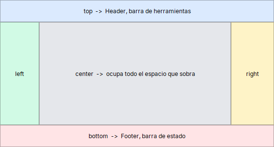

```java
return Page.create()
    .top(zone("top  ->  Header, barra de herramientas", new Color(0xDBEAFE), 14, 16))
    .left(zone("left", new Color(0xD1FAE5), 20, 30))
    .right(zone("right", new Color(0xFEF3C7), 20, 30))
    .center(zone("center  ->  ocupa todo el espacio que sobra", new Color(0xE5E7EB), 20, 16))
    .bottom(zone("bottom  ->  Footer, barra de estado", new Color(0xFFE4E6), 14, 16));
```

Un menu lateral (`left`) mide lo que **pida su contenido**: para hacerlo mas ancho, dale margen interior (`padding`) o un elemento mas ancho.
`Page.minWidth(px)` evita que la ventana se abra mas angosta que eso al hacer `pack()`.

### Tabs, Split y Pages

Tres formas de repartir una zona entre varios contenidos:

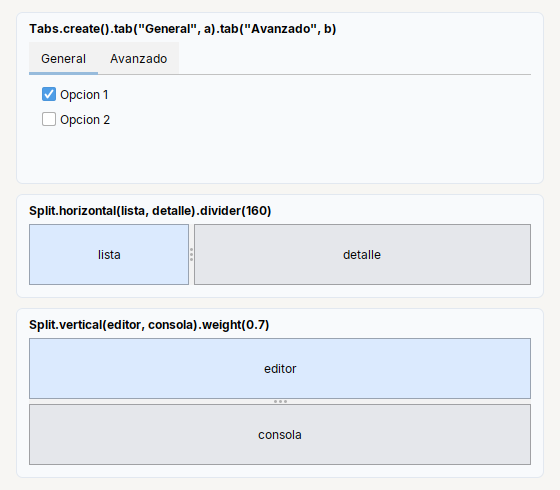

```java
Tabs.create()
    .tab("General", Col.gap(6).padding(10).children(Check.of("Opcion 1").selected(true), Check.of("Opcion 2")))
    .tab("Avanzado", Col.gap(6).padding(10).children(Check.of("Opcion avanzada")))
```

| Pieza | Uso |
|---|---|
| `Tabs.create().tab("Titulo", contenido)` | **pestanas**: el usuario elige cual ver |
| `Split.horizontal(izq, der).divider(160)` | dos zonas **lado a lado** con una barra que se arrastra; `divider` = posicion inicial (px) |
| `Split.vertical(arriba, abajo).weight(0.7)` | dos zonas **una sobre otra**; `weight` = cuanto del espacio extra se queda la primera (0 a 1) |
| `Pages.create().page("a", a).page("b", b)` | **pasos**: se ve uno a la vez y el programa decide cual con `pages.show("a")` |

`Tabs` y `Split` ocupan solo el espacio que les das; `Pages` mide lo que la **pagina mas grande**, asi la ventana no cambia de tamano entre paso y paso (se ve en el
[asistente](#asistente-de-pasos) de mas abajo).

### Espaciado: `gap` y `padding`

Dos medidas distintas, que no se deben confundir:

- **`gap`**: el espacio **entre** un hijo y el siguiente (`Row.gap(10)`, `Col.gap(8)`, `Form.gap(4)`, `Card.gap(6)`).
- **`padding`**: el espacio **entre el borde del contenedor y sus hijos** (`padding(12)`, `padding(vertical, horizontal)`, `padding(arriba, izq, abajo, der)`).


Un valor de partida comodo: `Col.gap(10).padding(12)` para el contenido de una ventana, y `gap(6)` o `gap(8)` dentro de un `Card`. Todos los valores
estan en **px logicos**: se escalan con el zoom de la pantalla.

### Ocultar sin dejar hueco

En **todos** los contenedores del kit, un componente invisible **no ocupa espacio ni deja su `gap`**. Para ocultar algo solo hay que llamar a `setVisible(false)` (o `.visible(false)`):


```java
final Button hidden = Button.of("Dos").visible(false);
final Label lblPass = Label.field("Clave").visible(false);
final Password txtPass = Input.password().placeholder("Clave").visible(false);

return Col.gap(10).padding(12, 16, 12, 16).children(
    Card.section("Row: todos visibles").children(
        Row.gap(8).children(Button.of("Uno"), Button.of("Dos"), Button.of("Tres"))),
    Card.section("Row: Button.of(\"Dos\").visible(false)  -> no deja hueco").children(
        Row.gap(8).children(Button.of("Uno"), hidden, Button.of("Tres"))),
    Row.gap(12).fillEqual(
        Card.section("Form: dos filas visibles").children(
            Form.create()
                .row("Usuario", Input.text().placeholder("Usuario"))
                .row("Clave", Input.password().placeholder("Clave"))),
        Card.section("Form: etiqueta y campo ocultos").children(
            Form.create()
                .row("Usuario", Input.text().placeholder("Usuario"))
                .row(lblPass, txtPass))));
```

En un `Form`, una fila son **dos componentes**: para ocultar la fila hay que ocultar **la etiqueta y el campo** (si solo ocultas el campo, la etiqueta se queda). Por eso, cuando
una fila va a mostrarse y ocultarse, conviene guardar la etiqueta en una variable como `lblPass`.

## Pantallas completas

Las piezas combinadas en **disposiciones tipicas** de una aplicacion. Cada una va con el codigo que la arma (en tu clase de pantalla, ese `return` es lo que se pasa a
`add(...)` desde `buildUI()`; los campos van arriba, como se explica en [La idea](#la-idea)).

### Dialogo clasico

Cabecera, bloques con titulo y barra de botones: el esqueleto de [este mismo documento](#esqueleto).


### Barra de herramientas, tabla y barra de estado

Una pantalla de **listado**: cabecera, una fila de acciones con un buscador a la derecha, la tabla ocupando el centro y una barra de estado abajo.

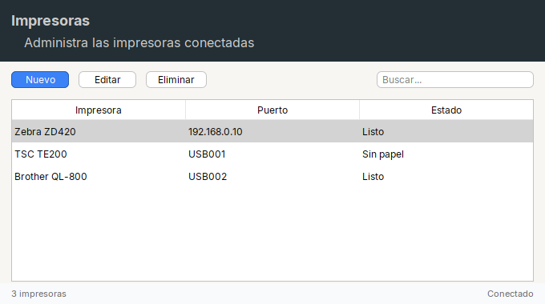

```java
final BaseTableModel.TArray model = new BaseTableModel.TArray("Impresora", "Puerto", "Estado");
model.addRow(new Object[] {"Zebra ZD420", "192.168.0.10", "Listo"});
model.addRow(new Object[] {"TSC TE200", "USB001", "Sin papel"});
model.addRow(new Object[] {"Brother QL-800", "USB002", "Listo"});
final Table table = Table.of(model).rowHeight(28).singleSelection();
table.setRowSelectionInterval(0, 0);

return Page.create()
    .top(Col.gap(0).children(
        Header.create("Impresoras", "Administra las impresoras conectadas"),
        Row.gap(8).padding(10, 12)
            .children(Button.primary("Nuevo"), Button.of("Editar"), Button.of("Eliminar"))
            .glue()
            .children(Input.text().placeholder("Buscar...").width(200))))
    .center(Col.gap(0).padding(0, 12, 0, 12).fillBoth(Scroll.of(table)))
    .bottom(Row.gap(12).padding(6, 14).background(Kit.SURFACE)
        .children(Label.muted("3 impresoras").small())
        .glue()
        .children(Label.muted("Conectado").small()));
```

Notas: la tabla va dentro de un `Scroll`, dentro de un `Col` con `fillBoth` para que ocupe el alto; el buscador usa `.glue()` antes para quedar a la derecha, con
`.width(200)` fijo; la barra de estado es una `Row` con `background(...)`.

### Lista y detalle

Una lista a la izquierda y el detalle de lo elegido a la derecha, con una barra para ajustar el reparto.


```java
final BaseTableModel.TArray model = new BaseTableModel.TArray("Cliente");
model.addRow(new Object[] {"Ana Torres"});
model.addRow(new Object[] {"Luis Prado"});
model.addRow(new Object[] {"Marta Rios"});
model.addRow(new Object[] {"Pedro Soto"});
final Table list = Table.of(model).rowHeight(30).singleSelection();
list.setRowSelectionInterval(0, 0);

return Page.create()
    .top(Header.create("Clientes", "Elige uno para ver su detalle"))
    .center(Split.horizontal(
        Scroll.of(list).noBorder(),
        Col.gap(10).padding(12).children(
            Card.create("Ana Torres").subtitle("Cliente desde 2021").children(
                Form.create()
                    .row("Ciudad", Label.text("Lima"))
                    .row("Correo", Label.text("ana@ejemplo.com"))
                    .row("Telefono", Label.text("555-0101"))),
            Row.gap(8).glue().children(Button.of("Editar"), Button.primary("Nuevo pedido")))).divider(220));
```

Notas: `Split.horizontal(...).divider(220)`; la lista va en un `Scroll` sin borde (`noBorder()`); el detalle es un `Col` con `Card` y una fila de botones a la derecha (`glue()`).
La logica de seleccionar y actualizar el detalle esta en la [receta de lista y detalle](recipes.md#2-lista-y-detalle).

### Menu lateral

Un menu oscuro a la izquierda y el contenido a la derecha: `Page.left(...)` y `Page.center(...)`.

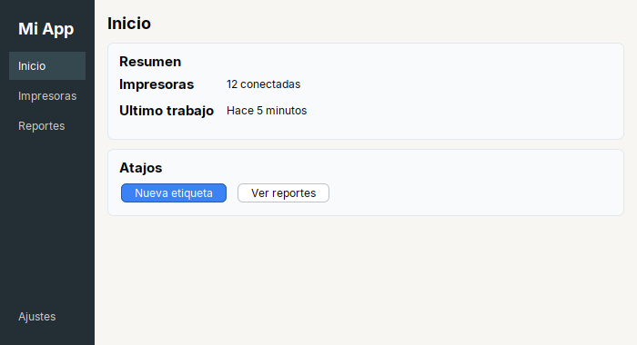

```java
private static Label navItem(String text, boolean selected) {
  return Label.text(text)
      .color(selected ? Color.WHITE : Kit.ON_DARK)
      .padding(8, 10, 8, 10)
      .background(selected ? new Color(0x35474F) : Kit.DARK);
}
```

```java
return Page.create()
    .left(Col.gap(2).padding(16, 10, 16, 10).background(Kit.DARK)
        .children(Label.title("Mi App").color(Color.WHITE).padding(4, 10, 12, 10))
        .fill(navItem("Inicio", true), navItem("Impresoras", false), navItem("Reportes", false))
        .glue()
        .fill(navItem("Ajustes", false)))
    .center(Col.gap(10).padding(14).children(
        Label.title("Inicio"),
        Card.create("Resumen").children(
            Form.create()
                .row("Impresoras", Label.text("12 conectadas"))
                .row("Ultimo trabajo", Label.text("Hace 5 minutos"))),
        Card.create("Atajos").children(
            Row.gap(8).children(Button.primary("Nueva etiqueta"), Button.of("Ver reportes")))));
```

Notas: el menu es un `Col` con `background(Kit.DARK)`; los elementos van con `.fill(...)` para que el fondo del seleccionado ocupe todo el ancho; el `.glue()` empuja "Ajustes"
al fondo. Para que cada elemento cambie el contenido, junta esto con un `Pages` en el centro (`pages.show("inicio")`).

### Asistente de pasos

Cabecera, un panel por paso y botones Atras / Siguiente. `Pages` mide la pagina mas grande, asi la ventana no cambia de tamano entre pasos.

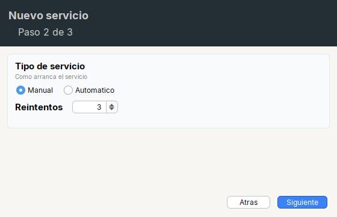

```java
final Pages pages = Pages.create()
    .page("name", Col.gap(10).padding(12).children(Card.create("Nombre")))
    .page("type", Col.gap(10).padding(12).children(
        Card.create("Tipo de servicio").subtitle("Como arranca el servicio").children(
            Row.gap(14).children(Radio.of("Manual").selected(true), Radio.of("Automatico")),
            Form.create().row("Reintentos", Spinner.integer(3, 0, 10, 1).width(80)))))
    .page("done", Col.gap(10).padding(12).children(Card.create("Listo")));
pages.show("type");

return Page.create()
    .top(Header.create("Nuevo servicio", "Paso 2 de 3"))
    .center(pages)
    .bottom(Footer.of(Button.of("Atras"), Button.primary("Siguiente")));
```

La logica de Atras / Siguiente esta en la [receta del asistente](recipes.md#3-asistente-de-pasos).

### Tablero con indicadores

Una fila de tarjetas del **mismo ancho** (`fillEqual`) con una cifra grande, y debajo un bloque de actividad.

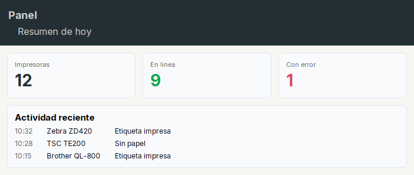

```java
private static Card stat(String title, String value, Color color) {
  return Card.create().gap(2).children(
      Label.muted(title).small(),
      Label.title(value).fontSize(28).color(color));
}
```

```java
return Page.create()
    .top(Header.create("Panel", "Resumen de hoy"))
    .center(Col.gap(12).padding(12).children(
        Row.gap(12).fillEqual(
            stat("Impresoras", "12", Kit.DARK),
            stat("En linea", "9", new Color(0x14A44D)),
            stat("Con error", "1", new Color(0xDC4C64))),
        Card.create("Actividad reciente").children(
            Grid.gap(6).columnGap(24)
                .row(Label.muted("10:32"), Label.text("Zebra ZD420"), Label.text("Etiqueta impresa"))
                .row(Label.muted("10:28"), Label.text("TSC TE200"), Label.text("Sin papel"))
                .row(Label.muted("10:15"), Label.text("Brother QL-800"), Label.text("Etiqueta impresa")))));
```

### Dos columnas de bloques

Dos columnas del mismo ancho, cada una con sus tarjetas apiladas: `Row.fillEqual(Col, Col)`.

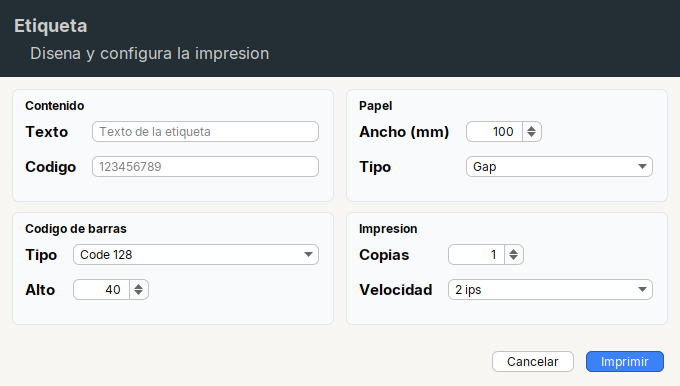

```java
return Page.create()
    .top(Header.create("Etiqueta", "Disena y configura la impresion"))
    .center(Row.gap(12).padding(12).fillEqual(
        Col.gap(10).children(
            Card.section("Contenido").children(
                Form.create()
                    .row("Texto", Input.text().placeholder("Texto de la etiqueta"))
                    .row("Codigo", Input.text().placeholder("123456789"))),
            Card.section("Codigo de barras").children(
                Form.create()
                    .row("Tipo", Combo.of("Code 128", "EAN-13", "QR"))
                    .row("Alto", Spinner.integer(40, 10, 200, 5).width(80)))),
        Col.gap(10).children(
            Card.section("Papel").children(
                Form.create()
                    .row("Ancho (mm)", Spinner.integer(100, 10, 300, 1).width(80))
                    .row("Tipo", Combo.of("Gap", "Continuo"))),
            Card.section("Impresion").children(
                Form.create()
                    .row("Copias", Spinner.integer(1, 1, 99, 1).width(80))
                    .row("Velocidad", Combo.of("2 ips", "4 ips"))))))
    .bottom(Footer.of(Button.of("Cancelar"), Button.primary("Imprimir")));
```

### Formulario centrado (inicio de sesion)

Un bloque **centrado** en la ventana, de ancho fijo. El truco: un `glue()` a cada lado, en horizontal (dentro de una `Row`) y en vertical (dentro de una `Col`).

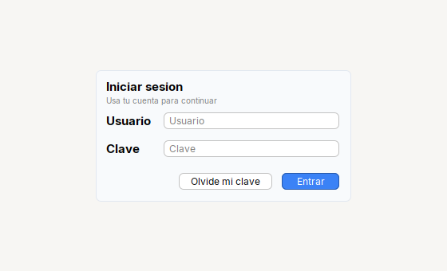

```java
return Page.create().center(
    Col.gap(0).glue().children(
        Row.gap(0).glue().children(
            Card.create("Iniciar sesion").subtitle("Usa tu cuenta para continuar").width(320).children(
                Form.create()
                    .row("Usuario", Input.text().placeholder("Usuario"))
                    .row("Clave", Input.password().placeholder("Clave")),
                Row.gap(8).glue().children(Button.of("Olvide mi clave"), Button.primary("Entrar"))))
            .glue())
        .glue());
```

La version modal de este dialogo, con validacion, esta en la [receta de inicio de sesion](recipes.md#1-dialogo-de-inicio-de-sesion).

### Editor y consola

Una barra de acciones y, debajo, un editor y una consola **una sobre otra** con una barra que se arrastra: `Split.vertical`. `weight(0.7)` hace que el editor se quede con el 70% al
crecer la ventana.

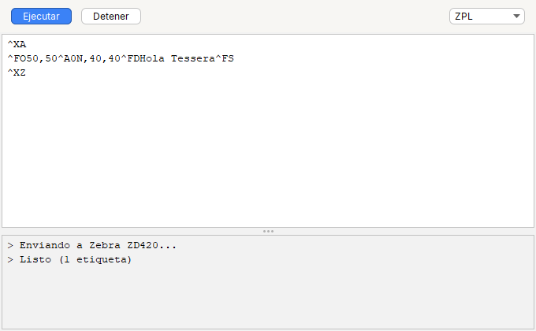

```java
final Font mono = new Font(Font.MONOSPACED, Font.PLAIN, 13);
final TextArea editor = Input.area(10).font(mono);
editor.setText("^XA\n^FO50,50^A0N,40,40^FDHola Tessera^FS\n^XZ");
final TextArea console = Input.area(4).font(mono).editable(false);
console.setText("> Enviando a Zebra ZD420...\n> Listo (1 etiqueta)");

return Page.create()
    .top(Row.gap(8).padding(8, 12)
        .children(Button.primary("Ejecutar"), Button.of("Detener"))
        .glue()
        .children(Combo.of("ZPL", "EPL").width(100)))
    .center(Split.vertical(Scroll.of(editor), Scroll.of(console)).weight(0.7).divider(250));
```

### Ajustes con pestanas

Una pantalla de preferencias: cabecera, `Tabs` en el centro y botones al pie.

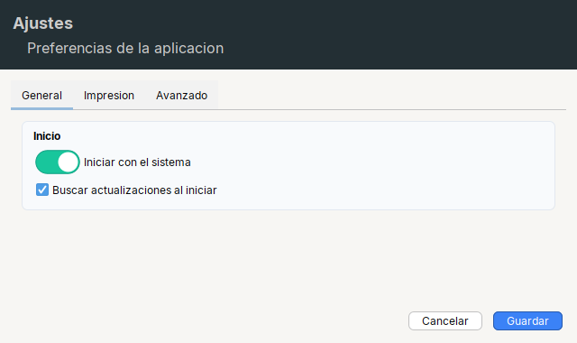

```java
return Page.create()
    .top(Header.create("Ajustes", "Preferencias de la aplicacion"))
    .center(Col.gap(0).padding(12).children(
        Tabs.create()
            .tab("General", Col.gap(10).padding(12).children(
                Card.section("Inicio").children(
                    Switch.of("Iniciar con el sistema").selected(true),
                    Check.of("Buscar actualizaciones al iniciar").selected(true))))
            .tab("Impresion", Col.gap(10).padding(12).children(
                Card.section("Predeterminados").children(
                    Form.create()
                        .row("Copias", Spinner.integer(1, 1, 99, 1).width(80))
                        .row("Velocidad", Combo.of("2 ips", "4 ips")))))
            .tab("Avanzado", Col.gap(10).padding(12).children(
                Card.section("Depuracion").children(Check.of("Guardar registro de eventos"))))))
    .bottom(Footer.of(Button.of("Cancelar"), Button.primary("Guardar")));
```

## Errores de disposicion que se repiten

| Sintoma | Causa y arreglo |
|---|---|
| Un boton o etiqueta dentro de un `Col` **no se estira** | es lo esperado; usa `.fill(boton)` |
| La **tabla** no muestra el encabezado, o no ocupa el alto | falta `Scroll.of(table)`, o el `Scroll` esta en un `Col` sin `fillBoth` |
| `.width(200)` **no hace nada** | solo lo entienden los contenedores del kit; dentro de un `Page` o un `JPanel` suelto se ignora |
| Un bloque no queda **centrado** | para centrar necesitas el `glue()` a ambos lados **y** un ancho fijo (`.width(...)`) en el bloque |
| Al ocultar una fila de un `Form` queda la **etiqueta** | una fila son dos componentes: oculta los dos |
| El menu lateral queda **muy angosto** | `Page.left` mide lo que pide su contenido: dale `padding` o elementos mas anchos |
| Un campo **no se estira** junto a su boton | falta `.fill(campo)` en el `Row` (con `.children(campo)` queda con su ancho natural) |
| Los hijos del `Row` quedan **a la izquierda** y quieres uno a la derecha | pon `.glue()` antes del que debe ir a la derecha |
| Dos bloques lado a lado miden **distinto** | usa `fillEqual(a, b)` en vez de `fill(a, b)` |

## Buscar rapido (para devs e IA)

- Donde esta la UI de una pantalla: buscar `UI: widgets y construcción` en el archivo y bajar desde ahi.
- Todas las pantallas del proyecto: `grep -rl "UI: widgets y construcción" src`.
- Donde se arma un widget: el campo esta declarado en la zona de UI, justo sobre el metodo del bloque al que pertenece.
- Donde esta su comportamiento: el `.onClick(this::metodo)` apunta al metodo, que esta en la zona de logica.
