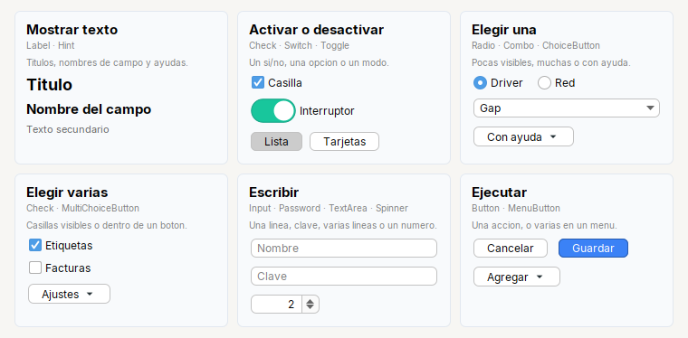
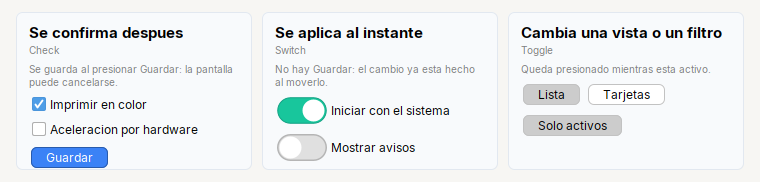
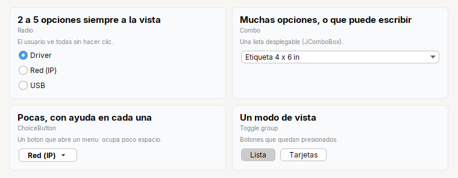
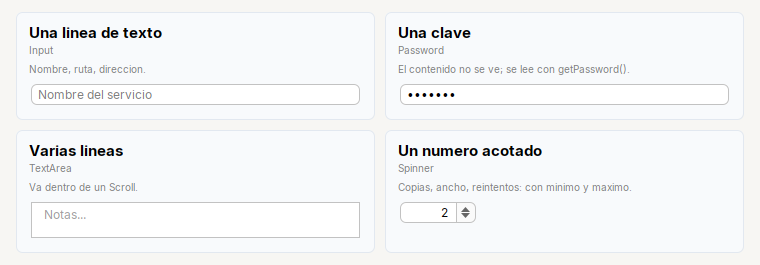

# Que widget uso

Tessera trae un widget para cada cosa que se le pide a un usuario. Esta guia ayuda a elegir el correcto con una sola pregunta: **que quiero que haga el
usuario?** Cada widget **es** el de Swing (`Button extends JButton`, `Input extends JTextField`...) con metodos encadenables, asi que todo lo que ya
sabes de Swing sigue valiendo.

| Quiero que el usuario... | Uso | Pagina |
|---|---|---|
| lea un titulo, el nombre de un campo o una ayuda | `Label`, `Hint` | [Mostrar texto](#mostrar-texto-label-o-hint) |
| active o desactive algo | `Check`, `Switch`, `Toggle` | [Activar o desactivar](#activar-o-desactivar-check-switch-o-toggle) |
| elija **una** opcion | `Radio`, `Combo`, `ChoiceButton`, `Toggle.group` | [Elegir una opcion](#elegir-una-opcion-radio-combo-choicebutton-o-togglegroup) |
| elija **varias** opciones | `Check` (a la vista), `MultiChoiceButton` (en un menu) | [Elegir varias](#elegir-varias-check-o-multichoicebutton) |
| escriba | `Input`, `Password`, `TextArea`, `Spinner` | [Escribir](#escribir-input-password-textarea-o-spinner) |
| ejecute una accion | `Button`, `MenuButton` | [Ejecutar](#ejecutar-button-o-menubutton) |
| vea una lista de datos | `Table` | [Mostrar datos](#mostrar-datos-table) |

Cada nombre lleva a su pagina de referencia: imagen, un ejemplo con codigo, todos los metodos y los errores comunes.

---

## Mostrar texto: `Label` o `Hint`

| | [`Label`](../reference/kit/widgets/label.md) | [`Hint`](../reference/kit/widgets/hint.md) |
|---|---|---|
| Es | texto con **estilo listo** | ayuda **pequena y gris** |
| Se parte en lineas | no | **si**, al ancho que reciba |
| Para | titulos, nombres de campo, textos cortos, enlaces | explicar un campo o un bloque en una o varias lineas |
| Se crea con | `Label.title(...)`, `.field(...)`, `.muted(...)`, `.text(...)` | `Hint.of(...)` |

Regla corta: **un texto corto va en `Label`; una explicacion que puede ocupar varias lineas, en `Hint`.** `Hint` extiende `JLabel` pero **no** `Label`.

---

## Activar o desactivar: `Check`, `Switch` o `Toggle`

Los tres son un boton con dos estados; lo que cambia es **cuando se aplica** lo que el usuario hace:

| | [`Check`](../reference/kit/widgets/check.md) | [`Switch`](../reference/kit/widgets/switch.md) | [`Toggle`](../reference/kit/widgets/toggle.md) |
|---|---|---|---|
| El cambio se aplica... | **despues**, con un boton Guardar | **al instante** | al instante, y es una **vista o un filtro** |
| Se ve como | casilla | interruptor estilo iOS | boton que queda presionado |
| Cuantos a la vez | los que quiera | los que quiera | uno solo si estan en `Toggle.group` (modo); varios si no (filtros) |
| Ejemplo | "Imprimir en color" | "Iniciar con el sistema" | "Lista / Tarjetas", "Solo activos" |

Si dudas: **hay un boton Guardar?** Si lo hay, `Check`; si el cambio ya esta hecho al moverlo, `Switch`.

---

## Elegir una opcion: `Radio`, `Combo`, `ChoiceButton` o `Toggle.group`

| | [`Radio`](../reference/kit/widgets/radio.md) | [`Combo`](../reference/kit/widgets/combo.md) | [`ChoiceButton`](../reference/kit/widgets/choicebutton.md) | [`Toggle.group`](../reference/kit/widgets/toggle.md) |
|---|---|---|---|---|
| Cuantas opciones | 2 a 5 | muchas | pocas (2 a 8) | 2 a 4 |
| Se ven... | todas, siempre | al abrir la lista | al abrir un menu | todas, como botones |
| Espacio que ocupa | mucho | una linea | una linea | una fila |
| Ayuda por opcion | no | no | **si** (tooltip y `getValueTip()`) | no |
| El usuario puede escribir | no | **si** (`editable(true)`) | no | no |
| Lo que lees | `isSelected()` de cada una | `ComboItem.getSelectedValue(combo)` | `getValue()` | `isSelected()` de cada uno |
| Ideal para | un metodo de conexion con 3 opciones | un papel de 40 tamanos | el tipo de servicio, con una explicacion cada uno | modo de vista |

Un camino rapido: **si caben a la vista, `Radio`; si son muchas, `Combo`; si son pocas pero cada una merece una explicacion o el espacio es poco, `ChoiceButton`.**

---

## Elegir varias: `Check` o `MultiChoiceButton`

| | [`Check`](../reference/kit/widgets/check.md) (varias) | [`MultiChoiceButton`](../reference/kit/widgets/multichoicebutton.md) |
|---|---|---|
| Se ven | todas las casillas, siempre | dentro de un menu, tras un boton |
| Ocupa | una fila por casilla | un solo boton |
| Ideal para | opciones importantes que el usuario debe ver | ajustes secundarios ("Configuracion para descomprimir") |
| Lo que lees | `isSelected()` de cada una | `getValues()` o `isChecked(valor)` |

Para una lista larga de casillas (cientos), mira [`CheckableListModel`](../reference/components/lists-and-combos.md).

---

## Escribir: `Input`, `Password`, `TextArea` o `Spinner`

| | [`Input`](../reference/kit/widgets/input.md) | [`Password`](../reference/kit/widgets/password.md) | [`TextArea`](../reference/kit/widgets/textarea.md) | [`Spinner`](../reference/kit/widgets/spinner.md) |
|---|---|---|---|---|
| Para | una linea de texto | una clave | varias lineas | un numero **acotado** |
| Se crea con | `Input.text()` | `Input.password()` | `Input.area(filas)` | `Spinner.integer(...)` / `.decimal(...)` |
| Va dentro de un `Scroll` | no | no | **si** | no |
| Lo que lees | `getText()` | `getPassword()` (`char[]`) | `getText()` | `getValue()` (`Integer` o `Double`) |
| No lo uses para | claves, varias lineas | nada que deba verse | una sola linea | un numero sin limites (usa `Input`) |

---

## Ejecutar: `Button` o `MenuButton`

| | [`Button`](../reference/kit/widgets/button.md) | [`MenuButton`](../reference/kit/widgets/menubutton.md) |
|---|---|---|
| Un clic... | corre **una** accion | abre un menu con **varias** acciones |
| Se crea con | `Button.of(txt)`, `Button.primary(txt)` | `MenuButton.of(txt)` |
| Ejemplo | "Guardar", "Cancelar", "Buscar" | "Agregar" (crear o importar), "Mas opciones" |

`Button.primary` es la accion que se espera del usuario: **uno por pantalla, el ultimo de la derecha** (`Footer.of(cancelar, guardar)`). Para un boton que
abre un menu de acciones, que elige una opcion o que marca varias, mira la guia [Botones que abren un menu](menus.md).

---

## Mostrar datos: `Table`

[`Table`](../reference/kit/widgets/table.md) muestra una lista de datos con columnas y filas seleccionables. **Siempre dentro de un `Scroll`**: sin el, no se ve el
encabezado. Para unas pocas celdas fijas de texto, un [`Grid`](../reference/kit/containers/grid.md) basta.

---

## Como reacciono a un cambio

Es lo que mas confunde: no todos los widgets avisan igual, y **no todos avisan cuando cambias el valor por codigo**.

| Widget | Para enterarte | Corre si lo cambias por codigo? |
|---|---|---|
| `Button`, `MenuButton` | `.onClick(...)` | no aplica: es un clic |
| `Check`, `Radio`, `Switch`, `Toggle` | `.onClick(...)` solo atiende al **usuario**; para todo cambio usa `addItemListener(e -> ...)` | `onClick`: **no**. `addItemListener`: **si** |
| `Input`, `Password`, `TextArea` | `.onChange(...)` | **si** (`setText`) |
| `Spinner` | `.onChange(...)` | **si** (`setValue`) |
| `Combo` | `.onChange(...)` | **si** (`setSelectedItem`) |
| `ChoiceButton` | `.onChange(...)` (recibe el valor) | **si** (`setValue`) |
| `MultiChoiceButton` | `.onChange(...)` (recibe el conjunto) | **si** (`setChecked`, `setValues`) |
| `Table` | `.onSelect(...)` | **si** (`setRowSelectionInterval`) |

Consecuencia practica: si una pantalla **carga un modelo** (pone valores por codigo), los `onChange` y los `ItemListener` corren en ese momento. Registralos
**antes** de cargar si quieres que armen la pantalla, o **despues** si no.

## Reglas que valen para todos

- **Se crean por fabrica**: `Button.of(...)`, `Input.text()`, `Spinner.integer(...)`. Los constructores son `protected`.
- **Los metodos se encadenan** y devuelven el propio widget: `Input.text().placeholder("Nombre").columns(20)`.
- **Medidas en px logicos**: `width(80)`, `rowHeight(28)` ya se escalan con el zoom; no los multipliques tu.
- **`.width(px)` y `.height(px)` solo los entienden los contenedores del kit** (`Row`, `Col`, `Form`, `Card`...): en un `Spinner` dentro de un `Form`, `.width(80)` lo deja de 80.
- **Imports explicitos**: `Label`, `Button`, `TextArea`, `Menu`... chocan con `java.awt`; usa `import tessera.kit.Label;`, no `java.awt.*`.

## Ver tambien

- [Referencia del kit](../reference/kit/README.md): todos los widgets y contenedores, y los metodos comunes (`Styled`, `Clickable`).
- [Botones que abren un menu](menus.md) · [Como armar una pantalla](screens.md) · [Recetas](recipes.md)
