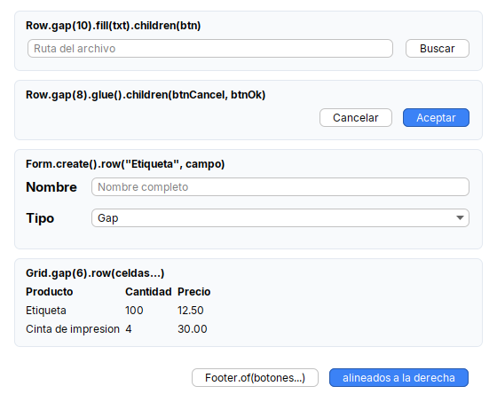
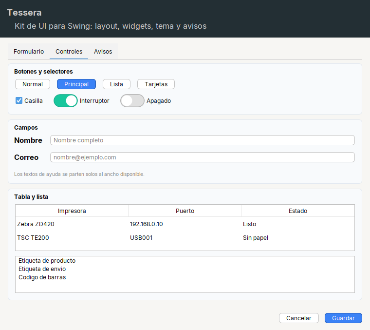
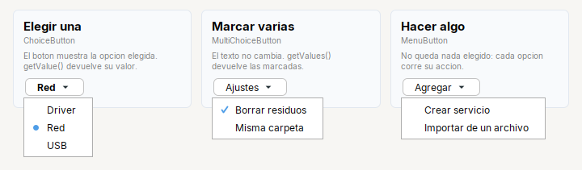

# Referencia del kit (`tessera.kit`)

El kit son los **contenedores** que acomodan y los **widgets** que capturan y muestran datos. Cada uno tiene su pagina con imagen, cuando usarlo, todos sus
metodos y los errores comunes. Esta pagina explica lo que comparten todos.



## Contenedores

Acomodan a sus hijos; son `JPanel` con MigLayout adentro (no hace falta saber MigLayout). Ver la [guia visual de disposiciones](../../guides/screens.md#guia-visual-de-disposiciones).

| Contenedor | Para que |
|---|---|
| [`Row`](containers/row.md) | Pone sus hijos **en una fila**, de izquierda a derecha, cada uno con su ancho natural. |
| [`Col`](containers/col.md) | Apila sus hijos **en una columna**, de arriba hacia abajo. |
| [`Stack`](containers/stack.md) | Apila varios componentes **en el mismo lugar**; quien arma la pantalla decide cual se ve. |
| [`Grid`](containers/grid.md) | Cuadricula: varias celdas por fila, **alineadas en columnas** (cada columna mide lo que su celda mas ancha). |
| [`Form`](containers/form.md) | Formulario de **dos columnas**: la etiqueta a la izquierda y el campo a la derecha, que ocupa el ancho que sobra. |
| [`Card`](containers/card.md) | Bloque con **fondo suave y borde redondeado**: titulo (con icono opcional), texto de ayuda y debajo sus hijos en columna. |
| [`Header`](containers/header.md) | **Banner oscuro** con un titulo y, opcionalmente, una descripcion: la cabecera de una ventana o de cada paso de un asistente. |
| [`Footer`](containers/footer.md) | Barra de botones de un dialogo: **abajo a la derecha**, con el espacio de siempre alrededor. |
| [`Page`](containers/page.md) | Estructura de una ventana o panel: **arriba, centro y abajo** (y a los lados si hace falta). |
| [`Pages`](containers/pages.md) | Varias paginas **en el mismo lugar**, de las que se ve una a la vez: los pasos de un asistente, las vistas de la ventana principal. |
| [`Scroll`](containers/scroll.md) | Contenedor con **barras de desplazamiento**. |
| [`Tabs`](containers/tabs.md) | **Pestanas**: el usuario elige cual contenido ver. |
| [`Split`](containers/split.md) | Dos zonas separadas por una **barra que se arrastra**. |
| [`Separator`](containers/separator.md) | **Linea fina** que separa secciones. |

## Widgets

Cada uno **es** el widget de Swing (`Button extends JButton`...) con metodos encadenables. Para elegir el correcto y saber como reaccionar a un cambio: [Que widget uso](../../guides/widgets.md).



| Widget | Para que |
|---|---|
| [`Label`](widgets/label.md) | Etiqueta de texto con **estilos listos**: titulo, nombre de campo, texto secundario y texto normal. |
| [`Hint`](widgets/hint.md) | Texto de ayuda: **pequeno, gris, y se parte en lineas** al ancho que reciba. |
| [`Button`](widgets/button.md) | Boton con estilos y eventos encadenables. |
| [`Check`](widgets/check.md) | **Casilla de verificacion** (`JCheckBox`). |
| [`Radio`](widgets/radio.md) | **Opcion** de un grupo de opciones excluyentes (`JRadioButton`). |
| [`Toggle`](widgets/toggle.md) | Boton que **queda presionado**: un modo de vista o un filtro. |
| [`Switch`](widgets/switch.md) | **Interruptor** estilo iOS: un si/no que se aplica al instante. |
| [`Input`](widgets/input.md) | **Campo de texto** de una linea. |
| [`Password`](widgets/password.md) | **Campo de clave**: el contenido no se ve. |
| [`TextArea`](widgets/textarea.md) | **Area de texto** de varias lineas. |
| [`Combo`](widgets/combo.md) | **Lista desplegable** (`JComboBox<T>`). |
| [`ChoiceButton`](widgets/choicebutton.md) | **Boton que abre un menu para elegir una opcion**: el boton muestra la elegida. |
| [`MultiChoiceButton`](widgets/multichoicebutton.md) | **Boton que abre un menu de casillas** para marcar varias opciones. |
| [`MenuButton`](widgets/menubutton.md) | **Boton que abre un menu de acciones**: el clic corre algo, no queda nada elegido. |
| [`Menu`](widgets/menu.md) | **Menu emergente de acciones** (y su `MenuItem`), con o sin boton: el clic derecho de una lista. |
| [`Spinner`](widgets/spinner.md) | **Selector numerico** con flechas (`JSpinner`). |
| [`Table`](widgets/table.md) | **Tabla** (`JTable`). |

### Botones que abren un menu: cual uso

| Quiero que el usuario... | Uso | Que queda |
|---|---|---|
| **elija una** opcion y el boton la muestre | [`ChoiceButton<T>`](widgets/choicebutton.md) | un valor: `getValue()` |
| **marque varias** opciones con casillas | [`MultiChoiceButton<T>`](widgets/multichoicebutton.md) | un conjunto: `getValues()` |
| haga clic y **pase algo** (agregar, exportar, insertar) | [`MenuButton`](widgets/menubutton.md) | nada: cada opcion corre su accion |
| haga clic derecho en una lista, o abra un menu **sin boton** | [`Menu`](widgets/menu.md) | nada: igual que `MenuButton` |

Los tres botones comparten `color`, `arrowLeft`, `noArrow` e `icon` (clase base `PopupButton`).



Ejemplos con imagenes, paso a paso: [Botones que abren un menu](../../guides/menus.md).

## Ideas base

1. **Un widget del kit es un widget de Swing.** `Button extends JButton`, `Input extends JTextField`, `Table extends JTable`...
   Donde Swing pida un `JButton`, vale un `Button`. Nada se envuelve ni se esconde: `input.getText()`, `combo.getSelectedItem()` y
   `table.getSelectedRow()` funcionan igual que siempre.
2. **Los metodos se encadenan.** Cada configuracion devuelve el propio widget, asi se arma en una expresion:
   `Input.text().placeholder("Nombre").columns(20)`.
3. **No se escribe MigLayout.** Los contenedores (`Row`, `Col`, `Form`...) son `JPanel` transparentes con MigLayout adentro; ellos
   deciden quien se estira y quien no. Los hijos solo se listan.
4. **Medidas en px logicos.** Todo numero en pixeles que entra por la API (`gap`, `padding`, `width`, `rowHeight`...) se multiplica por el
   zoom de la pantalla (`Kit.px`). Pon `12`, no `12 * zoom`.
5. **Se crean por fabrica.** Los constructores son `protected`: `Button.of("Ok")`, `Row.gap(8)`, `Input.text()`.

```java
Card.create("Conexion").children(
    Row.gap(14).children(Radio.of("Driver").selected(true), Radio.of("Red")),
    Row.gap(10).fill(Input.text().placeholder("192.168.0.10")).children(Button.of("Buscar")));
```

## Metodos comunes

### `Styled<T>` — todos los widgets y contenedores

| Metodo | Que hace |
|---|---|
| `.tip(String)` | texto emergente (tooltip) |
| `.bold()` | la misma fuente en negrita |
| `.fontSize(int)` | tamano de fuente, escalado con el zoom |
| `.font(Font)` | una fuente concreta |
| `.color(Color)` | color del texto |
| `.background(Color)` | color de fondo (y lo hace opaco) |
| `.width(int)` / `.height(int)` | tamano **fijo** en px. Solo lo entienden los contenedores del kit: ver [Errores comunes](#errores-comunes) |
| `.enabled(boolean)` / `.visible(boolean)` | habilitar / mostrar |
| `.name(String)` | nombre del componente (depuracion y pruebas) |

### `Clickable<T>` — `Button`, `Check`, `Radio`, `Toggle`, `Switch`

Extiende `Styled`.

| Metodo | Que hace |
|---|---|
| `.onClick(Runnable)` / `.onClick(ActionListener)` | accion al hacer clic. En casillas y opciones, al cambiar de estado **por el usuario** |
| `.icon(String recurso, int tam)` / `.icon(Icon)` | icono (SVG o imagen del classpath) |
| `.iconGap(int)` | espacio entre icono y texto |
| `.selected(boolean)` | estado inicial (en `Check`, `Radio`, `Toggle`, `Switch`) |

### `Box<T>` — todos los contenedores de layout

`Row`, `Col`, `Stack`, `Grid`, `Form`, `Card` y `Header` heredan de `Box`. Es un `JPanel` transparente (no pinta fondo, salvo `Header` y
`Card`, que traen el suyo) con MigLayout dentro.

| Metodo | Que hace |
|---|---|
| `.padding(todo)` | espacio entre el borde y los hijos, igual por los cuatro lados |
| `.padding(vertical, horizontal)` | arriba/abajo y izquierda/derecha |
| `.padding(arriba, izq, abajo, der)` | el mismo orden de `java.awt.Insets` |
| `.children(Component...)` | agrega los hijos en orden, cada uno con el comportamiento por defecto del contenedor. Los `null` se ignoran |
| `.build()` | devuelve el contenedor (opcional: ya es un `JPanel`) |

El espacio entre hijos (`gap`) se da al crear el contenedor (`Row.gap(10)`) o con `.gap(n)` en `Card`.

## Utilidades (`Kit`)

`Kit` tambien guarda la **paleta** del kit como campos `public static` (no finales): `PRIMARY`, `SURFACE`, `CARD_LINE`, `DARK`, `ON_DARK`, `MUTED`,
`LINE`, `ROW_ODD`, `ROW_EVEN`, `ROW_SELECTED`. Sus valores y como cambiarlos: [customizing.md](../../guides/customizing.md#2-paleta-del-kit-kit).

| Metodo | Que hace |
|---|---|
| `Kit.px(int)` | escala un tamano en px con el zoom de la interfaz (igual en 100%) |
| `Kit.font(tamano, negrita)` | la fuente de la interfaz (la del tema) con ese tamano y estilo, escalada |
| `Kit.icon(recurso, tam)` | icono de un recurso del classpath: **SVG** (vectorial) o imagen (PNG, tal cual). Devuelve `null` si una imagen no existe |
| `Kit.icon(svg, tam, color)` | SVG de un solo color (blanco sobre un boton principal) |
| `Kit.makePrimary(AbstractButton)` | estilo de boton principal para cualquier boton ya creado |
| `Kit.group(AbstractButton...)` | agrupa botones: solo uno queda seleccionado |
| `Kit.fill(c, horizontal, vertical)` | marca que el componente ocupa el espacio que sobra en esos ejes dentro de un `Row`, `Col`, `Form`, `Card` o `Stack` |

`Kit.fill` es lo que usan por dentro `Scroll`, `Tabs`, `Split`, `Hint` y `Stack.fill`. En un `Row` o `Col` se prefiere `.fill(c)` / `.fillBoth(c)`.

## Mezclar con Swing puro

- Un `JPanel`, `JLabel` o cualquier `Component` de Swing se puede pasar a `children(...)`, `fill(...)`, `Page.center(...)`, etc.
- `.width(px)` / `.height(px)` y `Kit.fill` funcionan con **cualquier** `JComponent`, aunque no sea del kit: se guardan como propiedades del
  componente y el contenedor las lee.
- Si algo es muy puntual, un contenedor del kit (que es un `JPanel` con MigLayout) acepta restricciones crudas:
  `contenedor.add(comp, "growx, wrap")`. Se prefiere evitarlo; si lo necesitas seguido, mejor pide un metodo nuevo al kit.

## Errores comunes

| Sintoma | Causa y arreglo |
|---|---|
| `.width(200)` no hace nada | solo lo entienden los contenedores del kit (`Row`, `Col`, `Form`, `Card`, `Stack`, `Grid`). Dentro de un `JPanel` suelto o de `Page` no tiene efecto |
| La tabla no muestra el encabezado | falta envolverla en `Scroll.of(table)` |
| `Label`, `Button`, `List`, `TextArea` o `Stack` no compilan o toman la clase equivocada | chocan con `java.awt` (y `Stack` con `java.util`); usa imports **explicitos** (`import tessera.kit.Label;`), no `java.awt.*` ni `java.util.*` |
| Un `Button` dentro de un `Col` no se estira | es lo esperado: botones y etiquetas se quedan con su ancho natural; usa `.fill(boton)` |
| `onClick` no se dispara al hacer `setSelected(true)` por codigo | `onClick` solo atiende clics del usuario. Para reaccionar a cambios por codigo usa un `ItemListener` |
| `Combo.onChange` se dispara al llenarlo | tambien lo hace al elegir por codigo: registra el `onChange` **despues** de llenar y seleccionar |
| `illegal forward reference` al declarar campos | Java inicializa los campos en orden: el que se usa va antes que el que lo usa (ver [screens.md](../../guides/screens.md#reglas)) |
| Un texto con `<` o `&` sale raro en un `Hint` o `Card.subtitle` | se interpreta como HTML; escapalo |
| Los colores no cambian al asignar `Kit.PRIMARY` | cada widget toma el color **al crearse**: asignalo antes de armar pantallas (mejor con `Theme.builder()`) |
