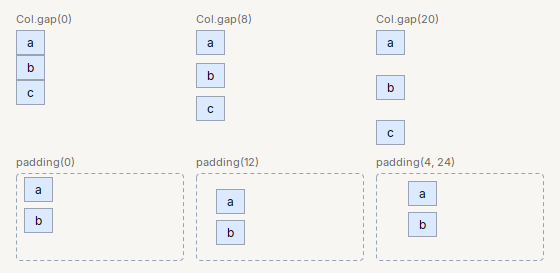
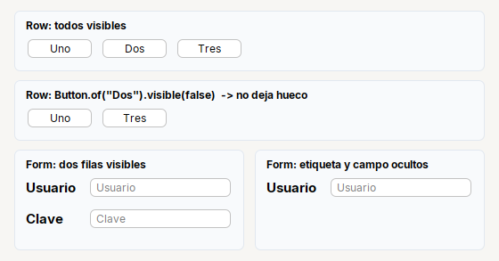

# Box

Lo que comparten `Row`, `Col`, `Stack`, `Grid`, `Form`, `Card` y `Header`: el espacio entre hijos, el margen interior, el tamano fijo y ocultar sin dejar
hueco. `Box` no se crea directamente: es la base de esos contenedores.

| | |
|---|---|
| **Paquete** | `tessera.kit` |
| **Clase** | `Box<T extends Box<T>> extends JPanel implements Styled<T>` (abstracta) |
| **La heredan** | [`Row`](row.md) · [`Col`](col.md) · [`Stack`](stack.md) · [`Grid`](grid.md) · [`Form`](form.md) · [`Card`](card.md) · [`Header`](header.md) |
| **Importar** | no se importa: se usa a traves de cada contenedor |

Es un `JPanel` **transparente** (no pinta fondo, salvo `Header` y `Card`, que traen el suyo) con MigLayout adentro: no hace falta saber MigLayout.

## `gap` y `padding`: no son lo mismo

- **`gap`**: el espacio **entre** un hijo y el siguiente.
- **`padding`**: el espacio **entre el borde del contenedor y sus hijos**.



Un valor de partida comodo: `Col.gap(10).padding(12)` para el contenido de una ventana, y `gap(6)` o `gap(8)` dentro de un `Card`. Todos los valores estan en
**px logicos**: se escalan con el zoom de la pantalla.

### Espacio entre hijos: `gap`

Se da al crear el contenedor (`Row.gap(10)`, `Col.gap(8)`, `Form.gap(4)`, `Grid.gap(6)`) o, en `Card`, con `.gap(n)`.

| Contenedor | Sin pedirlo |
|---|---|
| `Row.create()` · `Col.create()` | 8 px |
| `Form.create()` | 10 px entre filas |
| `Grid.gap(n)` | `n` px entre filas y 6 px entre columnas (`columnGap(..)` lo cambia) |
| `Card` | 6 px entre hijos |
| `Stack` | 0 (sus hijos comparten el mismo lugar) |

### Margen interior: `padding`

| Metodo | Que hace |
|---|---|
| `.padding(todo)` | igual por los cuatro lados |
| `.padding(vertical, horizontal)` | arriba y abajo, izquierda y derecha |
| `.padding(arriba, izq, abajo, der)` | el mismo orden de `java.awt.Insets` |
| `.paddingVertical(px)` | **solo** arriba y abajo; izquierda y derecha quedan como estaban |
| `.paddingHorizontal(px)` | **solo** izquierda y derecha; arriba y abajo quedan como estaban |
| `.padding()` | una **copia** del margen actual (`Insets`); cambiarla no afecta al contenedor |

```java
Col.gap(10).padding(12).children(a, b)                       // 12 por los cuatro lados
Col.gap(10).padding(12).paddingHorizontal(24).children(a, b) // 12 arriba y abajo, 24 a los lados
Card.create("Datos").paddingHorizontal(24)                   // conserva el 10 de arriba y el 12 de abajo del Card
```

`Card` arranca con un margen de 10, 12, 12, 12 (`Card.section`: 8, 12, 12, 12).

## Los hijos: `children` y `build`

| Metodo | Que hace |
|---|---|
| `.children(Component...)` | agrega los hijos en orden, cada uno con el comportamiento por defecto del contenedor. Los `null` se ignoran |
| `.build()` | devuelve el contenedor ya armado (opcional: ya es un `JPanel`) |

Cada contenedor agrega sus propias formas de colocar hijos: `fill`, `fillBoth`, `glue` en [`Row`](row.md) y [`Col`](col.md), `row` en [`Form`](form.md) y
[`Grid`](grid.md), etc.

## Tamano fijo: `width` y `height`

```java
Input.text().width(200)                       // 200 px de ancho
Scroll.of(table).height(150)                  // 150 px de alto
```

Las entienden `Row`, `Col`, `Form`, `Card`, `Stack` y `Grid`: dentro de un `Page` o de un `JPanel` suelto se ignoran. Un hijo con ancho fijo no se estira.

## Ocultar sin dejar hueco

En **todos** los contenedores del kit, un componente invisible **no ocupa espacio ni deja su `gap`**. Para ocultar algo solo hay que llamar a `setVisible(false)`
(o `.visible(false)`):



```java
final Button hidden = Button.of("Dos").visible(false);
final Label lblPass = Label.field("Clave").visible(false);
final Password txtPass = Input.password().placeholder("Clave").visible(false);

return Col.gap(10).padding(12, 16, 12, 16).children(
    Card.section("Row: todos visibles").children(
        Row.gap(8).children(Button.of("Uno"), Button.of("Dos"), Button.of("Tres"))),
    Card.section("Row: Button.of(\"Dos\").visible(false)  -> no deja hueco").children(
        Row.gap(8).children(Button.of("Uno"), hidden, Button.of("Tres"))),
    Row.gap(12).fillEqual(
        Card.section("Form: dos filas visibles").children(
            Form.create()
                .row("Usuario", Input.text().placeholder("Usuario"))
                .row("Clave", Input.password().placeholder("Clave"))),
        Card.section("Form: etiqueta y campo ocultos").children(
            Form.create()
                .row("Usuario", Input.text().placeholder("Usuario"))
                .row(lblPass, txtPass))));
```

En un [`Form`](form.md), una fila son **dos componentes**: para ocultar la fila hay que ocultar **la etiqueta y el campo** (si solo ocultas el campo, la etiqueta se
queda). Por eso, cuando una fila va a mostrarse y ocultarse, conviene guardar la etiqueta en una variable como `lblPass`.

## Mezclar con MigLayout

Un contenedor del kit es un `JPanel` con MigLayout: si algo es muy puntual, `contenedor.add(comp, "growx, wrap")` acepta restricciones crudas. Se prefiere
evitarlo; si lo necesitas seguido, mejor pide un metodo nuevo al kit.

## Ver tambien

- [Contenedores](README.md): cual usar para cada cosa.
- [Referencia del kit](../README.md): ideas base y metodos comunes (`Styled`, `Clickable`, `Box`).
- [Como armar una pantalla](../../../guides/screens.md): la convencion de las clases de pantalla.
