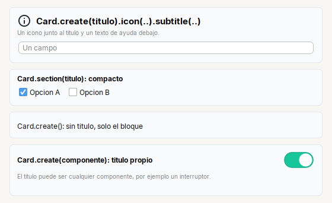

# Card

Bloque con **fondo suave y borde redondeado**: titulo (con icono opcional), texto de ayuda y debajo sus hijos en columna.

| | |
|---|---|
| **Paquete** | `tessera.kit` |
| **Clase** | `Card extends Box<Card>`: un `JPanel` transparente con MigLayout y borde propio |
| **Se crea con** | `Card.create(titulo)` · `Card.section(titulo)` · `Card.create()` · `Card.create(componente)` |
| **Importar** | `import tessera.kit.Card;` |

## Cuando usarlo

- Agrupar campos relacionados dentro de una pantalla (`Card.section`).
- Un bloque con titulo grande, icono y ayuda (`Card.create`).
- Un bloque con un titulo propio, como un interruptor.

**Cuando no:** Para la cabecera de la ventana usa `Header`.

## Lo que se puede hacer

Cada seccion muestra una cosa que se puede pedir, con la imagen de como queda y el codigo que la produce (el titulo de cada tarjeta de las imagenes es ese mismo codigo). En las imagenes, una caja de color (`zone(...)`) es solo una pieza dibujada y el borde punteado marca los limites de un contenedor: ver [como leer las imagenes](README.md#como-leer-las-imagenes).

### Con titulo, compacto, sin titulo y con titulo propio

`Card` agrupa contenido en un bloque con fondo suave y borde redondeado. Sus hijos siguen las reglas de `Col`.



```java
Card.create("Card.create(titulo).icon(..).subtitle(..)")
    .icon("tessera/img/info.svg")
    .subtitle("Un icono junto al titulo y un texto de ayuda debajo.")
    .children(Input.text().placeholder("Un campo"))
```

```java
Card.section("Card.section(titulo): compacto").children(
    Row.gap(10).children(Check.of("Opcion A").selected(true), Check.of("Opcion B")))
```

```java
Card.create().children(Label.text("Card.create(): sin titulo, solo el bloque"))
```

```java
Card.create(Row.gap(8).fill(Label.text("Card.create(componente): titulo propio").bold())
        .children(Switch.of("").selected(true)))
    .children(Hint.of("El titulo puede ser cualquier componente, por ejemplo un interruptor."))
```

| Fabrica | Cuando |
|---|---|
| `Card.create("Titulo")` | el bloque normal: titulo grande, con `.icon(..)` y `.subtitle(..)` opcionales |
| `Card.section("Titulo")` | para **agrupar campos** dentro de una pantalla: titulo del tamano del texto, mas compacto |
| `Card.create()` | sin titulo: solo un bloque con fondo |
| `Card.create(componente)` | titulo propio (interruptor, boton, enlace...) |

Con `.padding(...)` y `.gap(n)` ajustas el margen interior y el espacio entre hijos.

## Referencia

Bloque con **fondo suave y borde redondeado**: titulo (con icono opcional), texto de ayuda y debajo los hijos en columna (con las reglas
de `Col`). Relleno y borde salen de `Kit.SURFACE` y `Kit.CARD_LINE` (se cambian con `Theme`). El radio de las esquinas es fijo (12): ver
[customizing.md](../../../guides/customizing.md).

| Fabrica | Resultado |
|---|---|
| `Card.create("Titulo")` | titulo en negrita, un poco mas grande que el texto |
| `Card.section("Titulo")` | compacto: titulo en negrita del tamano del texto. Reemplaza a los `TitledBorder` |
| `Card.create()` | sin titulo |
| `Card.create(JComponent)` | titulo propio (un titulo con un interruptor al lado, por ejemplo) |

| Metodo | Que hace |
|---|---|
| `.subtitle(String)` | texto de ayuda bajo el titulo (se parte en lineas solo; ver [`Hint`](../widgets/hint.md)) |
| `.icon(String recurso)` / `.icon(Icon)` | icono junto al titulo (solo si el titulo es de texto); el recurso se carga como SVG de 24 px |
| `.gap(n)` | espacio entre hijos (6 por defecto) |
| `.title()` | el componente del titulo, para cambiarlo despues |
| `.padding(...)` | margen interior (por defecto 10, 12, 12, 12) |

```java
Card.create("Conexion")
    .icon("app/img/print.svg")
    .subtitle("Como se conecta la impresora")
    .children(
        Row.gap(14).children(rbtnPrinter, rbtnIp, rbtnUsb),
        Row.gap(10).fill(txtIp).children(btnScan))
```

## Ejemplos completos donde se usa

Pantallas completas y recetas que lo usan, para ver `Card` dentro de una aplicacion real:

- [Dialogo clasico](../../../guides/screens.md#dialogo-clasico)
- [Lista y detalle](../../../guides/screens.md#lista-y-detalle)
- [Menu lateral](../../../guides/screens.md#menu-lateral)
- [Asistente de pasos](../../../guides/screens.md#asistente-de-pasos)
- [Tablero con indicadores](../../../guides/screens.md#tablero-con-indicadores)
- [Dos columnas de bloques](../../../guides/screens.md#dos-columnas-de-bloques)
- [Formulario centrado (inicio de sesion)](../../../guides/screens.md#formulario-centrado-inicio-de-sesion)
- [Ajustes con pestanas](../../../guides/screens.md#ajustes-con-pestanas)
- [1. Dialogo de inicio de sesion](../../../guides/recipes.md#1-dialogo-de-inicio-de-sesion)
- [2. Lista y detalle](../../../guides/recipes.md#2-lista-y-detalle)
- [3. Asistente de pasos](../../../guides/recipes.md#3-asistente-de-pasos)
- [4. Pantalla de ajustes](../../../guides/recipes.md#4-pantalla-de-ajustes)
- [5. Tarea larga con progreso](../../../guides/recipes.md#5-tarea-larga-con-progreso)
- [Formulario con acciones](../../../guides/layout.md#formulario-con-acciones)
- [Tablero](../../../guides/layout.md#tablero)

## Errores comunes

- El radio de las esquinas es fijo (12) y no sigue a `Theme.arc`: ver [Personalizar](../../../guides/customizing.md#5-lo-que-no-se-puede-cambiar-desde-la-app).
- `.icon(..)` solo funciona si el titulo es de texto; con `Card.create(componente)` se ignora.

## Ver tambien

- [`Header`](header.md) · [`Form`](form.md) · [`Col`](col.md)
- [Referencia del kit](../README.md): ideas base y metodos comunes (`Styled`, `Clickable`, `Box`).
- [Contenedores](README.md): la tabla "que uso para cada cosa" y todos los contenedores.
- [Lo comun a los contenedores (`Box`)](box.md): `gap`, `padding`, `children`, tamano fijo y ocultar.
- [Como armar una pantalla](../../../guides/screens.md#pantallas-completas): pantallas completas que los combinan.
