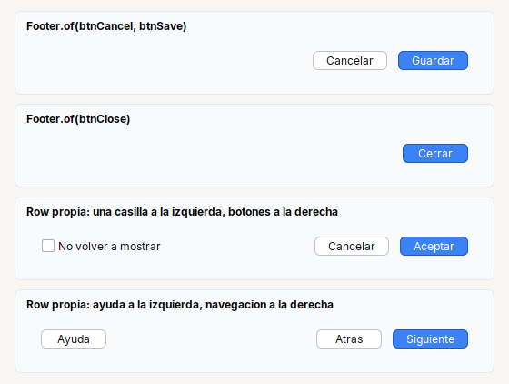

# Footer

Barra de botones de un dialogo: **abajo a la derecha**, con el espacio de siempre alrededor.

| | |
|---|---|
| **Paquete** | `tessera.kit` |
| **Clase** | clase de utilidad (no se instancia): `Footer.of(...)` devuelve un `Row` |
| **Se crea con** | `Footer.of(botones...)` |
| **Importar** | `import tessera.kit.Footer;` |



## Cuando usarlo

- La barra de botones de un dialogo o pantalla (`Page.bottom(...)`).

**Cuando no:** Si necesitas algo **a la izquierda** (una casilla, un boton de ayuda), arma tu propia fila con `glue()` en medio.

## Referencia

`Footer.of(Component... botones)` devuelve un `Row` con los botones **alineados a la derecha**, 8 px entre ellos y 12/14 px de margen.

```java
Footer.of(btnCancel, btnSave)
```

## Errores comunes

- `Footer` no admite elementos a la izquierda: usa `Row.gap(8).padding(12, 14).children(izq).glue().children(botones)`.
- Convencion: el boton de la accion principal (`Button.primary`) es el **ultimo** de la derecha.

## Ver tambien

- [`Row`](row.md) · [`Page`](page.md) · [`Header`](header.md) · [`Button`](../widgets/button.md)
- [Referencia del kit](../README.md): ideas base y metodos comunes (`Styled`, `Clickable`, `Box`).
- [Guia visual de disposiciones](../../../guides/screens.md#guia-visual-de-disposiciones): cada contenedor con imagenes y pantallas completas.
