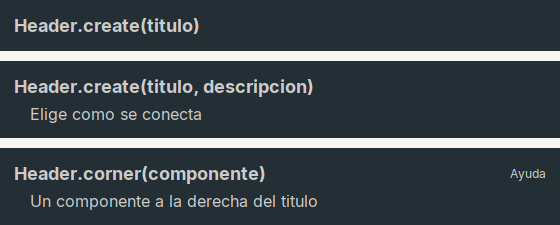

# Header

**Banner oscuro** con un titulo y, opcionalmente, una descripcion: la cabecera de una ventana o de cada paso de un asistente.

| | |
|---|---|
| **Paquete** | `tessera.kit` |
| **Clase** | `Header extends Box<Header>`: un `JPanel` con fondo `Kit.DARK` |
| **Se crea con** | `Header.create(titulo)` · `Header.create(titulo, descripcion)` |
| **Importar** | `import tessera.kit.Header;` |

## Cuando usarlo

- La parte de arriba de una ventana o dialogo (`Page.top(...)`).
- La cabecera de cada paso de un asistente.

**Cuando no:** Para un bloque con titulo dentro de la pantalla usa `Card`.

## Lo que se puede hacer

Cada seccion muestra una cosa que se puede pedir, con la imagen de como queda y el codigo que la produce (el titulo de cada tarjeta de las imagenes es ese mismo codigo). En las imagenes, una caja de color (`zone(...)`) es solo una pieza dibujada y el borde punteado marca los limites de un contenedor: ver [como leer las imagenes](README.md#como-leer-las-imagenes).

### Titulo, descripcion y componente a la derecha

`Header` es el **banner oscuro** de arriba de una ventana o de cada paso de un asistente.



```java
Header.create("Header.create(titulo)")
```

```java
Header.create("Header.create(titulo, descripcion)", "Elige como se conecta")
```

```java
Header.create("Header.corner(componente)", "Un componente a la derecha del titulo")
    .corner(Label.text("Ayuda").color(Kit.ON_DARK).onClick(() -> { }))
```

Se coloca normalmente en `Page.top(...)`. Para cambiar el texto despues de armado: `header.title().setText(..)` y `header.subtitle(..)`.

## Referencia

Banner **oscuro** con titulo y descripcion opcional: la cabecera de cada paso de un asistente o dialogo. Colores de `Kit.DARK` y
`Kit.ON_DARK`.

| Metodo | Que hace |
|---|---|
| `Header.create(titulo)` / `Header.create(titulo, descripcion)` | banner |
| `.subtitle(String)` | descripcion bajo el titulo (si ya existe, cambia su texto) |
| `.corner(Component)` | un componente (un enlace de ayuda) a la derecha del titulo |
| `.title()` | la `Label` del titulo, para cambiarla despues |

## Ejemplos completos donde se usa

Pantallas completas y recetas que lo usan, para ver `Header` dentro de una aplicacion real:

- [Dialogo clasico](../../../guides/screens.md#dialogo-clasico)
- [Barra de herramientas, tabla y barra de estado](../../../guides/screens.md#barra-de-herramientas-tabla-y-barra-de-estado)
- [Lista y detalle](../../../guides/screens.md#lista-y-detalle)
- [Asistente de pasos](../../../guides/screens.md#asistente-de-pasos)
- [Tablero con indicadores](../../../guides/screens.md#tablero-con-indicadores)
- [Dos columnas de bloques](../../../guides/screens.md#dos-columnas-de-bloques)
- [Ajustes con pestanas](../../../guides/screens.md#ajustes-con-pestanas)
- [1. Dialogo de inicio de sesion](../../../guides/recipes.md#1-dialogo-de-inicio-de-sesion)
- [3. Asistente de pasos](../../../guides/recipes.md#3-asistente-de-pasos)
- [4. Pantalla de ajustes](../../../guides/recipes.md#4-pantalla-de-ajustes)
- [6. App que vive en la bandeja](../../../guides/recipes.md#6-app-que-vive-en-la-bandeja)

## Errores comunes

- `.corner(componente)` coloca el componente junto al **titulo**, no junto a la descripcion.
- Para cambiar el texto despues de armado: `header.title().setText(..)` y `header.subtitle(..)`.

## Ver tambien

- [`Page`](page.md) · [`Footer`](footer.md) · [`Card`](card.md)
- [Referencia del kit](../README.md): ideas base y metodos comunes (`Styled`, `Clickable`, `Box`).
- [Contenedores](README.md): la tabla "que uso para cada cosa" y todos los contenedores.
- [Lo comun a los contenedores (`Box`)](box.md): `gap`, `padding`, `children`, tamano fijo y ocultar.
- [Como armar una pantalla](../../../guides/screens.md#pantallas-completas): pantallas completas que los combinan.
