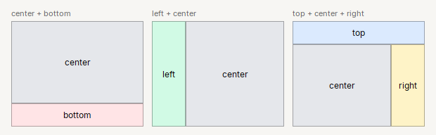

# Page

Estructura de una ventana o panel: **arriba, centro y abajo** (y a los lados si hace falta).

| | |
|---|---|
| **Paquete** | `tessera.kit` |
| **Clase** | `Page extends JPanel implements Styled<Page>`, con `BorderLayout` |
| **Se crea con** | `Page.create()` |
| **Importar** | `import tessera.kit.Page;` |

## Cuando usarlo

- El contenido de una ventana: `Header` arriba, contenido al centro, `Footer` abajo.
- Un menu lateral (`left`) con el contenido a la derecha.

## Lo que se puede hacer

Cada seccion muestra una cosa que se puede pedir, con la imagen de como queda y el codigo que la produce (el titulo de cada tarjeta de las imagenes es ese mismo codigo). En las imagenes, una caja de color (`zone(...)`) es solo una pieza dibujada y el borde punteado marca los limites de un contenedor: ver [como leer las imagenes](README.md#como-leer-las-imagenes).

### Las cinco zonas

`Page` divide la ventana en **cinco zonas**: `top`, `left`, `center`, `right` y `bottom`. Arriba y abajo toman el **alto que piden** y todo el ancho; izquierda y
derecha, el **ancho que piden** y el alto que queda; el **centro se queda con todo lo que sobra**. No hace falta llenar las cinco.


```java
return Page.create()
    .top(zone("top  ->  Header, barra de herramientas", new Color(0xDBEAFE), 14, 16))
    .left(zone("left", new Color(0xD1FAE5), 20, 30))
    .right(zone("right", new Color(0xFEF3C7), 20, 30))
    .center(zone("center  ->  ocupa todo el espacio que sobra", new Color(0xE5E7EB), 20, 16))
    .bottom(zone("bottom  ->  Footer, barra de estado", new Color(0xFFE4E6), 14, 16));
```

Un menu lateral (`left`) mide lo que **pida su contenido**: para hacerlo mas ancho, dale margen interior (`padding`) o un elemento mas ancho.
`Page.minWidth(px)` evita que la ventana se abra mas angosta que eso al hacer `pack()`.

### Solo las zonas que necesitas

Cualquier combinacion vale; el centro siempre se queda con lo que sobra.



```java
Page.create().center(content).bottom(bottomBar)                         // contenido y barra de abajo
Page.create().left(menu).center(content)                                 // menu lateral
Page.create().top(header).center(content).right(sidePanel)               // con un panel a la derecha
```

### Centrar un bloque en la ventana

Un bloque **centrado** y de ancho fijo: un `glue()` a cada lado, en horizontal (dentro de un `Row`) y en vertical (dentro de un `Col`).


```java
return Page.create().center(
    Col.gap(0).glue().children(
        Row.gap(0).glue().children(
            Card.create("Iniciar sesion").subtitle("Usa tu cuenta para continuar").width(320).children(
                Form.create()
                    .row("Usuario", Input.text().placeholder("Usuario"))
                    .row("Clave", Input.password().placeholder("Clave")),
                Row.gap(8).glue().children(Button.of("Olvide mi clave"), Button.primary("Entrar"))))
            .glue())
        .glue());
```

La version modal de este dialogo, con validacion, esta en la [receta de inicio de sesion](../../../guides/recipes.md#1-dialogo-de-inicio-de-sesion).

## Referencia

Estructura de una ventana o panel: **arriba, centro, abajo** (y a los lados si hace falta), con `BorderLayout`.

| Metodo | Que hace |
|---|---|
| `Page.create()` | pagina vacia |
| `.top(c)` / `.bottom(c)` / `.left(c)` / `.right(c)` / `.center(c)` | coloca el componente en esa zona |
| `.minWidth(px)` | ancho minimo que pide la pagina: `pack()` no abre la ventana mas angosta |
| `.build()` | devuelve la pagina |

```java
frame.setContentPane(Page.create()
    .top(Header.create("Titulo"))
    .center(content)
    .bottom(Footer.of(btnCancel, btnOk)));
```

`Page` **no** es un `Box`: no tiene `children`, `gap` ni `padding`. Para margenes pon un `Col` con `padding` en el centro.

## Ejemplos completos donde se usa

Pantallas completas y recetas que lo usan, para ver `Page` dentro de una aplicacion real:

- [Dialogo clasico](../../../guides/screens.md#dialogo-clasico)
- [Barra de herramientas, tabla y barra de estado](../../../guides/screens.md#barra-de-herramientas-tabla-y-barra-de-estado)
- [Lista y detalle](../../../guides/screens.md#lista-y-detalle)
- [Menu lateral](../../../guides/screens.md#menu-lateral)
- [Asistente de pasos](../../../guides/screens.md#asistente-de-pasos)
- [Tablero con indicadores](../../../guides/screens.md#tablero-con-indicadores)
- [Dos columnas de bloques](../../../guides/screens.md#dos-columnas-de-bloques)
- [Formulario centrado (inicio de sesion)](../../../guides/screens.md#formulario-centrado-inicio-de-sesion)
- [Editor y consola](../../../guides/screens.md#editor-y-consola)
- [Ajustes con pestanas](../../../guides/screens.md#ajustes-con-pestanas)
- [1. Dialogo de inicio de sesion](../../../guides/recipes.md#1-dialogo-de-inicio-de-sesion)
- [3. Asistente de pasos](../../../guides/recipes.md#3-asistente-de-pasos)
- [4. Pantalla de ajustes](../../../guides/recipes.md#4-pantalla-de-ajustes)
- [6. App que vive en la bandeja](../../../guides/recipes.md#6-app-que-vive-en-la-bandeja)

## Errores comunes

- `Page` **no** es un `Box`: no tiene `children`, `gap` ni `padding`; para margenes pon un `Col` con `padding` en el centro.
- `.width(px)` no tiene efecto en una zona de `Page`: `left` y `right` miden lo que pida su contenido.

## Ver tambien

- [`Header`](header.md) · [`Footer`](footer.md) · [`Pages`](pages.md) · [`Split`](split.md)
- [Referencia del kit](../README.md): ideas base y metodos comunes (`Styled`, `Clickable`, `Box`).
- [Contenedores](README.md): la tabla "que uso para cada cosa" y todos los contenedores.
- [Lo comun a los contenedores (`Box`)](box.md): `gap`, `padding`, `children`, tamano fijo y ocultar.
- [Como armar una pantalla](../../../guides/screens.md#pantallas-completas): pantallas completas que los combinan.
