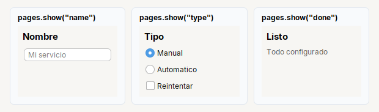

# Pages

Varias paginas **en el mismo lugar**, de las que se ve una a la vez: los pasos de un asistente, las vistas de la ventana principal.

| | |
|---|---|
| **Paquete** | `tessera.kit` |
| **Clase** | `Pages extends JPanel implements Styled<Pages>`, con `CardLayout` |
| **Se crea con** | `Pages.create()` |
| **Importar** | `import tessera.kit.Pages;` |

## Cuando usarlo

- Los pasos de un asistente.
- Las vistas de una ventana principal con menu lateral.

**Cuando no:** Para que el usuario elija la vista con pestanas usa `Tabs`; para dos alternativas pequenas, `Stack`.

## Lo que se puede hacer

Cada seccion muestra una cosa que se puede pedir, con la imagen de como queda y el codigo que la produce (el titulo de cada tarjeta de las imagenes es ese mismo codigo). En las imagenes, una caja de color (`zone(...)`) es solo una pieza dibujada y el borde punteado marca los limites de un contenedor: ver [como leer las imagenes](README.md#como-leer-las-imagenes).

### Una pagina a la vez



```java
final Pages pages = Pages.create()
    .page("name", namePanel)
    .page("type", typePanel)
    .page("done", donePanel);

pages.show("type");              // se ve esa; las demas quedan ocultas
```

`Pages` mide lo que la **pagina mas grande**: en la imagen las tres miden lo mismo aunque `name` tenga menos contenido, asi la ventana no cambia de tamano
entre un paso y otro.

### Dentro de un asistente


```java
Page.create()
    .top(Header.create("Nuevo servicio", "Paso 2 de 3"))
    .center(pages)
    .bottom(Footer.of(btnBack, btnNext))
```

El ejemplo completo esta en [Asistente de pasos](../../../guides/screens.md#asistente-de-pasos) y la logica de Atras / Siguiente en la
[receta del asistente](../../../guides/recipes.md#3-asistente-de-pasos).

### Pages, Tabs o Stack

| Si... | Usa |
|---|---|
| el **programa** decide que pantalla se ve (los pasos de un asistente, las vistas de la ventana principal) | `Pages` |
| el **usuario** decide cual ver | [`Tabs`](tabs.md) |
| cambia solo una pieza pequena dentro de una fila o un bloque | [`Stack`](stack.md) |

## Referencia

Varias paginas **en el mismo lugar**, de las que se ve una a la vez (pasos de un asistente, vistas de la ventana principal); usa
`CardLayout`.

```java
Pages pages = Pages.create().page("name", namePanel).page("type", typePanel);
pages.show("type");
```

## Ejemplos completos donde se usa

Pantallas completas y recetas que lo usan, para ver `Pages` dentro de una aplicacion real:

- [Asistente de pasos](../../../guides/screens.md#asistente-de-pasos)
- [3. Asistente de pasos](../../../guides/recipes.md#3-asistente-de-pasos)

## Errores comunes

- `pages.show("nombre")` con un nombre que no se agrego no hace nada.
- `Pages` mide lo que la **pagina mas grande**: la ventana no cambia de tamano entre paso y paso.

## Ver tambien

- [`Tabs`](tabs.md) · [`Stack`](stack.md) · [`Page`](page.md)
- [Referencia del kit](../README.md): ideas base y metodos comunes (`Styled`, `Clickable`, `Box`).
- [Contenedores](README.md): la tabla "que uso para cada cosa" y todos los contenedores.
- [Lo comun a los contenedores (`Box`)](box.md): `gap`, `padding`, `children`, tamano fijo y ocultar.
- [Como armar una pantalla](../../../guides/screens.md#pantallas-completas): pantallas completas que los combinan.
