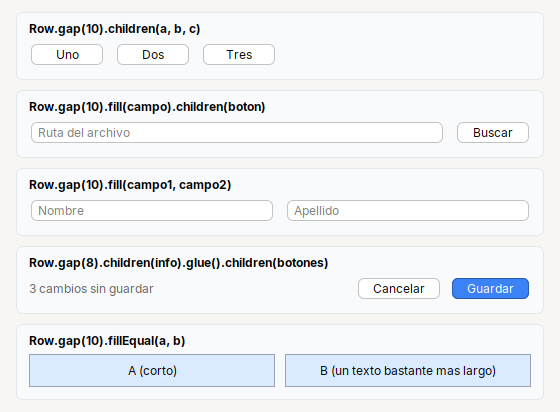
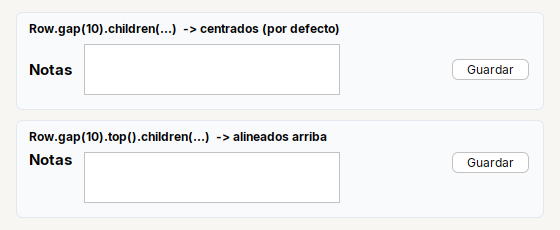

# Row

Pone sus hijos **en una fila**, de izquierda a derecha, cada uno con su ancho natural.

| | |
|---|---|
| **Paquete** | `tessera.kit` |
| **Clase** | `Row extends Box<Row>`: un `JPanel` transparente con MigLayout |
| **Se crea con** | `Row.gap(n)` · `Row.create()` |
| **Importar** | `import tessera.kit.Row;` |





## Cuando usarlo

- Un campo con su boton al lado (`fill`).
- Botones o texto pegados a la derecha (`glue`).
- Varios widgets uno junto a otro: las opciones de un grupo, una barra de acciones.
- Dos bloques lado a lado del mismo ancho (`fillEqual`).

**Cuando no:** Si necesitas que las columnas queden **alineadas entre filas**, usa `Form` (etiqueta y campo) o `Grid` (varias columnas).

## Referencia

Hijos **en una fila**, de izquierda a derecha, cada uno con su ancho natural, centrados en vertical.

| Metodo | Que hace |
|---|---|
| `Row.gap(n)` / `Row.create()` | fila con `n` px entre hijos / con 8 px |
| `.fill(Component...)` | hijos que ocupan el **ancho** que sobra (se reparte entre ellos) |
| `.fillBoth(Component...)` | hijos que ocupan el ancho **y el alto** que sobran (una tabla, un area de texto) |
| `.fillEqual(Component...)` | como `fillBoth`, y miden **siempre lo mismo de ancho** entre si (dos columnas lado a lado) |
| `.glue()` | hueco elastico: lo que se agregue despues queda pegado a la derecha |
| `.top()` / `.center()` | alineacion vertical de los hijos cuando no miden lo mismo (por defecto `center`) |

```java
Row.gap(10).fill(txtPath).children(btnBrowse)            // campo + boton
Row.gap(8).glue().children(btnCancel, btnOk)             // botones a la derecha
Row.gap(14).children(rbtnPrinter, rbtnIp, rbtnUsb)       // opciones una al lado de otra
```

`children(...)` agrega con el ancho natural, salvo que el hijo ya este marcado con `Kit.fill(...)` (ver [Utilidades](../README.md#utilidades-kit)).

## Errores comunes

- Un campo no se estira junto a su boton: falta `.fill(campo)`; con `.children(campo)` queda con su ancho natural.
- Los hijos quedan a la izquierda y quieres uno a la derecha: pon `.glue()` antes del que debe ir a la derecha.
- Dos bloques lado a lado miden distinto: usa `fillEqual(a, b)` en vez de `fill(a, b)`.

## Ver tambien

- [`Col`](col.md) · [`Form`](form.md) · [`Grid`](grid.md) · [`Stack`](stack.md) · [`Footer`](footer.md)
- [Referencia del kit](../README.md): ideas base y metodos comunes (`Styled`, `Clickable`, `Box`).
- [Guia visual de disposiciones](../../../guides/screens.md#guia-visual-de-disposiciones): cada contenedor con imagenes y pantallas completas.
