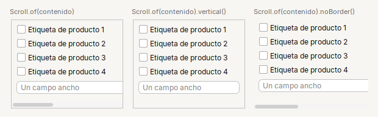

# Scroll

Contenedor con **barras de desplazamiento**. Dentro de un `Row` o un `Col` ocupa el espacio que sobra.

| | |
|---|---|
| **Paquete** | `tessera.kit` |
| **Clase** | `Scroll extends JScrollPane implements Styled<Scroll>` |
| **Se crea con** | `Scroll.of(componente)` |
| **Importar** | `import tessera.kit.Scroll;` |

## Cuando usarlo

- Envolver una `Table` (siempre).
- Un contenido largo: un formulario o una lista que puede no caber.
- Un area de texto.

## Lo que se puede hacer

Cada seccion muestra una cosa que se puede pedir, con la imagen de como queda y el codigo que la produce (el titulo de cada tarjeta de las imagenes es ese mismo codigo). En las imagenes, una caja de color (`zone(...)`) es solo una pieza dibujada y el borde punteado marca los limites de un contenedor: ver [como leer las imagenes](README.md#como-leer-las-imagenes).

### Los tres modos



```java
Scroll.of(content)                     // barras donde haga falta (aqui, tambien la horizontal)
Scroll.of(content).vertical()          // solo vertical: el contenido toma el ancho de la ventana
Scroll.of(content).noBorder()          // sin borde alrededor
```

Con `.vertical()` el campo ancho se encoge al ancho disponible en lugar de mostrar la barra horizontal; es lo que quieres para un formulario largo. Si el
contenido ya es desplazable por si mismo (una tabla, un area de texto), `.vertical()` lo deja como esta.

### Siempre con una tabla


```java
Scroll.of(table)
```

Una `Table` sin `Scroll` no muestra su encabezado. Dentro de un `Col` o un `Row`, un `Scroll` ya ocupa el espacio que sobra (no hace falta `fillBoth`).

## Referencia

Contenedor con barras de desplazamiento (`JScrollPane`). Dentro de un `Row` o `Col` ocupa el espacio que sobra.

| Metodo | Que hace |
|---|---|
| `Scroll.of(c)` | envuelve el componente |
| `.noBorder()` | sin borde alrededor |
| `.vertical()` | solo desplazamiento vertical: el contenido toma el ancho de la ventana (los textos largos se parten y las tarjetas no se salen por la derecha). Si el contenido ya es `Scrollable` (tabla, area de texto) se deja como esta |
| `.step(px)` | cuanto avanza la rueda del mouse |

```java
Scroll.of(table)
Scroll.of(content).noBorder().vertical()
```

## Ejemplos completos donde se usa

Pantallas completas y recetas que lo usan, para ver `Scroll` dentro de una aplicacion real:

- [Barra de herramientas, tabla y barra de estado](../../../guides/screens.md#barra-de-herramientas-tabla-y-barra-de-estado)
- [Lista y detalle](../../../guides/screens.md#lista-y-detalle)
- [Editor y consola](../../../guides/screens.md#editor-y-consola)
- [2. Lista y detalle](../../../guides/recipes.md#2-lista-y-detalle)
- [4. Pantalla de ajustes](../../../guides/recipes.md#4-pantalla-de-ajustes)
- [Busqueda, tabla y acciones](../../../guides/layout.md#busqueda-tabla-y-acciones)

## Errores comunes

- Una `Table` sin `Scroll` no muestra el encabezado.
- Con `.vertical()` el contenido toma el ancho de la ventana: si necesitas desplazamiento horizontal, no lo uses.
- Dentro de un `Col` o `Row` ya ocupa el espacio que sobra: no hace falta `fillBoth`.

## Ver tambien

- [`Table`](../widgets/table.md) · [`TextArea`](../widgets/textarea.md) · [`Col`](col.md)
- [Referencia del kit](../README.md): ideas base y metodos comunes (`Styled`, `Clickable`, `Box`).
- [Contenedores](README.md): la tabla "que uso para cada cosa" y todos los contenedores.
- [Lo comun a los contenedores (`Box`)](box.md): `gap`, `padding`, `children`, tamano fijo y ocultar.
- [Como armar una pantalla](../../../guides/screens.md#pantallas-completas): pantallas completas que los combinan.
