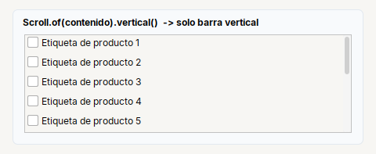

# Scroll

Contenedor con **barras de desplazamiento**. Dentro de un `Row` o un `Col` ocupa el espacio que sobra.

| | |
|---|---|
| **Paquete** | `tessera.kit` |
| **Clase** | `Scroll extends JScrollPane implements Styled<Scroll>` |
| **Se crea con** | `Scroll.of(componente)` |
| **Importar** | `import tessera.kit.Scroll;` |



## Cuando usarlo

- Envolver una `Table` (siempre).
- Un contenido largo: un formulario o una lista que puede no caber.
- Un area de texto.

## Referencia

Contenedor con barras de desplazamiento (`JScrollPane`). Dentro de un `Row` o `Col` ocupa el espacio que sobra.

| Metodo | Que hace |
|---|---|
| `Scroll.of(c)` | envuelve el componente |
| `.noBorder()` | sin borde alrededor |
| `.vertical()` | solo desplazamiento vertical: el contenido toma el ancho de la ventana (los textos largos se parten y las tarjetas no se salen por la derecha). Si el contenido ya es `Scrollable` (tabla, area de texto) se deja como esta |
| `.step(px)` | cuanto avanza la rueda del mouse |

```java
Scroll.of(table)
Scroll.of(content).noBorder().vertical()
```

## Errores comunes

- Una `Table` sin `Scroll` no muestra el encabezado.
- Con `.vertical()` el contenido toma el ancho de la ventana: si necesitas desplazamiento horizontal, no lo uses.
- Dentro de un `Col` o `Row` ya ocupa el espacio que sobra: no hace falta `fillBoth`.

## Ver tambien

- [`Table`](../widgets/table.md) · [`TextArea`](../widgets/textarea.md) · [`Col`](col.md)
- [Referencia del kit](../README.md): ideas base y metodos comunes (`Styled`, `Clickable`, `Box`).
- [Guia visual de disposiciones](../../../guides/screens.md#guia-visual-de-disposiciones): cada contenedor con imagenes y pantallas completas.
