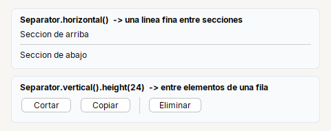

# Separator

**Linea fina** que separa secciones. Dentro de un `Col` ocupa todo el ancho.

| | |
|---|---|
| **Paquete** | `tessera.kit` |
| **Clase** | `Separator extends JSeparator implements Styled<Separator>` |
| **Se crea con** | `Separator.horizontal()` · `Separator.vertical()` |
| **Importar** | `import tessera.kit.Separator;` |

## Cuando usarlo

- Separar dos grupos de contenido.
- Separar acciones dentro de una fila.

## Referencia

`Separator.horizontal()` / `Separator.vertical()`: linea fina. Dentro de un `Col` ocupa todo el ancho.

## Errores comunes

- Un `Separator.vertical()` dentro de un `Row` necesita un alto: `Separator.vertical().height(24)`.

## Ver tambien

- [`Col`](col.md) · [`Row`](row.md) · [`Card`](card.md)
- [Referencia del kit](../README.md): ideas base y metodos comunes (`Styled`, `Clickable`, `Box`).
- [Guia visual de disposiciones](../../../guides/screens.md#guia-visual-de-disposiciones): cada contenedor con imagenes y pantallas completas.
