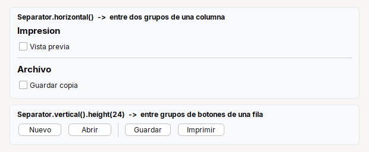

# Separator

**Linea fina** que separa secciones. Dentro de un `Col` ocupa todo el ancho.

| | |
|---|---|
| **Paquete** | `tessera.kit` |
| **Clase** | `Separator extends JSeparator implements Styled<Separator>` |
| **Se crea con** | `Separator.horizontal()` · `Separator.vertical()` |
| **Importar** | `import tessera.kit.Separator;` |

## Cuando usarlo

- Separar dos grupos de contenido.
- Separar acciones dentro de una fila.

## Lo que se puede hacer

Cada seccion muestra una cosa que se puede pedir, con la imagen de como queda y el codigo que la produce (el titulo de cada tarjeta de las imagenes es ese mismo codigo). En las imagenes, una caja de color (`zone(...)`) es solo una pieza dibujada y el borde punteado marca los limites de un contenedor: ver [como leer las imagenes](README.md#como-leer-las-imagenes).

### Entre grupos, en vertical y en horizontal



```java
Col.gap(8).children(lblPrint, chckPreview, Separator.horizontal(), lblFile, chckCopy)       // dentro de un Col ocupa todo el ancho

Row.gap(8).children(btnNew, btnOpen, Separator.vertical().height(24), btnSave, btnPrint)   // dentro de un Row necesita alto
```

Un `Separator.vertical()` dentro de un `Row` mide 0 de alto si no le das uno: `Separator.vertical().height(24)`.

## Referencia

`Separator.horizontal()` / `Separator.vertical()`: linea fina. Dentro de un `Col` ocupa todo el ancho.

## Errores comunes

- Un `Separator.vertical()` dentro de un `Row` necesita un alto: `Separator.vertical().height(24)`.

## Ver tambien

- [`Col`](col.md) · [`Row`](row.md) · [`Card`](card.md)
- [Referencia del kit](../README.md): ideas base y metodos comunes (`Styled`, `Clickable`, `Box`).
- [Contenedores](README.md): la tabla "que uso para cada cosa" y todos los contenedores.
- [Lo comun a los contenedores (`Box`)](box.md): `gap`, `padding`, `children`, tamano fijo y ocultar.
- [Como armar una pantalla](../../../guides/screens.md#pantallas-completas): pantallas completas que los combinan.
