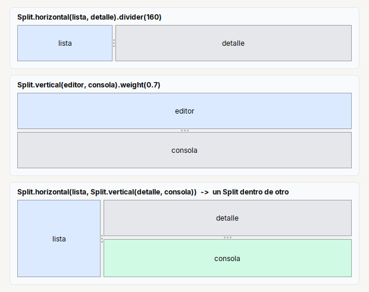
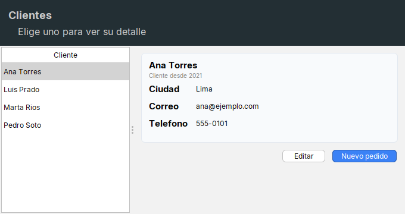

# Split

Dos zonas separadas por una **barra que se arrastra**. Dentro de un `Row` o un `Col` ocupa el espacio que sobra.

| | |
|---|---|
| **Paquete** | `tessera.kit` |
| **Clase** | `Split extends JSplitPane implements Styled<Split>` |
| **Se crea con** | `Split.horizontal(izq, der)` · `Split.vertical(arriba, abajo)` |
| **Importar** | `import tessera.kit.Split;` |

## Cuando usarlo

- Lista a la izquierda y detalle a la derecha.
- Editor arriba y consola abajo.

## Lo que se puede hacer

Cada seccion muestra una cosa que se puede pedir, con la imagen de como queda y el codigo que la produce (el titulo de cada tarjeta de las imagenes es ese mismo codigo). En las imagenes, una caja de color (`zone(...)`) es solo una pieza dibujada y el borde punteado marca los limites de un contenedor: ver [como leer las imagenes](README.md#como-leer-las-imagenes).

### Lado a lado, una sobre otra y uno dentro de otro



```java
Split.horizontal(list, details).divider(160)                      // lado a lado, con la barra en 160 px
Split.vertical(editor, console).weight(0.7)                       // una sobre otra; el editor se queda con el 70% del extra
Split.horizontal(list, Split.vertical(details, console))          // un Split dentro de otro
    .divider(140)
```

### `divider` y `weight`

| Metodo | Que decide |
|---|---|
| `.divider(px)` | donde esta la barra **al abrir** la ventana |
| `.weight(0..1)` | cuanto del espacio **extra** se queda la primera zona cuando la ventana crece o se achica (0.7 = el 70%) |

El usuario puede arrastrar la barra en cualquier momento: `divider` es solo la posicion inicial.

### En una pantalla de lista y detalle



```java
Split.horizontal(
    Scroll.of(list).noBorder(),
    Col.gap(10).padding(12).children(detailCard, Row.gap(8).glue().children(btnEdit, btnNew)))
    .divider(220)
```

El ejemplo completo esta en [Lista y detalle](../../../guides/screens.md#lista-y-detalle) y la logica de seleccionar y actualizar el detalle en la
[receta](../../../guides/recipes.md#2-lista-y-detalle).

## Referencia

Dos zonas separadas por una **barra que se arrastra** (`JSplitPane`). Ocupa el espacio que sobra.

| Metodo | Que hace |
|---|---|
| `Split.horizontal(izq, der)` | una zona a la izquierda y otra a la derecha |
| `Split.vertical(arriba, abajo)` | una zona arriba y otra abajo |
| `.divider(px)` | posicion inicial de la barra |
| `.weight(0..1)` | cuanto del espacio extra se queda la primera zona al cambiar el tamano |

```java
Split.horizontal(list, details).divider(260)
Split.vertical(editor, console).weight(0.7)
```

## Ejemplos completos donde se usa

Pantallas completas y recetas que lo usan, para ver `Split` dentro de una aplicacion real:

- [Lista y detalle](../../../guides/screens.md#lista-y-detalle)
- [Editor y consola](../../../guides/screens.md#editor-y-consola)
- [2. Lista y detalle](../../../guides/recipes.md#2-lista-y-detalle)

## Errores comunes

- `divider(px)` es la posicion **inicial** de la barra; `weight(0..1)` decide quien se queda con el espacio extra al cambiar el tamano.

## Ver tambien

- [`Tabs`](tabs.md) · [`Page`](page.md) · [`Scroll`](scroll.md)
- [Referencia del kit](../README.md): ideas base y metodos comunes (`Styled`, `Clickable`, `Box`).
- [Contenedores](README.md): la tabla "que uso para cada cosa" y todos los contenedores.
- [Lo comun a los contenedores (`Box`)](box.md): `gap`, `padding`, `children`, tamano fijo y ocultar.
- [Como armar una pantalla](../../../guides/screens.md#pantallas-completas): pantallas completas que los combinan.
