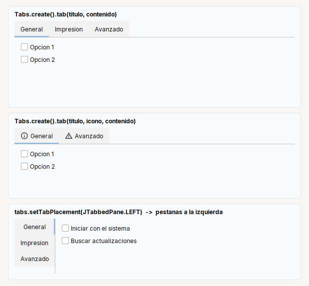

# Tabs

**Pestanas**: el usuario elige cual contenido ver. Dentro de un `Row` o un `Col` ocupa el espacio que sobra.

| | |
|---|---|
| **Paquete** | `tessera.kit` |
| **Clase** | `Tabs extends JTabbedPane implements Styled<Tabs>` |
| **Se crea con** | `Tabs.create()` |
| **Importar** | `import tessera.kit.Tabs;` |

## Cuando usarlo

- Una pantalla de ajustes con varias secciones.
- Contenidos largos que el usuario quiere recorrer por separado.

**Cuando no:** Para pasos que el programa controla usa `Pages`.

## Lo que se puede hacer

Cada seccion muestra una cosa que se puede pedir, con la imagen de como queda y el codigo que la produce (el titulo de cada tarjeta de las imagenes es ese mismo codigo). En las imagenes, una caja de color (`zone(...)`) es solo una pieza dibujada y el borde punteado marca los limites de un contenedor: ver [como leer las imagenes](README.md#como-leer-las-imagenes).

### Con titulo, con icono y a la izquierda



```java
Tabs.create()
    .tab("General", general)
    .tab("Impresion", printing)
    .tab("Avanzado", advanced)
```

```java
Tabs.create()                                                                   // con icono
    .tab("General", Icons.of("tessera/img/info.svg", 16), general)
    .tab("Avanzado", Icons.of("tessera/img/warning_amber.svg", 16), advanced)
```

```java
final Tabs tabs = Tabs.create().tab("General", general).tab("Avanzado", advanced);
tabs.setTabPlacement(JTabbedPane.LEFT);                                         // pestanas a la izquierda
```

`Tabs` **es** un `JTabbedPane`: lo que no tiene metodo propio (donde van las pestanas, cual esta elegida, `setSelectedIndex`...) se hace con el de Swing.

### El contenido de cada pestana

Cada pestana pide **un componente**: pon un `Col` con `padding` en cada una para que el contenido no quede pegado al borde.

```java
Tabs.create()
    .tab("General", Col.gap(6).padding(10).children(Check.of("Opcion 1").selected(true), Check.of("Opcion 2")))
    .tab("Avanzado", Col.gap(6).padding(10).children(Check.of("Opcion avanzada")))
```

Dentro de un `Col` o un `Row` ocupa el espacio que sobra: no hace falta `fillBoth`. Un ejemplo completo, con tres pestanas de ajustes, esta en
[Ajustes con pestanas](../../../guides/screens.md#ajustes-con-pestanas).

## Referencia

Pestanas (`JTabbedPane`). Ocupa el espacio que sobra.

```java
Tabs.create().tab("General", general).tab("Avanzado", iconAdvanced, advanced)
```

Metodos: `.tab(titulo, contenido)` y `.tab(titulo, icono, contenido)`.

## Ejemplos completos donde se usa

Pantallas completas y recetas que lo usan, para ver `Tabs` dentro de una aplicacion real:

- [Ajustes con pestanas](../../../guides/screens.md#ajustes-con-pestanas)

## Errores comunes

- Cada pestana pide su propio contenedor: pon un `Col` con `padding` en cada una.

## Ver tambien

- [`Pages`](pages.md) · [`Split`](split.md) · [`Card`](card.md)
- [Referencia del kit](../README.md): ideas base y metodos comunes (`Styled`, `Clickable`, `Box`).
- [Contenedores](README.md): la tabla "que uso para cada cosa" y todos los contenedores.
- [Lo comun a los contenedores (`Box`)](box.md): `gap`, `padding`, `children`, tamano fijo y ocultar.
- [Como armar una pantalla](../../../guides/screens.md#pantallas-completas): pantallas completas que los combinan.
