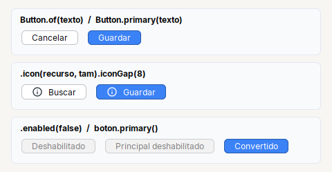
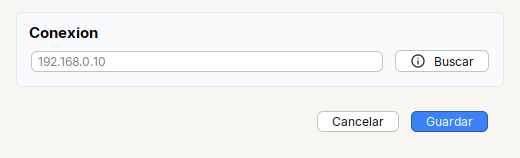

# Button

Boton con estilos y eventos encadenables. `Button.primary` marca la accion que se espera del usuario.

| | |
|---|---|
| **Paquete** | `tessera.kit` |
| **Clase** | `Button extends JButton implements Clickable<Button>` |
| **Se crea con** | `Button.of(txt)` · `Button.primary(txt)` |
| **Importar** | `import tessera.kit.Button;` |



**En una frase:** boton con su **estilo y su accion en la misma cadena**; `Button.primary` marca la accion que se espera del usuario.

**Reemplaza, en Swing puro:** `new JButton(texto)` + `addActionListener(...)` + `setIcon(...)` y, para el boton azul, los colores de FlatLaf a mano (`Kit.makePrimary`).

**Cual elegir entre varios widgets parecidos:** [Que widget uso](../../../guides/widgets.md#ejecutar-button-o-menubutton).

## Cuando usarlo

- Cualquier accion: guardar, cancelar, buscar.
- La accion principal de una pantalla (`primary`).

**Cuando no:** Para un si/no que se aplica al instante usa `Switch`; para un modo de vista, `Toggle`.

## Ejemplo: un campo con su boton "Buscar" y el pie del dialogo



```java
final Card connection = Card.create("Conexion").children(
    Row.gap(8).fill(Input.text().placeholder("192.168.0.10")).children(
        Button.of("Buscar").icon("tessera/img/info.svg", 16).iconGap(8)));

final Row footer = Footer.of(
    Button.of("Cancelar").onClick(() -> { }),
    Button.primary("Guardar").onClick(() -> { }));          // un solo primary por pantalla: el ultimo de la derecha
```

1. `Row.gap(8).fill(campo).children(boton)`: el campo ocupa el ancho que sobra y el boton se queda con el suyo.
2. `.icon(recurso, tam).iconGap(px)` pone un icono antes del texto.
3. `Footer.of(...)` alinea los botones **abajo a la derecha**; el `primary` va el **ultimo** y solo hay uno por pantalla.

## Referencia

`Button.of(txt)`: boton normal. `Button.primary(txt)` o `boton.primary()`: boton **principal** (color `Kit.PRIMARY`, texto blanco), la accion
que se espera del usuario. Hereda [`Clickable`](../README.md#clickablet--button-check-radio-toggle-switch).

| Metodo | Que hace |
|---|---|
| `.onClick(Runnable)` / `.onClick(ActionListener)` | accion cuando el **usuario** hace clic. **No** corre si cambias el estado por codigo |
| `.icon(recurso, tam)` / `.icon(Icon)` | icono (SVG o imagen del classpath) |
| `.iconGap(px)` | espacio entre el icono y el texto |
| `.selected(boolean)` | estado inicial |
| `.variant(Variant)` / `.outline(Variant)` | relleno / solo borde con el color de la variante |

### Variantes de color (como Bootstrap)

`Button.secondary / accent / success / danger / warning / info / inverse(txt)`, `Button.of(Variant, txt)` y `Button.outline(Variant, txt)` (solo borde; se rellena al pasar el mouse).
El texto va blanco, u oscuro si el color es claro (amarillo, celeste). `primary`, `accent` e `inverse` siguen al tema; los demas se cambian con
`Theme.builder().success("#2E7D32").danger("#C62828")...` (ver [Theme](../../theme/theme.md)).

```java
Button.success("Aprobar")
Button.danger("Eliminar")
Button.outline(Variant.DANGER, "Eliminar")
```

Ademas los de [`Styled`](../README.md#styledt--todos-los-widgets-y-contenedores) (`tip`, `bold`, `color`, `enabled`...), y los de Swing de siempre (`isSelected()`, `setSelected(b)`, `addItemListener(...)`).

| Para... | Hacer |
|---|---|
| un boton que abre un menu | [`MenuButton`](menubutton.md) (acciones), [`ChoiceButton`](choicebutton.md) (elegir una) o [`MultiChoiceButton`](multichoicebutton.md) (marcar varias) |
| los botones de un dialogo | [`Footer.of(cancelar, guardar)`](../containers/footer.md): abajo a la derecha |
| un boton azul ya creado | `Kit.makePrimary(boton)` |

```java
Button.primary("Guardar").onClick(e -> save())
Button.of("Buscar").icon("app/img/search.svg", 16).iconGap(8)
```

## Errores comunes

- Dentro de un `Col` un boton no se estira: usa `.fill(boton)`.
- Convencion: un solo `primary` por pantalla, el **ultimo** de la derecha.

## Ver tambien

- [`Footer`](../containers/footer.md) · [`Check`](check.md) · [`Switch`](switch.md) · [`Toggle`](toggle.md)
- [Referencia del kit](../README.md): ideas base y metodos comunes (`Styled`, `Clickable`, `Box`).
