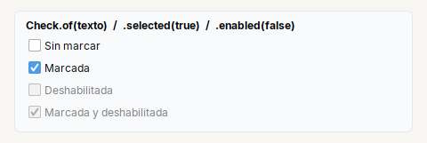
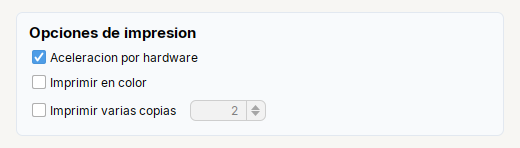

# Check

**Casilla de verificacion** (`JCheckBox`).

| | |
|---|---|
| **Paquete** | `tessera.kit` |
| **Clase** | `Check extends JCheckBox implements Clickable<Check>` |
| **Se crea con** | `Check.of(txt)` |
| **Importar** | `import tessera.kit.Check;` |



**En una frase:** casilla que se **marca o desmarca**; lo elegido se guarda despues (con un boton Guardar), asi que la pantalla todavia se puede cancelar.

**Reemplaza, en Swing puro:** `new JCheckBox(texto)` + `setSelected(...)` + `isSelected()` + un `ItemListener` por casilla que afecta a otro control.

**Cual elegir entre varios widgets parecidos:** [Que widget uso](../../../guides/widgets.md#activar-o-desactivar-check-switch-o-toggle).

## Cuando usarlo

- Una opcion que se activa o desactiva y se guarda despues.
- Varias opciones independientes.

**Cuando no:** Para opciones excluyentes usa `Radio`; para un si/no inmediato, `Switch`.

## Ejemplo: opciones independientes y una casilla que habilita otro control



```java
final Spinner spnCopies = Spinner.integer(2, 1, 99, 1).width(80);
final Check chkCopies = Check.of("Imprimir varias copias").selected(true);
chkCopies.addItemListener(e -> spnCopies.setEnabled(chkCopies.isSelected()));
chkCopies.setSelected(false);       // por codigo: el ItemListener corre y el Spinner se deshabilita (onClick no)

final Card options = Card.create("Opciones de impresion").children(
    Check.of("Aceleracion por hardware").selected(true),
    Check.of("Imprimir en color"),
    Row.gap(10).children(chkCopies, spnCopies));
```

1. `Check.of(txt).selected(true)` crea la casilla con su estado inicial.
2. El `ItemListener` habilita o deshabilita el `Spinner` segun la casilla. Corre con los clics **y** con `setSelected(...)` por codigo (arriba, `setSelected(false)` lo deshabilita al armar la pantalla).
3. `onClick(...)` en cambio solo atiende los **clics del usuario**: para reaccionar a cambios por codigo usa `addItemListener`.

## Referencia

`Check.of(txt)`: casilla de verificacion (`JCheckBox`). Hereda [`Clickable`](../README.md#clickablet--button-check-radio-toggle-switch).

| Metodo | Que hace |
|---|---|
| `.onClick(Runnable)` / `.onClick(ActionListener)` | accion cuando el **usuario** hace clic. **No** corre si cambias el estado por codigo |
| `.icon(recurso, tam)` / `.icon(Icon)` | icono (SVG o imagen del classpath) |
| `.iconGap(px)` | espacio entre el icono y el texto |
| `.selected(boolean)` | estado inicial |

Ademas los de [`Styled`](../README.md#styledt--todos-los-widgets-y-contenedores) (`tip`, `bold`, `color`, `enabled`...), y los de Swing de siempre (`isSelected()`, `setSelected(b)`, `addItemListener(...)`).

**Reaccionar a un cambio:** `onClick` solo atiende al usuario. Si la pantalla tambien marca la casilla por codigo (al cargar un modelo, por ejemplo)
y algo debe seguirla, usa un `ItemListener`, registrado **despues** de armar la pantalla:

```java
chkCopies.addItemListener(e -> spnCopies.setEnabled(chkCopies.isSelected()));
```

## Errores comunes

- `onClick` solo atiende clics del usuario, no `setSelected(true)` por codigo: para eso usa un `ItemListener` registrado **despues** de armar la pantalla.

## Ver tambien

- [`Radio`](radio.md) · [`Switch`](switch.md) · [`Button`](button.md)
- [Referencia del kit](../README.md): ideas base y metodos comunes (`Styled`, `Clickable`, `Box`).
