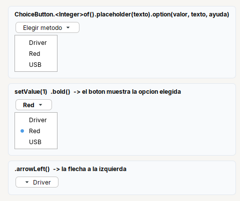

# ChoiceButton

**Boton que abre un menu para elegir una opcion**: el boton muestra la elegida.

| | |
|---|---|
| **Paquete** | `tessera.kit` |
| **Clase** | `ChoiceButton<T> extends PopupButton<ChoiceButton<T>>` (un `JButton`) |
| **Se crea con** | `ChoiceButton.<T>of()` |
| **Importar** | `import tessera.kit.ChoiceButton;` |



## Cuando usarlo

- Elegir **una** opcion de pocas (2 a 8) cuando cada una merece una **ayuda breve** o el espacio es poco: el tipo de servicio, el metodo de impresion.
- Cuando el resto de la pantalla depende de la opcion elegida: `onChange` avisa con el valor.

**Cuando no:** para una lista larga o editable usa [`Combo`](combo.md); para 2 a 5 opciones siempre visibles, [`Radio`](radio.md); para marcar varias, [`MultiChoiceButton`](multichoicebutton.md); si el clic solo corre una accion y no queda nada elegido, [`MenuButton`](menubutton.md).

## Referencia

Es un `JButton`: se puede pasar a `Form.row(...)`, a `ErrorProvider.setError(...)`, etc. Los metodos de [`Styled`](../README.md#styledt--todos-los-widgets-y-contenedores) (`bold`, `fontSize`, `tip`...) devuelven el propio `ChoiceButton`. Los de [`PopupButton`](menubutton.md#metodos-de-popupbutton) (`color`, `arrowLeft`, `noArrow`, `icon`) tambien.

| Metodo | Que hace |
|---|---|
| `ChoiceButton.<T>of()` | boton sin opciones (hay que escribir el tipo: `ChoiceButton.<Integer>of()`) |
| `.placeholder(texto)` | texto del boton mientras no hay nada elegido |
| `.option(valor, texto)` | agrega una opcion: su valor y el texto del menu (y del boton al elegirla) |
| `.option(valor, texto, ayuda)` | igual, con una ayuda breve que sale al dejar el mouse sobre la opcion |
| `.optionEnabled(valor, habilitada)` | habilita o deshabilita una opcion |
| `.optionEnabled(valor, habilitada, ayuda)` | igual; deshabilitada, el menu muestra esa ayuda en lugar de la suya (ej. "No disponible en este equipo") |
| `.onChange(Consumer<T>)` | cada vez que cambia la opcion, con su valor (`null` si se limpio). **Tambien si se elige por codigo** |
| `.onChange(Runnable)` | lo mismo, sin recibir el valor |
| `getValue()` / `getValue(porDefecto)` | valor de la opcion elegida (`null` o el valor por defecto si no hay ninguna) |
| `setValue(valor)` | elige esa opcion (`null` limpia la eleccion; un valor que no existe se ignora) |
| `hasValue()` | hay una opcion elegida |
| `is(valor)` | la opcion elegida es esa |
| `getValueTip()` | la ayuda de la opcion elegida: sirve para la linea de ayuda junto al selector |

Con un `enum` el resto del codigo deja de depender de cada opcion por separado:

```java
private enum Method { DRIVER, NETWORK, USB }

private final ChoiceButton<Method> method = ChoiceButton.<Method>of()
    .placeholder("Elegir metodo")
    .option(Method.DRIVER, "Driver", "Imprime con el driver del sistema")
    .option(Method.NETWORK, "Red", "Imprime por IP")
    .option(Method.USB, "USB", "Imprime directo al puerto USB")
    .bold().color(Kit.MUTED)
    .onChange(this::onMethodChanged);

private void onMethodChanged(Method value) {
  txtIp.setVisible(value == Method.NETWORK);
  lblHint.setText(method.getValueTip());
}

// al cargar un modelo:  method.setValue(model.method);
// al guardarlo:         model.method = method.getValue(Method.DRIVER);
```

## Errores comunes

- `ChoiceButton.of()` sin el tipo (`ChoiceButton.of().placeholder(...)`) da un `ChoiceButton<Object>` y la cadena no compila contra `ChoiceButton<Integer>`: escribe `ChoiceButton.<Integer>of()`.
- `onChange` solo avisa cuando la opcion **cambia**: elegir la que ya esta elegida no lo dispara. Registralo **despues** de elegir el valor inicial si no quieres que corra con el.
- No uses `addActionListener` para enterarte de la eleccion: se dispara al **abrir** el menu, no al elegir. Usa `onChange`.

## Ver tambien

- [`MultiChoiceButton`](multichoicebutton.md) · [`MenuButton`](menubutton.md) · [`Combo`](combo.md) · [`Radio`](radio.md)
- [Referencia del kit](../README.md): ideas base y metodos comunes (`Styled`, `Clickable`, `Box`).
