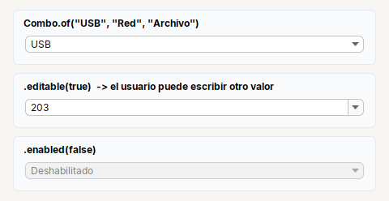
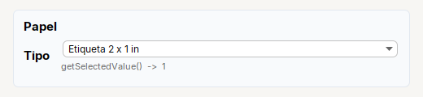

# Combo

**Lista desplegable** (`JComboBox<T>`).

| | |
|---|---|
| **Paquete** | `tessera.kit` |
| **Clase** | `Combo<T> extends JComboBox<T> implements Styled<Combo<T>>` |
| **Se crea con** | `Combo.of(items...)` · `Combo.empty()` |
| **Importar** | `import tessera.kit.Combo;` |



**En una frase:** **lista desplegable**: el usuario ve una etiqueta y el codigo recibe un valor.

**Reemplaza, en Swing puro:** `new JComboBox<>()` + `DefaultComboBoxModel` + un renderer (o un `toString()`) para mostrar un texto y guardar otro valor.

**Cual elegir entre varios widgets parecidos:** [Que widget uso](../../../guides/widgets.md#elegir-una-opcion-radio-combo-choicebutton-o-togglegroup).

## Cuando usarlo

- Elegir una opcion de varias (5 o mas), o cuando el espacio es poco.

**Cuando no:** Para 2 a 5 opciones visibles a la vez usa `Radio`.

## Ejemplo: un combo con etiqueta visible y valor real



```java
final Combo<ComboItem<Integer>> cbPaper = Combo.empty();
ComboItem.setupModel(cbPaper, ComboItem.itemsOf(
    new ComboItem<>("Etiqueta 4 x 6 in", 0),
    new ComboItem<>("Etiqueta 2 x 1 in", 1),
    new ComboItem<>("Papel continuo", 2)));
final Label lblValue = Label.muted("").small();
cbPaper.addActionListener(e -> lblValue.setText("getSelectedValue()  ->  " + ComboItem.getSelectedValue(cbPaper)));
cbPaper.setSelectedIndex(1);                                // el combo muestra el texto; el codigo recibe el valor

final Card paper = Card.create("Papel").children(Form.gap(6).row("Tipo", Col.gap(2).children(cbPaper, lblValue)));
```

1. `ComboItem` junta la **etiqueta** que ve el usuario con el **valor** que usa el codigo; `ComboItem.setupModel(...)` llena el combo.
2. `ComboItem.getSelectedValue(combo)` devuelve el valor (un `Integer` aqui), no el texto.
3. Para elegir una de **pocas** opciones con una ayuda cada una, [`ChoiceButton`](choicebutton.md) ocupa menos espacio y trae el valor listo.

## Referencia

Lista desplegable (`JComboBox<T>`).

| Metodo | Que hace |
|---|---|
| `Combo.of(items...)` | con esos elementos |
| `Combo.empty()` | vacio, se llena despues (con un `ComboItem.Binder`, por ejemplo) |
| `.onChange(Runnable)` | cada vez que se elige un elemento (tambien si se elige por codigo) |
| `.maxRows(n)` | cuantos elementos se ven a la vez al desplegar |
| `.editable(boolean)` | el usuario puede escribir un valor que no esta en la lista |

Para mostrar una etiqueta y guardar otro valor (un enum, un id), usa [`ComboItem`](../../components/lists-and-combos.md#comboitem).

## Errores comunes

- `onChange` tambien se dispara al elegir por codigo y al llenar el combo: registralo **despues** de llenarlo y elegir su valor inicial.
- Para mostrar un texto y guardar otro valor (un enum, un id) usa `ComboItem`.

## Ver tambien

- [`Radio`](radio.md) · [`ComboItem`](../../components/lists-and-combos.md#comboitem) · [`Input`](input.md)
- [Referencia del kit](../README.md): ideas base y metodos comunes (`Styled`, `Clickable`, `Box`).
