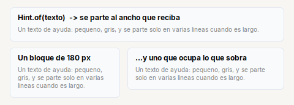
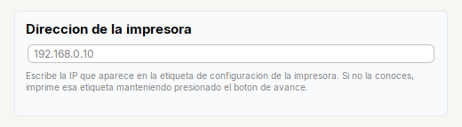

# Hint

Texto de ayuda: **pequeno, gris, y se parte en lineas** al ancho que reciba.

| | |
|---|---|
| **Paquete** | `tessera.kit` |
| **Clase** | `Hint extends JLabel implements Styled<Hint>` (no es un `Label`) |
| **Se crea con** | `Hint.of(txt)` · `Hint.ofHtml(txt)` |
| **Importar** | `import tessera.kit.Hint;` |



**En una frase:** ayuda **pequena y gris** que se parte en lineas al ancho que reciba, para explicar un campo o un bloque.

**Reemplaza, en Swing puro:** un `JLabel` con `<html>` y un ancho fijo puesto a ojo para que el texto largo no se salga.

**Cual elegir entre varios widgets parecidos:** [Que widget uso](../../../guides/widgets.md#mostrar-texto-label-o-hint).

## Cuando usarlo

- La linea de ayuda bajo un campo o un bloque.
- Un texto explicativo largo dentro de un `Card` (`Card.subtitle(..)` lo usa).

**Cuando no:** Para un texto corto y normal usa `Label`.

## Ejemplo: la ayuda de un campo, partida al ancho de la tarjeta



```java
final Card address = Card.create("Direccion de la impresora").children(
    Input.text().placeholder("192.168.0.10"),
    Hint.of("Escribe la IP que aparece en la etiqueta de configuracion de la impresora. "
        + "Si no la conoces, imprime esa etiqueta manteniendo presionado el boton de avance."));
```

1. No hay que poner saltos de linea ni un ancho fijo: el texto se parte solo al ancho de la tarjeta (y de nuevo si la ventana cambia).
2. Va **debajo** del campo al que explica, dentro del mismo `Card` o `Col`.
3. `Hint` es un `JLabel` pero **no** un `Label`: para un texto corto y normal usa `Label`.

## Referencia

Texto de ayuda: pequeno, gris, y **se parte en lineas** al ancho que le toque. Extiende `JLabel`, **no** `Label` (son tipos distintos).

| Metodo | Que hace |
|---|---|
| `Hint.of(txt)` | ayuda de texto |
| `Hint.ofHtml(txt)` | igual, para un texto que ya viene en `<html>...</html>` (quita esas marcas) |
| `.width(px)` | el ancho que **pide** (325 por defecto): lo respetan los contenedores que dan a cada hijo su tamano preferido (`pack()`, `FlowLayout`); en `Col`, `Card`, `Form` o `Row` se estira al ancho disponible |
| `.html(txt)` | cambia el texto despues |

El texto se parte al ancho **real** que reciba el `Hint`. El texto se mete dentro de `<html>`: un `<` o un `&` sueltos se interpretan como HTML; si viene de un usuario o del sistema, escapalo.

## Errores comunes

- `.width(px)` es el ancho que el `Hint` **pide**, no un limite: dentro de `Col`, `Card`, `Form` o `Row` se estira al ancho disponible y parte el texto ahi.

## Ver tambien

- [`Label`](label.md) · [`Card`](../containers/card.md) · [`Form`](../containers/form.md)
- [Referencia del kit](../README.md): ideas base y metodos comunes (`Styled`, `Clickable`, `Box`).
