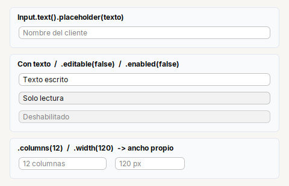
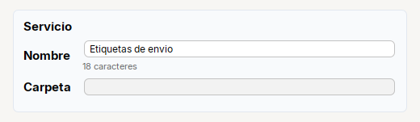

# Input

**Campo de texto** de una linea. Con `Input.password()` y `Input.area(filas)` salen los otros dos tipos de entrada.

| | |
|---|---|
| **Paquete** | `tessera.kit` |
| **Clase** | `Input extends JTextField implements Styled<Input>` |
| **Se crea con** | `Input.text()` |
| **Importar** | `import tessera.kit.Input;` |



**En una frase:** campo de **una linea** de texto, con placeholder y eventos en la misma cadena.

**Reemplaza, en Swing puro:** `new JTextField()` + un `DocumentListener` (tres metodos) para saber cuando cambia + un placeholder propio.

**Cual elegir entre varios widgets parecidos:** [Que widget uso](../../../guides/widgets.md#escribir-input-password-textarea-o-spinner).

## Cuando usarlo

- Cualquier dato de texto de una linea: nombre, ruta, direccion.

**Cuando no:** Para claves usa `Password`; para varias lineas, `TextArea`; para elegir de una lista, `Combo`.

## Ejemplo: un campo con contador de caracteres y otro de solo lectura



```java
final Label lblCount = Label.muted("").small();
final Input txtName = Input.text().placeholder("Nombre del servicio");
txtName.onChange(() -> lblCount.setText(txtName.getText().length() + " caracteres"));
txtName.setText("Etiquetas de envio");                      // onChange tambien corre con setText

final Card service = Card.create("Servicio").children(
    Form.gap(6)
        .row("Nombre", Col.gap(2).children(txtName, lblCount))     // el contador va justo debajo del campo
        .row("Carpeta", Input.text().editable(false)));
```

1. `placeholder(...)` muestra el texto gris mientras el campo esta vacio.
2. `onChange(...)` corre con cada cambio del contenido, del usuario **o por codigo** (`setText`): por eso se registra antes de dar el valor inicial.
3. `.editable(false)` deja un campo que solo muestra (una ruta que se elige con un boton).
4. Dentro de un `Form`, `Col.gap(2).children(campo, ayuda)` pone la ayuda justo debajo del campo. (`Form.field(...)` solo vale como **ultima** fila.)

## Referencia

Campo de texto de una linea (`JTextField`). Con `Input.password()` y `Input.area(filas)` salen los otros dos tipos.

| Metodo | Que hace |
|---|---|
| `Input.text()` | campo de texto normal |
| `.placeholder(txt)` | texto gris mientras el campo esta vacio |
| `.columns(n)` | ancho preferido en caracteres |
| `.editable(boolean)` | permitir o no escribir |
| `.onChange(Runnable)` | cada vez que cambia el contenido (por el usuario **o por codigo**) |
| `.onEnter(ActionListener)` | al presionar Enter |

## Errores comunes

- `onChange` tambien se dispara cuando el texto cambia **por codigo** (`setText`): registralo despues de dar el valor inicial.

## Ver tambien

- [`Password`](password.md) · [`TextArea`](textarea.md) · [`Form`](../containers/form.md) · [`Combo`](combo.md)
- [Referencia del kit](../README.md): ideas base y metodos comunes (`Styled`, `Clickable`, `Box`).
