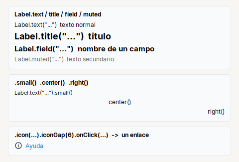
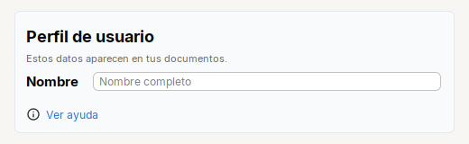
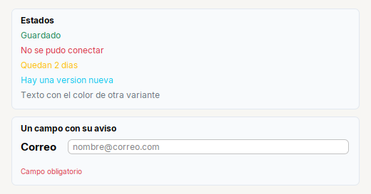

# Label

Etiqueta de texto con **estilos listos**: titulo, nombre de campo, texto secundario y texto normal. Tambien sirve como enlace.

| | |
|---|---|
| **Paquete** | `tessera.kit` |
| **Clase** | `Label extends JLabel implements Styled<Label>` |
| **Se crea con** | `Label.text(txt)` · `Label.title(txt)` · `Label.field(txt)` · `Label.muted(txt)` |
| **Importar** | `import tessera.kit.Label;` |



**En una frase:** texto de la pantalla con el **estilo listo**: titulo, nombre de campo, texto secundario o texto normal. Con `.onClick(...)` se vuelve un enlace.

**Reemplaza, en Swing puro:** `new JLabel(texto)` + `setFont(...)` + `setForeground(...)` + `setBorder(...)` en cada pantalla, y un `MouseListener` para el enlace.

**Cual elegir entre varios widgets parecidos:** [Que widget uso](../../../guides/widgets.md#mostrar-texto-label-o-hint).

## Cuando usarlo

- Cualquier texto de la pantalla.
- Un enlace (`.onClick(...)`).
- El nombre de un campo en un `Form` (se crea solo con `.row("Nombre", campo)`).

**Cuando no:** Para ayudas largas que deben partirse en lineas usa `Hint`.

## Ejemplo: un bloque de perfil: titulo, ayuda, campo y enlace



```java
final Card profile = Card.create().children(
    Label.title("Perfil de usuario"),
    Label.muted("Estos datos aparecen en tus documentos.").small(),
    Form.create().row("Nombre", Input.text().placeholder("Nombre completo")),
    Label.text("Ver ayuda").icon("tessera/img/info.svg", 16).iconGap(6).color(Theme.accent())
        .onClick(() -> { }));                   // un enlace: cursor de mano y una accion
```

1. `Label.title(...)` y `Label.muted(...).small()` arman el encabezado: el titulo y, debajo, su ayuda en gris.
2. En el `Form`, `.row("Nombre", campo)` crea la etiqueta del campo sola, con el estilo de `Label.field`.
3. `.onClick(...)` convierte el texto en un **enlace**: cursor de mano y una accion al hacer clic.

## Referencia

Etiqueta de texto (`JLabel`).

| Fabrica | Estilo |
|---|---|
| `Label.text(txt)` | texto normal |
| `Label.title(txt)` | titulo: negrita, 18 |
| `Label.field(txt)` | nombre de un campo: negrita, 15 |
| `Label.muted(txt)` | texto secundario: gris (`Kit.MUTED`) |
| `Label.primary / accent / secondary / success / danger / warning / info / light / dark(txt)` | texto del color de esa [`Variant`](../../theme/theme.md) (como Bootstrap) |

### Ejemplo: variantes de color



```java
final Card states = Card.section("Estados").children(
    Label.success("Guardado"),
    Label.danger("No se pudo conectar"),
    Label.warning("Quedan 2 dias"),
    Label.info("Hay una version nueva"),
    Label.text("Texto con el color de otra variante").variant(Variant.SECONDARY));

final Card field = Card.section("Un campo con su aviso").children(
    Form.create().row("Correo", Input.text().placeholder("nombre@correo.com")),
    Hint.of("Campo obligatorio").variant(Variant.DANGER));
```
`import tessera.theme.Variant;`. `Hint` y `Toggle` tambien aceptan `.variant(v)`.

| Metodo | Que hace |
|---|---|
| `.variant(Variant)` | el texto toma el color de la variante |
| `.icon(recurso, tam)` / `.icon(Icon)` | icono |
| `.iconGap(px)` | espacio entre icono y texto |
| `.small()` | un punto mas pequena que el texto normal |
| `.center()` / `.right()` | alineacion horizontal del texto |
| `.padding(arriba, izq, abajo, der)` | margen alrededor del texto |
| `.onClick(Runnable)` | la etiqueta se comporta como un **enlace**: cursor de mano y una accion al hacer clic |

```java
Label.text("Ayuda").icon("app/img/help_blue.svg", 16).onClick(this::openHelp)
```

## Errores comunes

- `Hint` **no** es un `Label`: son tipos distintos (los dos extienden `JLabel`).
- `.fontSize(n)` ya escala con el zoom: no multipliques tu mismo.

## Ver tambien

- [`Hint`](hint.md) · [`Form`](../containers/form.md) · [`Button`](button.md)
- [Referencia del kit](../README.md): ideas base y metodos comunes (`Styled`, `Clickable`, `Box`).
