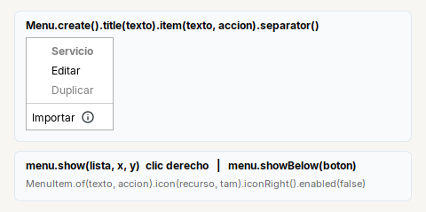

# Menu

**Menu emergente de acciones**, con o sin boton: se abre debajo de un componente o donde se haga clic (el clic derecho de una lista).

| | |
|---|---|
| **Paquete** | `tessera.kit` |
| **Clase** | `Menu extends JPopupMenu implements Styled<Menu>` · `MenuItem extends JMenuItem implements Styled<MenuItem>` |
| **Se crea con** | `Menu.create()` · `MenuItem.of(texto, accion)` |
| **Importar** | `import tessera.kit.Menu;` y `import tessera.kit.MenuItem;` (chocan con `java.awt`: imports explicitos) |



**En una frase:** un menu emergente de acciones que no depende de un boton: se abre donde se haga clic o debajo de cualquier componente.

**Reemplaza, en Swing puro:** `new JPopupMenu()` + `new JMenuItem(texto)` + `addActionListener` por opcion + un metodo auxiliar por archivo para armar los items (`menuItem`, `popup`, `titleItem`...).

**Guia con ejemplos paso a paso:** [Botones que abren un menu, receta 4](../../../guides/menus.md#4-un-menu-sin-boton-el-clic-derecho-con-menu).

## Cuando usarlo

- El **clic derecho** de una lista o tabla: `menu.show(lista, x, y)`.
- Un menu que se abre desde un componente que no es un boton del kit.
- Para un boton que abre un menu usa [`MenuButton`](menubutton.md), que ya trae su `Menu`.

**Cuando no:** para elegir una opcion y mostrarla, [`ChoiceButton`](choicebutton.md); para marcar varias, [`MultiChoiceButton`](multichoicebutton.md).

## Referencia

### `Menu`

| Metodo | Que hace |
|---|---|
| `Menu.create()` | menu vacio |
| `.item(texto, Runnable)` | agrega una opcion que corre la accion |
| `.item(JMenuItem)` | agrega una opcion ya armada (un `MenuItem`) |
| `.title(texto)` | encabezado en negrita, sin accion |
| `.separator()` | linea que separa grupos |
| `.clear()` | quita todas las opciones (para volver a llenarlo) |
| `.showBelow(componente)` | abre el menu debajo del componente, alineado a su borde izquierdo |
| `.show(componente, x, y)` | abre el menu en ese punto (de `JPopupMenu`): el clic derecho |

### `MenuItem`

Una opcion con su accion; se guarda en un campo cuando hay que cambiarla despues (`setText`, `setEnabled`, `setIcon`).

| Metodo | Que hace |
|---|---|
| `MenuItem.of(texto)` / `MenuItem.of(texto, Runnable)` | opcion, con o sin accion |
| `MenuItem.title(texto)` | encabezado: negrita y sin accion |
| `.onClick(Runnable)` | que hacer al elegirla |
| `.icon(recurso, tam)` / `.icon(Icon)` | icono |
| `.iconRight()` | el icono despues del texto (una insignia) |
| `.accelerator(KeyStroke)` | atajo de teclado que se muestra junto al texto (sirve tambien en los menus de una `JMenuBar`) |
| `.padding(vertical, horizontal)` | margen interno en px |
| `.tip(texto)` `.enabled(b)` `.bold()` `.fontSize(n)` | los de [`Styled`](../README.md#styledt--todos-los-widgets-y-contenedores) |

### Ejemplo: el clic derecho de una lista


El titulo (nombre del servicio) y las opciones que dependen de la fila ("Bajar" esta deshabilitada porque es la ultima) se ajustan justo antes de abrir
el menu; por eso esas opciones se guardan en un campo.

```java
private final MenuItem miToggle = MenuItem.of("Deshabilitar", this::toggleSelected);
private final MenuItem miTitle = MenuItem.title("").fontSize(15);

private final Menu rowMenu = Menu.create()
    .item(miTitle)
    .item("Editar", this::editSelected)
    .item(miToggle)
    .separator()
    .item("Eliminar", this::deleteSelected);

// clic derecho
miTitle.setText(model.name);
miToggle.setText(model.enabled ? "Deshabilitar" : "Habilitar");
rowMenu.show(listView, evt.getX(), evt.getY());
```

## Errores comunes

- `Menu` y `MenuItem` chocan con `java.awt.Menu` y `java.awt.MenuItem`: usa imports **explicitos**, no `java.awt.*`.
- Un `Menu` sin opciones se abre como un cuadro vacio: no lo muestres si no tiene (`MenuButton` ya lo evita).

## Ver tambien

- [`MenuButton`](menubutton.md) · [`ChoiceButton`](choicebutton.md) · [`MultiChoiceButton`](multichoicebutton.md)
- [Referencia del kit](../README.md): ideas base y metodos comunes (`Styled`, `Clickable`, `Box`).
