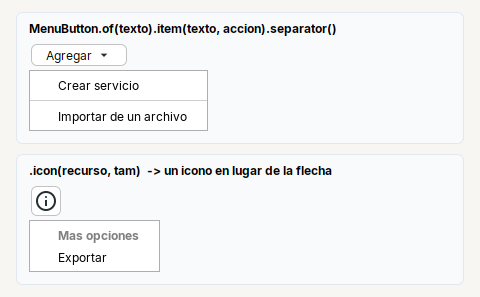

# MenuButton

**Boton que abre un menu de acciones**: el usuario hace clic en una opcion y pasa algo; no queda nada elegido.

| | |
|---|---|
| **Paquete** | `tessera.kit` |
| **Clase** | `MenuButton extends PopupButton<MenuButton>` (un `JButton`) |
| **Se crea con** | `MenuButton.of(texto)` |
| **Importar** | `import tessera.kit.MenuButton;` |



## Cuando usarlo

- "Agregar" con varias formas de agregar, "Mas opciones", "Insertar columna": un boton que agrupa acciones.
- Menus que se llenan al momento (las columnas de unos datos): `onOpen`.

**Cuando no:** para elegir una opcion y que el boton la muestre, [`ChoiceButton`](choicebutton.md); para marcar varias, [`MultiChoiceButton`](multichoicebutton.md); para un menu sin boton (clic derecho de una lista), [`Menu`](menu.md).

## Referencia

Es un `JButton` (`Styled`, y los metodos de `PopupButton`). Las opciones son [`MenuItem`](menu.md#menuitem): `item(texto, accion)` o `item(MenuItem...)` para una con icono, ayuda o que se cambia despues.

| Metodo | Que hace |
|---|---|
| `MenuButton.of(texto)` | boton con ese texto (`""` si solo lleva icono) |
| `.item(texto, Runnable)` | agrega una opcion que corre la accion |
| `.item(MenuItem)` | agrega una opcion ya armada: conserva su referencia para `setText`, `setEnabled`, `setIcon` despues |
| `.title(texto)` | encabezado en negrita, sin accion |
| `.separator()` | linea que separa grupos |
| `.clear()` | quita todas las opciones |
| `.onOpen(Consumer<Menu>)` | corre justo antes de abrir, para llenar el menu al momento (`menu.clear()` y de nuevo `item`). Si queda sin opciones no se abre |
| `.menu()` | el [`Menu`](menu.md) que abre el boton |

### Metodos de `PopupButton`

Comunes a `MenuButton`, [`ChoiceButton`](choicebutton.md) y [`MultiChoiceButton`](multichoicebutton.md) (todos devuelven el propio boton):

| Metodo | Que hace |
|---|---|
| `.color(Color)` | color del texto **y** de la flecha |
| `.arrowLeft()` | la flecha a la izquierda del texto (por defecto va a la derecha) |
| `.noArrow()` | sin flecha |
| `.icon(recurso, tam)` / `.icon(Icon)` | un icono propio, antes del texto, **en lugar de** la flecha |
| `.iconGap(px)` | espacio entre el icono y el texto |
| `.menu()` | el `Menu` que abre |

```java
private final MenuButton btnAdd = MenuButton.of("Agregar")
    .item("Crear servicio", this::create)
    .separator()
    .item(MenuItem.of("Importar de un archivo", this::importFile).icon("app/img/pro.svg", 16).iconRight());

// menu que se llena al momento
private final MenuButton btnInsert = MenuButton.of("Insertar columna").noArrow()
    .onOpen(menu -> {
      menu.clear();
      for (String column : columns()) {
        menu.item(column, () -> insert(column));
      }
    });
```

## Errores comunes

- Un `MenuButton` sin opciones no hace nada al hacer clic (no abre un menu vacio).
- `.icon(...)` reemplaza la flecha; si quieres icono **y** flecha no se puede: un `JButton` lleva un solo icono.
- No agregues un `addActionListener` para correr una accion: se dispara al **abrir** el menu. La accion va en cada `item`.

## Ver tambien

- [`Menu`](menu.md) · [`ChoiceButton`](choicebutton.md) · [`MultiChoiceButton`](multichoicebutton.md) · [`Button`](button.md)
- [Referencia del kit](../README.md): ideas base y metodos comunes (`Styled`, `Clickable`, `Box`).
