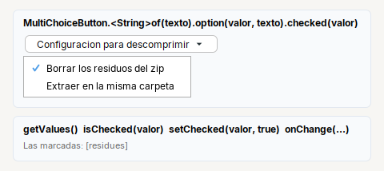

# MultiChoiceButton

**Boton que abre un menu de casillas** para marcar varias opciones. El texto del boton es fijo.

| | |
|---|---|
| **Paquete** | `tessera.kit` |
| **Clase** | `MultiChoiceButton<T> extends PopupButton<MultiChoiceButton<T>>` (un `JButton`) |
| **Se crea con** | `MultiChoiceButton.<T>of(texto)` |
| **Importar** | `import tessera.kit.MultiChoiceButton;` |



## Cuando usarlo

- Un boton de **ajustes** con varias casillas que no merecen una fila cada una: "Configuracion para descomprimir", filtros, columnas visibles.

**Cuando no:** para elegir una sola opcion y que el boton la muestre, [`ChoiceButton`](choicebutton.md); si el clic solo corre una accion, [`MenuButton`](menubutton.md); si las casillas deben verse siempre, [`Check`](check.md).

## Referencia

Es un `JButton` (`Styled`, y los metodos de [`PopupButton`](menubutton.md#metodos-de-popupbutton)).

| Metodo | Que hace |
|---|---|
| `MultiChoiceButton.<T>of(texto)` | boton con ese texto y sin opciones |
| `.option(valor, texto)` | agrega una casilla (empieza sin marcar) |
| `.option(valor, texto, ayuda)` | igual, con una ayuda breve al dejar el mouse encima |
| `.checked(valor)` | la deja marcada: el estado inicial al armar el boton |
| `.optionEnabled(valor, habilitada)` | habilita o deshabilita una casilla |
| `.onChange(Consumer<Set<T>>)` | cada vez que cambian las marcadas, con el conjunto de valores (**tambien por codigo**) |
| `.onChange(Runnable)` | lo mismo, sin recibir el conjunto |
| `getValues()` | los valores marcados, en el orden de las opciones |
| `isChecked(valor)` | esa casilla esta marcada |
| `setChecked(valor, marcada)` | marca o desmarca una casilla |
| `setValues(coleccion)` | deja marcadas exactamente esas; avisa **una sola vez** a `onChange` |

```java
private enum Unzip { REMOVE_RESIDUES, SAME_FOLDER }

private final MultiChoiceButton<Unzip> btnUnzip = MultiChoiceButton.<Unzip>of("Configuracion para descomprimir")
    .option(Unzip.REMOVE_RESIDUES, "Borrar los residuos del zip").checked(Unzip.REMOVE_RESIDUES)
    .option(Unzip.SAME_FOLDER, "Extraer en la misma carpeta");

// al cargar:   btnUnzip.setChecked(Unzip.SAME_FOLDER, model.isUnzipToSameFolder);
// al guardar:  model.isUnzipToSameFolder = btnUnzip.isChecked(Unzip.SAME_FOLDER);
```

## Errores comunes

- El menu se cierra al marcar cada casilla (como cualquier menu de Swing): para varias a la vez hay que volver a abrirlo.
- `onChange` tambien se dispara al marcar por codigo: registralo **despues** de cargar el estado inicial.

## Ver tambien

- [`ChoiceButton`](choicebutton.md) · [`MenuButton`](menubutton.md) · [`Check`](check.md)
- [Referencia del kit](../README.md): ideas base y metodos comunes (`Styled`, `Clickable`, `Box`).
