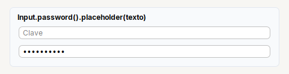

# Password

**Campo de clave**: el contenido no se ve. Se crea con `Input.password()`.

| | |
|---|---|
| **Paquete** | `tessera.kit` |
| **Clase** | `Password extends JPasswordField implements Styled<Password>` |
| **Se crea con** | `Input.password()` |
| **Importar** | `import tessera.kit.Password;` |

## Cuando usarlo

- Pedir una clave o un secreto.

## Referencia

`Input.password()` devuelve un `Password` (`JPasswordField`). Metodos: `.placeholder`, `.columns`, `.onChange`, `.onEnter`. Se lee con
`getPassword()` (un `char[]`), como en Swing.

## Errores comunes

- Se lee con `getPassword()` (un `char[]`), no con `getText()`.

## Ver tambien

- [`Input`](input.md) · [`Form`](../containers/form.md)
- [Referencia del kit](../README.md): ideas base y metodos comunes (`Styled`, `Clickable`, `Box`).
