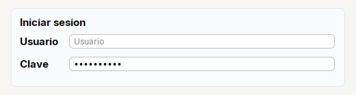

# Password

**Campo de clave**: el contenido no se ve. Se crea con `Input.password()`.

| | |
|---|---|
| **Paquete** | `tessera.kit` |
| **Clase** | `Password extends JPasswordField implements Styled<Password>` |
| **Se crea con** | `Input.password()` |
| **Importar** | `import tessera.kit.Password;` |


**En una frase:** campo de **clave**: el contenido se ve como puntos. Se crea con `Input.password()`.

**Reemplaza, en Swing puro:** `new JPasswordField()` + `addActionListener(...)` para Enter + un placeholder propio.

**Cual elegir entre varios widgets parecidos:** [Que widget uso](../../../guides/widgets.md#escribir-input-password-textarea-o-spinner).

## Cuando usarlo

- Pedir una clave o un secreto.

## Ejemplo: un dialogo de inicio de sesion



```java
final Input txtUser = Input.text().placeholder("Usuario");
final Password txtPass = Input.password().placeholder("Clave");
txtPass.onEnter(e -> { });                                  // Enter en la clave entra, sin buscar el boton
txtPass.setText("secreto123");

final Card login = Card.create("Iniciar sesion").children(
    Form.gap(8).row("Usuario", txtUser).row("Clave", txtPass));
// la clave se lee con new String(txtPass.getPassword()), no con getText()
```

1. `Input.password()` devuelve un `Password`; sus metodos son los de `Input` (`placeholder`, `columns`, `onChange`, `onEnter`).
2. `onEnter(...)` entra con Enter desde el campo de la clave, sin tener que hacer clic en el boton.
3. La clave se lee con `getPassword()` (un `char[]`), **no** con `getText()`; conviene borrarla del arreglo (`Arrays.fill(clave, (char) 0)`) al terminar.

## Referencia

`Input.password()` devuelve un `Password` (`JPasswordField`). Se lee con `getPassword()` (un `char[]`), como en Swing.

| Metodo | Que hace |
|---|---|
| `Input.password()` | campo de clave |
| `.placeholder(txt)` | texto gris mientras el campo esta vacio |
| `.columns(n)` | ancho preferido en caracteres |
| `.onChange(Runnable)` | cada vez que cambia el contenido (por el usuario **o por codigo**) |
| `.onEnter(ActionListener)` | al presionar Enter |

Ademas los de [`Styled`](../README.md#styledt--todos-los-widgets-y-contenedores). No tiene `editable(...)`.

## Errores comunes

- Se lee con `getPassword()` (un `char[]`), no con `getText()`.

## Ver tambien

- [`Input`](input.md) · [`Form`](../containers/form.md)
- [Referencia del kit](../README.md): ideas base y metodos comunes (`Styled`, `Clickable`, `Box`).
