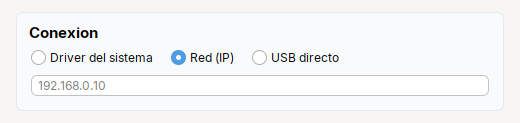

# Radio

**Opcion** de un grupo de opciones excluyentes (`JRadioButton`).

| | |
|---|---|
| **Paquete** | `tessera.kit` |
| **Clase** | `Radio extends JRadioButton implements Clickable<Radio>` |
| **Se crea con** | `Radio.of(txt)` · `Radio.group(radios...)` |
| **Importar** | `import tessera.kit.Radio;` |


**En una frase:** una **opcion de un grupo**: al marcar una se desmarca la otra. `Radio.group(...)` arma el grupo.

**Reemplaza, en Swing puro:** `new JRadioButton(texto)` por opcion + un `ButtonGroup` aparte al que hay que agregar cada una.

**Cual elegir entre varios widgets parecidos:** [Que widget uso](../../../guides/widgets.md#elegir-una-opcion-radio-combo-choicebutton-o-togglegroup).

## Cuando usarlo

- Elegir una opcion de pocas (2 a 5).

**Cuando no:** Para muchas opciones usa `Combo`; para varias a la vez, `Check`.

## Ejemplo: tres opciones y un campo que solo se ve con una de ellas



```java
final Radio rbtnDriver = Radio.of("Driver del sistema").selected(true);
final Radio rbtnIp = Radio.of("Red (IP)");
final Radio rbtnUsb = Radio.of("USB directo");
Radio.group(rbtnDriver, rbtnIp, rbtnUsb);                   // solo una marcada a la vez

final Input txtIp = Input.text().placeholder("192.168.0.10");
rbtnIp.addItemListener(e -> txtIp.setVisible(rbtnIp.isSelected()));
rbtnIp.setSelected(true);

final Card connection = Card.create("Conexion").children(
    Row.gap(14).children(rbtnDriver, rbtnIp, rbtnUsb), txtIp);
```

1. `Radio.group(...)` deja marcada **solo una** a la vez; sin el grupo cada opcion seria independiente.
2. El `ItemListener` de `rbtnIp` muestra el campo de la IP cuando esa opcion esta marcada. `rbtnIp.setSelected(true)` por codigo tambien lo dispara.
3. Para saber cual quedo: `rbtnIp.isSelected()` (uno por opcion). Si son varias opciones con ayuda, mira [`ChoiceButton`](choicebutton.md): devuelve un solo valor.

## Referencia

`Radio.of(txt)`: opcion excluyente (`JRadioButton`). `Radio.group(Radio...)` agrupa para que solo una quede marcada y devuelve el `ButtonGroup`.
Hereda [`Clickable`](../README.md#clickablet--button-check-radio-toggle-switch).

| Metodo | Que hace |
|---|---|
| `.onClick(Runnable)` / `.onClick(ActionListener)` | accion cuando el **usuario** hace clic. **No** corre si cambias el estado por codigo |
| `.icon(recurso, tam)` / `.icon(Icon)` | icono (SVG o imagen del classpath) |
| `.iconGap(px)` | espacio entre el icono y el texto |
| `.selected(boolean)` | estado inicial |

Ademas los de [`Styled`](../README.md#styledt--todos-los-widgets-y-contenedores) (`tip`, `bold`, `color`, `enabled`...), y los de Swing de siempre (`isSelected()`, `setSelected(b)`, `addItemListener(...)`).

| Para... | Hacer |
|---|---|
| que solo una quede marcada | `Radio.group(a, b, c)` (despues de crearlas) |
| saber cual esta marcada | `a.isSelected()` en cada una; para un solo valor devuelto, [`ChoiceButton`](choicebutton.md) |
| reaccionar a un cambio, tambien por codigo | `addItemListener(e -> ...)` en la opcion que interesa |
| asociar cada opcion a una clave (un `int`, un `enum`) | [`CheckGroup`](../../components/lists-and-combos.md#checkgroup) |

## Errores comunes

- Sin `Radio.group(...)` cada opcion es independiente y se pueden marcar varias.
- `onClick` no se dispara con `setSelected(true)` por codigo: usa un `ItemListener`.

## Ver tambien

- [`Check`](check.md) · [`Toggle`](toggle.md) · [`Combo`](combo.md) · [`CheckGroup`](../../components/lists-and-combos.md#checkgroup)
- [Referencia del kit](../README.md): ideas base y metodos comunes (`Styled`, `Clickable`, `Box`).
