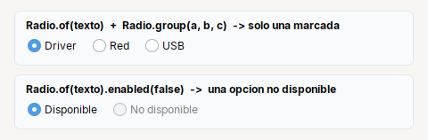

# Radio

**Opcion** de un grupo de opciones excluyentes (`JRadioButton`).

| | |
|---|---|
| **Paquete** | `tessera.kit` |
| **Clase** | `Radio extends JRadioButton implements Clickable<Radio>` |
| **Se crea con** | `Radio.of(txt)` · `Radio.group(radios...)` |
| **Importar** | `import tessera.kit.Radio;` |

## Cuando usarlo

- Elegir una opcion de pocas (2 a 5).

**Cuando no:** Para muchas opciones usa `Combo`; para varias a la vez, `Check`.

## Referencia

`Radio.of(txt)`: opcion excluyente (`JRadioButton`). `Radio.group(Radio...)` agrupa para que solo una quede marcada.

## Errores comunes

- Sin `Radio.group(...)` cada opcion es independiente y se pueden marcar varias.
- `onClick` no se dispara con `setSelected(true)` por codigo: usa un `ItemListener`.

## Ver tambien

- [`Check`](check.md) · [`Toggle`](toggle.md) · [`Combo`](combo.md) · [`CheckGroup`](../../components/lists-and-combos.md#checkgroup)
- [Referencia del kit](../README.md): ideas base y metodos comunes (`Styled`, `Clickable`, `Box`).
