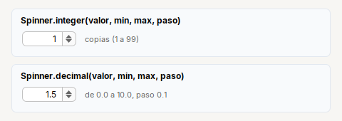

# Spinner

**Selector numerico** con flechas (`JSpinner`).

| | |
|---|---|
| **Paquete** | `tessera.kit` |
| **Clase** | `Spinner extends JSpinner implements Styled<Spinner>` |
| **Se crea con** | `Spinner.integer(valor, min, max, paso)` · `Spinner.decimal(...)` · `Spinner.of(modelo)` |
| **Importar** | `import tessera.kit.Spinner;` |

## Cuando usarlo

- Un numero acotado: copias, ancho en mm, reintentos.

**Cuando no:** Para un numero libre o sin limites usa `Input`.

## Referencia

Selector numerico con flechas (`JSpinner`).

| Metodo | Que hace |
|---|---|
| `Spinner.integer(valor, min, max, paso)` | numeros enteros |
| `Spinner.decimal(valor, min, max, paso)` | numeros con decimales |
| `Spinner.of(SpinnerNumberModel)` | con un modelo propio (otro tipo de numero, limites abiertos con `null`) |
| `.onChange(Runnable)` | cada vez que cambia el valor |

## Errores comunes

- En un `Form` o `Grid`, un `Spinner` sin `.width(px)` se estira a todo el ancho: dale `.width(80)`.
- El valor se lee con `getValue()` (un `Integer` o `Double` segun el modelo).

## Ver tambien

- [`Input`](input.md) · [`Form`](../containers/form.md) · [`Grid`](../containers/grid.md)
- [Referencia del kit](../README.md): ideas base y metodos comunes (`Styled`, `Clickable`, `Box`).
