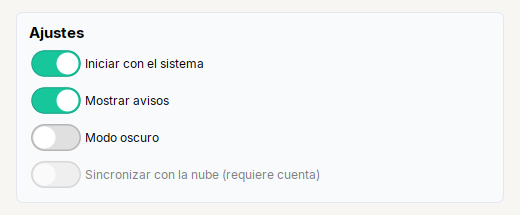

# Switch

**Interruptor** estilo iOS: un si/no que se aplica al instante.

| | |
|---|---|
| **Paquete** | `tessera.kit` |
| **Clase** | `Switch extends JCheckBox implements Clickable<Switch>` (con los iconos del interruptor) |
| **Se crea con** | `Switch.of(txt)` |
| **Importar** | `import tessera.kit.Switch;` |


**En una frase:** **interruptor** estilo iOS: un si/no que se aplica **al instante**, sin boton Guardar.

**Reemplaza, en Swing puro:** un `JCheckBox` con iconos propios (cuatro SVG para encendido, apagado, y sus estados) y su `ItemListener`.

**Cual elegir entre varios widgets parecidos:** [Que widget uso](../../../guides/widgets.md#activar-o-desactivar-check-switch-o-toggle).

## Cuando usarlo

- Una opcion que se aplica en cuanto se cambia ("Iniciar con el sistema").

**Cuando no:** Para una opcion que se confirma despues (con un boton "Guardar") usa `Check`.

## Ejemplo: una tarjeta de ajustes



```java
final Card settings = Card.create("Ajustes").children(
    Switch.of("Iniciar con el sistema").selected(true).onClick(() -> { }),
    Switch.of("Mostrar avisos").selected(true),
    Switch.of("Modo oscuro"),
    Switch.of("Sincronizar con la nube (requiere cuenta)").enabled(false));
```

1. Cada `Switch` es una opcion que ya esta aplicada cuando el usuario la mueve: `onClick(...)` corre en ese momento.
2. `.selected(true)` fija el estado inicial; `.enabled(false)` lo deja en gris (abajo).
3. Si la opcion se confirma despues con un boton, usa [`Check`](check.md).

## Referencia

`Switch.of(txt)`: interruptor estilo iOS (`JCheckBox` con otros iconos), un si/no que se aplica al instante. Sus colores son SVG propios y no
siguen al acento del tema. Hereda [`Clickable`](../README.md#clickablet--button-check-radio-toggle-switch).

| Metodo | Que hace |
|---|---|
| `.onClick(Runnable)` / `.onClick(ActionListener)` | accion cuando el **usuario** hace clic. **No** corre si cambias el estado por codigo |
| `.icon(recurso, tam)` / `.icon(Icon)` | icono (SVG o imagen del classpath) |
| `.iconGap(px)` | espacio entre el icono y el texto |
| `.selected(boolean)` | estado inicial |

Ademas los de [`Styled`](../README.md#styledt--todos-los-widgets-y-contenedores) (`tip`, `bold`, `color`, `enabled`...), y los de Swing de siempre (`isSelected()`, `setSelected(b)`, `addItemListener(...)`).

```java
Switch.of("Iniciar con el sistema").selected(true).onClick(this::onChanged)
```

## Errores comunes

- Sus colores son SVG propios: **no siguen** al acento del tema.

## Ver tambien

- [`Check`](check.md) · [`Toggle`](toggle.md) · [`Card`](../containers/card.md)
- [Referencia del kit](../README.md): ideas base y metodos comunes (`Styled`, `Clickable`, `Box`).
