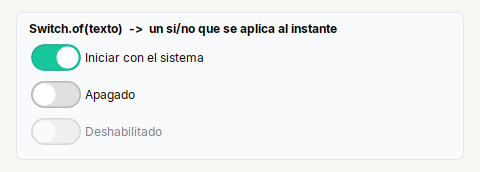

# Switch

**Interruptor** estilo iOS: un si/no que se aplica al instante.

| | |
|---|---|
| **Paquete** | `tessera.kit` |
| **Clase** | `Switch extends JCheckBox implements Clickable<Switch>` (con los iconos del interruptor) |
| **Se crea con** | `Switch.of(txt)` |
| **Importar** | `import tessera.kit.Switch;` |



## Cuando usarlo

- Una opcion que se aplica en cuanto se cambia ("Iniciar con el sistema").

**Cuando no:** Para una opcion que se confirma despues (con un boton "Guardar") usa `Check`.

## Referencia

`Switch.of(txt)`: interruptor estilo iOS (`JCheckBox` con otros iconos), un si/no que se aplica al instante. Sus colores son SVG propios y no
siguen al acento del tema.

```java
Switch.of("Iniciar con el sistema").selected(true).onClick(this::onChanged)
```

## Errores comunes

- Sus colores son SVG propios: **no siguen** al acento del tema.

## Ver tambien

- [`Check`](check.md) · [`Toggle`](toggle.md) · [`Card`](../containers/card.md)
- [Referencia del kit](../README.md): ideas base y metodos comunes (`Styled`, `Clickable`, `Box`).
