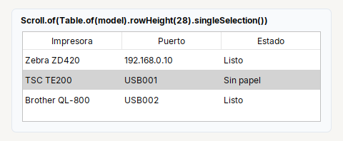
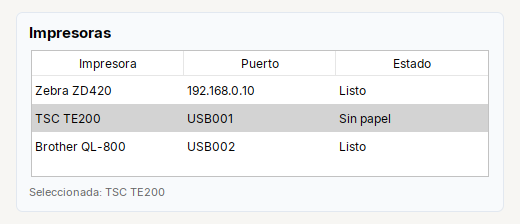

# Table

**Tabla** (`JTable`). Se pone siempre dentro de un `Scroll`.

| | |
|---|---|
| **Paquete** | `tessera.kit` |
| **Clase** | `Table extends JTable implements Styled<Table>` |
| **Se crea con** | `Table.of(modelo)` |
| **Importar** | `import tessera.kit.Table;` |



**En una frase:** **tabla** de datos con filas seleccionables; siempre dentro de un `Scroll`.

**Reemplaza, en Swing puro:** `new JTable(modelo)` + `new JScrollPane(...)` + un `AbstractTableModel` + un `ListSelectionListener` (con su `getValueIsAdjusting()`).

**Cual elegir entre varios widgets parecidos:** [Que widget uso](../../../guides/widgets.md#mostrar-datos-table).

## Cuando usarlo

- Mostrar una lista de datos con columnas.

**Cuando no:** Para pocas celdas fijas de texto usa `Grid`.

## Ejemplo: una lista de impresoras con la fila seleccionada



```java
final BaseTableModel.TArray model = new BaseTableModel.TArray("Impresora", "Puerto", "Estado");
model.addRow(new Object[] {"Zebra ZD420", "192.168.0.10", "Listo"});
model.addRow(new Object[] {"TSC TE200", "USB001", "Sin papel"});
model.addRow(new Object[] {"Brother QL-800", "USB002", "Listo"});

final Label lblSelected = Label.muted("Selecciona una impresora").small();
final Table table = Table.of(model).rowHeight(28).singleSelection();
table.onSelect(() -> {
  final int row = table.getSelectedRow();                   // -1 si no hay fila seleccionada
  lblSelected.setText(row < 0 ? "Selecciona una impresora" : "Seleccionada: " + model.getValueAt(row, 0));
});

final Card printers = Card.create("Impresoras").children(Scroll.of(table), lblSelected);   // siempre dentro de un Scroll
```

1. `BaseTableModel.TArray` es un modelo listo: se le dan los nombres de las columnas y se agregan filas con `addRow(...)`.
2. `onSelect(...)` corre **una sola vez** por cambio de seleccion (el kit descarta los eventos intermedios); `getSelectedRow()` es `-1` si no hay fila.
3. `Scroll.of(table)`: sin el `Scroll` no se ve el encabezado. Si la tabla se ordena o filtra, usa `table.convertRowIndexToModel(fila)` antes de leer el modelo.

## Referencia

Tabla (`JTable`). **Siempre dentro de un [`Scroll`](../containers/scroll.md)**, si no el encabezado no se ve.

| Metodo | Que hace |
|---|---|
| `Table.of(TableModel)` | tabla con ese modelo (ver [`BaseTableModel`](../../components/tables.md#basetablemodel)) |
| `.rowHeight(px)` | alto de cada fila |
| `.singleSelection()` | una sola fila seleccionada a la vez |
| `.onSelect(Runnable)` | cuando cambia la fila seleccionada (una sola vez por cambio) |
| `.columnWidth(columna, px)` | ancho preferido de una columna, por posicion en la vista |

```java
Table table = Table.of(model).rowHeight(28).singleSelection().onSelect(this::onRowSelected);
Scroll.of(table)
```

## Errores comunes

- Sin `Scroll.of(table)` no se ve el encabezado.
- Si la tabla se ordena o filtra, usa `table.convertRowIndexToModel(fila)` antes de leer el modelo.

## Ver tambien

- [`Scroll`](../containers/scroll.md) · [`BaseTableModel`](../../components/tables.md#basetablemodel) · [`Col`](../containers/col.md)
- [Referencia del kit](../README.md): ideas base y metodos comunes (`Styled`, `Clickable`, `Box`).
