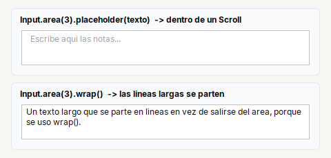
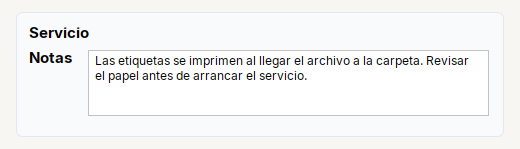

# TextArea

**Area de texto** de varias lineas. Se crea con `Input.area(filas)` y va dentro de un `Scroll`.

| | |
|---|---|
| **Paquete** | `tessera.kit` |
| **Clase** | `TextArea extends JTextArea implements Styled<TextArea>` |
| **Se crea con** | `Input.area(filas)` |
| **Importar** | `import tessera.kit.TextArea;` |



**En una frase:** campo de **varias lineas**, siempre dentro de un `Scroll`.

**Reemplaza, en Swing puro:** `new JTextArea(filas, 0)` + `new JScrollPane(...)` + `setLineWrap(true)` + `setWrapStyleWord(true)` + un placeholder propio (FlatLaf no lo pinta en un `JTextArea`).

**Cual elegir entre varios widgets parecidos:** [Que widget uso](../../../guides/widgets.md#escribir-input-password-textarea-o-spinner).

## Cuando usarlo

- Notas, descripciones, texto libre.

**Cuando no:** Para una sola linea usa `Input`.

## Ejemplo: notas con placeholder y lineas largas que se parten



```java
final TextArea txtNotes = Input.area(4).wrap().placeholder("Escribe aqui las notas...");
txtNotes.setText("Las etiquetas se imprimen al llegar el archivo a la carpeta. "
    + "Revisar el papel antes de arrancar el servicio.");

final Card notes = Card.create("Servicio").children(
    Form.gap(6).rowTop("Notas", Scroll.of(txtNotes)));      // rowTop: la etiqueta queda arriba
```

1. `Input.area(4)` crea el area de 4 filas; `.wrap()` hace que las lineas largas se partan por palabras en vez de salirse.
2. `Scroll.of(area)` le da sus barras: **sin `Scroll` no hay barras de desplazamiento**.
3. En un `Form`, `rowTop(...)` deja la etiqueta arriba, junto a la primera linea (con `row(...)` quedaria centrada).

## Referencia

`Input.area(filas)` devuelve un `TextArea` (`JTextArea`). Va dentro de un [`Scroll`](../containers/scroll.md).

| Metodo | Que hace |
|---|---|
| `.placeholder(txt)` | texto gris mientras el area esta vacia (se oculta al escribir) |
| `.columns(n)` | ancho preferido en caracteres |
| `.editable(boolean)` | permitir o no escribir |
| `.wrap()` | las lineas largas se parten (por palabras) en vez de salirse |
| `.onChange(Runnable)` | cada vez que cambia el contenido |

## Errores comunes

- Sin `Scroll`, no hay barras de desplazamiento: `Scroll.of(area)`.
- Dentro de un `Form`, usa `rowTop(...)` para que la etiqueta quede arriba.

## Ver tambien

- [`Input`](input.md) · [`Scroll`](../containers/scroll.md) · [`Form`](../containers/form.md) · [`TextPlaceholder`](../../components/text.md#textplaceholder)
- [Referencia del kit](../README.md): ideas base y metodos comunes (`Styled`, `Clickable`, `Box`).
