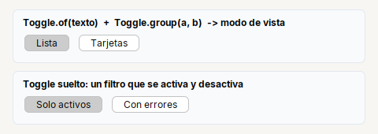

# Toggle

Boton que **queda presionado**: un modo de vista o un filtro. Los de un mismo grupo son excluyentes.

| | |
|---|---|
| **Paquete** | `tessera.kit` |
| **Clase** | `Toggle extends JToggleButton implements Clickable<Toggle>` |
| **Se crea con** | `Toggle.of(txt)` · `Toggle.group(toggles...)` |
| **Importar** | `import tessera.kit.Toggle;` |

## Cuando usarlo

- Cambiar entre vistas ("Lista" / "Tarjetas").
- Filtros que se activan y desactivan.

**Cuando no:** Para un si/no de configuracion usa `Switch` o `Check`.

## Referencia

`Toggle.of(txt)`: boton que queda presionado (`JToggleButton`): modo de vista, filtro. `Toggle.group(Toggle...)` los hace excluyentes.

## Errores comunes

- Sin `Toggle.group(...)` cada boton es independiente.

## Ver tambien

- [`Button`](button.md) · [`Radio`](radio.md) · [`Switch`](switch.md)
- [Referencia del kit](../README.md): ideas base y metodos comunes (`Styled`, `Clickable`, `Box`).
