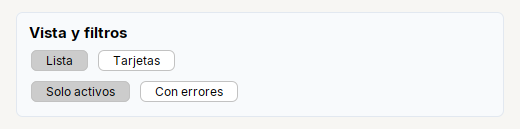

# Toggle

Boton que **queda presionado**: un modo de vista o un filtro. Los de un mismo grupo son excluyentes.

| | |
|---|---|
| **Paquete** | `tessera.kit` |
| **Clase** | `Toggle extends JToggleButton implements Clickable<Toggle>` |
| **Se crea con** | `Toggle.of(txt)` · `Toggle.group(toggles...)` |
| **Importar** | `import tessera.kit.Toggle;` |


**En una frase:** boton que **queda presionado**: un modo de vista o un filtro. En un grupo, solo uno queda presionado.

**Reemplaza, en Swing puro:** `new JToggleButton(texto)` + un `ButtonGroup` aparte para los modos excluyentes.

**Cual elegir entre varios widgets parecidos:** [Que widget uso](../../../guides/widgets.md#activar-o-desactivar-check-switch-o-toggle).

## Cuando usarlo

- Cambiar entre vistas ("Lista" / "Tarjetas").
- Filtros que se activan y desactivan.

**Cuando no:** Para un si/no de configuracion usa `Switch` o `Check`.

## Ejemplo: un modo de vista (Lista / Tarjetas) y dos filtros



```java
final Toggle tglList = Toggle.of("Lista").selected(true);
final Toggle tglCards = Toggle.of("Tarjetas");
Toggle.group(tglList, tglCards);                            // modos excluyentes: al presionar uno se suelta el otro

final Card view = Card.create("Vista y filtros").children(
    Row.gap(6).children(tglList, tglCards),
    Row.gap(6).children(Toggle.of("Solo activos").selected(true), Toggle.of("Con errores")));   // filtros independientes
```

1. `Toggle.group(lista, tarjetas)`: al presionar uno se suelta el otro. Es un **modo**: siempre hay uno activo.
2. Los filtros (`Solo activos`, `Con errores`) no estan en un grupo: cada uno se presiona y se suelta por su cuenta.
3. Para reaccionar a un cambio usa `addItemListener` (como en `Check`); `onClick` solo atiende al usuario.

## Referencia

`Toggle.of(txt)`: boton que queda presionado (`JToggleButton`): modo de vista, filtro. `Toggle.group(Toggle...)` los hace excluyentes y devuelve el `ButtonGroup`.
Hereda [`Clickable`](../README.md#clickablet--button-check-radio-toggle-switch).

| Metodo | Que hace |
|---|---|
| `.onClick(Runnable)` / `.onClick(ActionListener)` | accion cuando el **usuario** hace clic. **No** corre si cambias el estado por codigo |
| `.icon(recurso, tam)` / `.icon(Icon)` | icono (SVG o imagen del classpath) |
| `.iconGap(px)` | espacio entre el icono y el texto |
| `.selected(boolean)` | estado inicial |

Ademas los de [`Styled`](../README.md#styledt--todos-los-widgets-y-contenedores) (`tip`, `bold`, `color`, `enabled`...), y los de Swing de siempre (`isSelected()`, `setSelected(b)`, `addItemListener(...)`).

| Para... | Hacer |
|---|---|
| un **modo** (siempre hay uno activo) | `Toggle.group(lista, tarjetas)` y una de ellas `.selected(true)` |
| un **filtro** (activo o no, por su cuenta) | un `Toggle` sin grupo |
| saber si esta presionado | `isSelected()` |
| reaccionar a un cambio, tambien por codigo | `addItemListener(e -> ...)` |

## Errores comunes

- Sin `Toggle.group(...)` cada boton es independiente.

## Ver tambien

- [`Button`](button.md) · [`Radio`](radio.md) · [`Switch`](switch.md)
- [Referencia del kit](../README.md): ideas base y metodos comunes (`Styled`, `Clickable`, `Box`).
