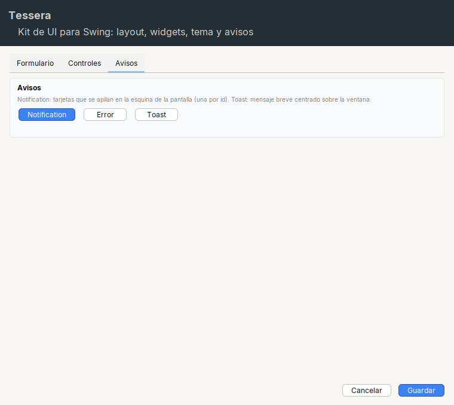

# Avisos (`tessera.notify`)

Dos formas de avisar al usuario sin abrir un dialogo que bloquee: [`Notification`](notification.md) y [`Toast`](toast.md). Las dos tienen el mismo aspecto
(tarjeta **negra** con texto blanco y un icono de color segun el estilo) y ninguna usa `JOptionPane`.

## Cual usar

| | `Notification` | `Toast` |
|---|---|---|
| Aparece | en la **esquina inferior derecha de la pantalla** | **centrado sobre una ventana** o componente |
| Varios a la vez | **si**, se apilan y se acomodan | **no**, se muestran de uno en uno, en cola |
| Identificador | **si** (`id` obligatorio): mostrar otra con el mismo `id` la **reemplaza** | no |
| Barra de progreso | si | no |
| Boton de accion | si (`setOnAction`) | si (`setAction`) |
| Clic en el cuerpo | si (`setOnClick`) | no hace nada |
| Duracion corta / larga | 4 s / 8 s | 3 s / 6 s |
| Ideal para | cosas que pasan **en segundo plano** (una impresion termino, hay una actualizacion, una descarga avanza) | **confirmaciones inmediatas** de lo que acaba de hacer el usuario ("Copiado", "Guardado") |

Regla practica: si el usuario esta mirando la ventana y acaba de hacer clic, `Toast`; si algo ocurre solo y puede que no este mirando,
`Notification`.

Estilos de las dos: `NORMAL`, `SUCCESS`, `ERROR`, `WARNING`. El estilo solo cambia el **icono** y su color; el fondo siempre es negro.

## Paginas

- [`Notification`](notification.md): tarjetas apiladas en la esquina de la pantalla, con `id`, progreso y acciones.
- [`Toast`](toast.md): mensaje breve centrado sobre una ventana, en cola.

## Los avisos y el `ErrorProvider`

`ErrorProvider.setError(...)` (ver [Validacion de formularios](../components/forms.md#errorprovider)) muestra un `Toast` de error de 3 segundos ademas de marcar el
campo con borde rojo.
