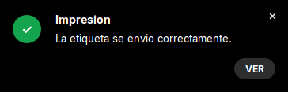
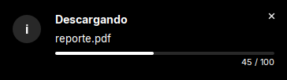
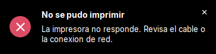

# Notification

Notificacion flotante estilo Chrome o Windows: **tarjeta oscura** en la esquina inferior derecha de la pantalla. Pueden verse varias a la vez; se apilan.

| | |
|---|---|
| **Paquete** | `tessera.notify` |
| **Clase** | `Notification` (con su `Notification.Builder`) |
| **Se crea con** | `new Notification.Builder(id)` ... `.show()` |
| **Importar** | `import tessera.notify.Notification;` |







> Para elegir entre `Notification` y `Toast`, mira [la comparacion](README.md#cual-usar).

## Ejemplo

```java
new Notification.Builder("print.done")                  // el id es obligatorio
    .setTitle("Impresion")
    .setMessage("La etiqueta se envio correctamente.")
    .setStyle(Notification.Style.SUCCESS)
    .setDuration(Notification.LENGTH_LONG)
    .setOnAction("Ver", n -> abrirHistorial())          // boton de la tarjeta
    .setOnClick(n -> abrirHistorial())                  // clic en el cuerpo
    .show();
```

## El `id`

Cada notificacion lleva un `id` (texto, no vacio: si es `null` o vacio el `Builder` lanza `IllegalArgumentException`). Si muestras otra con
el **mismo id mientras la anterior sigue visible**, la nueva **toma su lugar** en vez de apilarse. Sirve para estados que cambian
("Conectando..." → "Conectado") y para no llenar la pantalla de avisos repetidos. Usa ids con significado: `"print.done"`, `"update.ready"`,
`"download.report"`.

## `Notification.Builder`

| Metodo | Que hace |
|---|---|
| `new Notification.Builder(id)` | empieza una notificacion con ese `id` |
| `.setTitle(String)` | titulo, en una linea (si no cabe se recorta con "...") |
| `.setMessage(String)` | mensaje; se parte en lineas y, pasadas unas 8, aparece scroll vertical en vez de agrandar la tarjeta |
| `.setStyle(Notification.Style)` | `NORMAL` (por defecto), `SUCCESS`, `ERROR`, `WARNING` |
| `.setDuration(int)` | milisegundos: `LENGTH_SHORT` (4000, por defecto), `LENGTH_LONG` (8000), `LENGTH_INDEFINITE` (-1: no se cierra sola) o cualquier valor en ms |
| `.setIcon(Image)` | icono propio (el logo de la app) en lugar del dibujado por el estilo |
| `.setOnClick(Consumer<Notification>)` | clic en cualquier parte del cuerpo (no en el boton de accion) |
| `.setOnAction(String texto, Consumer<Notification>)` | boton de accion, estilo `Snackbar` de Android. Al usarlo la tarjeta se cierra y luego corre la accion |
| `.setOnDismiss(Consumer<Notification>)` | se ejecuta si se cierra **sin** clic ni accion (la X o el tiempo) |
| `.setDismissible(boolean)` | con `false` oculta la X: el usuario no puede descartarla sin usar la accion (avisos obligatorios, como una actualizacion forzosa) |
| `.setProgress(int valor, int max)` | agrega una barra de progreso |
| `.show()` | la muestra y devuelve la `Notification` (se puede ignorar) |

Los `Consumer<Notification>` reciben **la propia notificacion**, con la que puedes leer el `id` o actualizarla. Cuando el callback corre,
la notificacion **ya se esta cerrando**, asi que `dismiss()` dentro del callback no hace nada.

## Sobre una notificacion ya mostrada

Son los metodos de la `Notification` que devuelve `show()` (y la que reciben los callbacks). Cada llamada busca la tarjeta por `id`: si ya
se cerro, se ignora; si otra con el mismo `id` la reemplazo, actua sobre la nueva.

| Metodo | Que hace |
|---|---|
| `getId()` | el `id` con el que se creo |
| `setProgress(valor, max)` | actualiza la barra (no hace nada si no se creo con `setProgress`) |
| `setProgress(valor, max, etiqueta)` | igual, con un texto propio en la barra (por defecto `valor / max`), p. ej. `"12.3 / 45.6 MB"` |
| `complete(titulo, mensaje, estilo, duracion)` | oculta la barra y reemplaza titulo, mensaje y estilo; reinicia el cierre automatico con esa duracion |
| `complete(titulo, mensaje, estilo, duracion, textoAccion, accion)` | igual, y ademas agrega o reemplaza el boton de accion |
| `dismiss()` | la cierra antes de que expire |

## Texto de la app

`Notification.setAppName("Mi App")` muestra el nombre de la app en letras pequenas sobre el titulo de **todas** las notificaciones (como
Chrome). Se llama una vez al iniciar.

## Receta: tarea larga con progreso

```java
final Notification n = new Notification.Builder("download.report")
    .setTitle("Descargando")
    .setMessage("reporte.pdf")
    .setDuration(Notification.LENGTH_INDEFINITE)
    .setProgress(0, 100)
    .show();

new Thread(() -> {                                       // trabajo fuera del EDT
  for (int i = 1; i <= 100; i++) {
    hacerUnPaso();
    n.setProgress(i, 100);                               // se puede llamar desde cualquier hilo
  }
  n.complete("Listo", "reporte.pdf descargado", Notification.Style.SUCCESS, Notification.LENGTH_LONG,
      "Abrir", done -> abrirArchivo());
}).start();
```

## Comportamiento y limites

- **Hilos**: `show()` se puede llamar desde cualquier hilo (si no es el EDT, espera brevemente a que la tarjeta exista para que puedas
  actualizar su progreso enseguida). `setProgress`, `complete` y `dismiss` tambien. Los callbacks corren en el EDT.
- **Cierre automatico**: se pausa mientras el mouse esta sobre la tarjeta y se reanuda al salir.
- **Posicion**: esquina inferior derecha del area usable de la pantalla (sin la barra de tareas), con 16 px de margen y 10 px entre
  tarjetas. Las nuevas se apilan hacia arriba.
- **Tamano**: todas miden el mismo ancho (364 px), sea cual sea el contenido.
- **Linux sin compositor**: las esquinas redondeadas y el fundido necesitan translucidez de ventana. Si el gestor de ventanas no la
  soporta, la tarjeta se ve **rectangular y sin animacion** en lugar de fallar.
- **Aspecto fijo**: colores, radio y tamanos estan dentro de la clase. Ver "Lo que no se puede cambiar" en [customizing.md](../../guides/customizing.md#5-lo-que-no-se-puede-cambiar-desde-la-app).
