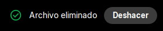

# Toast

Mensaje **breve y transitorio** sobre una ventana o componente. Se muestran de uno en uno (en cola) y centrados sobre su dueno.

| | |
|---|---|
| **Paquete** | `tessera.notify` |
| **Clase** | `Toast` |
| **Se crea con** | `Toast.makeToast(owner, texto, ...)` ... `.show()` |
| **Importar** | `import tessera.notify.Toast;` |



> Para elegir entre `Notification` y `Toast`, mira [la comparacion](README.md#cual-usar).

Mensaje breve y transitorio sobre una ventana o componente. Se muestran **de uno en uno** (cola interna): el siguiente aparece cuando termina
el anterior.

## Ejemplo

```java
Toast.makeToast(frame, "Guardado", Toast.Style.SUCCESS).show();

// con boton de accion, como Snackbar.setAction de Android
Toast.makeToast(frame, "Archivo eliminado")
    .setAction("Deshacer", toast -> restaurar())
    .show();
```

El primer parametro (`owner`) es la ventana o componente sobre el que se centra: puede ser un `JFrame`, un `JDialog` o cualquier componente
(se usa su ventana).

## Crear

| Metodo estatico | Resultado |
|---|---|
| `Toast.makeToast(owner, texto)` | estilo `NORMAL`, `LENGTH_SHORT` |
| `Toast.makeToast(owner, texto, Style)` | con estilo |
| `Toast.makeToast(owner, texto, int duracion)` | con duracion |
| `Toast.makeToast(owner, texto, int duracion, Style)` | con duracion y estilo |
| `Toast.makeToast(owner, texto, duracion, Style, textoAccion, accion)` | todo, incluida la accion |

Duraciones: `Toast.LENGTH_SHORT` (3000 ms), `Toast.LENGTH_LONG` (6000 ms), `Toast.LENGTH_INDEFINITE` (-1) o cualquier valor en ms.

> **Cuidado con `LENGTH_INDEFINITE`**: el toast no se cierra solo y **un clic sobre el no lo cierra**. Solo se va con `dismiss()` o con su boton de
> accion. Si lo usas, guarda la referencia y cierralo desde tu codigo. A diferencia de los toasts con duracion, la cola **no espera** a que
> este se cierre: el siguiente toast aparece enseguida (encima, en la misma posicion).

## Configurar y controlar

| Metodo | Que hace |
|---|---|
| `.setAction(String texto, Consumer<Toast>)` | boton de accion. Al usarlo el toast se cierra y luego corre la accion (en el EDT). Con `null` en cualquiera de los dos se quita. **Devuelve el toast** (se puede encadenar) |
| `.setText(String)` | cambia el texto |
| `.setDuration(int)` | cambia la duracion |
| `.setStyle(Style)` | cambia el estilo (el icono) |
| `.setBackground(Color)` / `.setForeground(Color)` | colores de la tarjeta (negro y blanco por defecto) |
| `.show()` | lo pone en la cola |
| `.dismiss()` | lo cierra desde cualquier hilo; si seguia en la cola, ya no se muestra |

Salvo `setAction`, los metodos de configuracion **no se encadenan** (devuelven `void`): configura el toast y luego llama a `show()`.

## Comportamiento

- **Texto largo**: se parte en lineas a partir de 420 px. Un texto que empieza con `<html>` se toma como HTML tal cual; los demas se escapan
  (un `<` o `&` salen como texto).
- **Hilos**: `show()` se puede llamar desde cualquier hilo.
- **Dialogos modales**: el toast se ve y atiende clics aunque haya un dialogo modal abierto (no se bloquea).
- **Foco**: no roba el foco de la ventana.
- **Linux sin compositor**: igual que `Notification`, queda rectangular y sin fundido.
