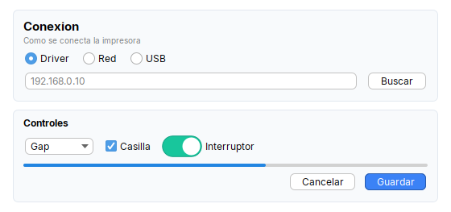
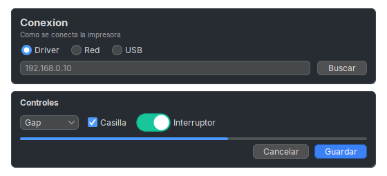
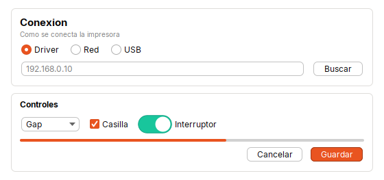
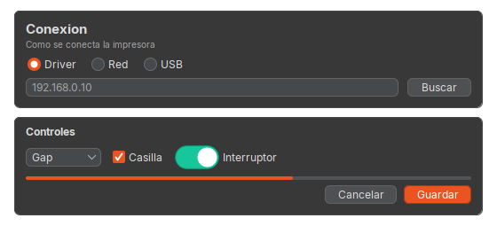

# Palette

Los **colores de un tema**, como datos de solo lectura: fondos, tarjetas, texto secundario, filas de listas, banners, acento y los colores de variante que el tema cambia.
`Theme` los aplica al instalar y los widgets los leen al crearse con `Theme.palette()`.

| | |
|---|---|
| **Paquete** | `tessera.theme` |
| **Clase** | `Palette` (clase final, inmutable) |
| **Se obtiene con** | `Theme.palette()` (la instalada) · `Palette.LIGHT`, `DARK`, `UBUNTU`, `UBUNTU_DARK` (los temas listos) |
| **Importar** | `import tessera.theme.Palette;` |

## Cuando usarla

- Leer un color del tema en codigo propio: `label.setForeground(Theme.palette().muted)`, en vez de repetir el `new Color(102, 102, 102)`.
- Instalar un tema entero: `Theme.builder().palette(Palette.UBUNTU).install()` (es lo mismo que `Theme.ubuntu().install()`).
- Saber si el tema es oscuro: `Theme.palette().dark` (o `Theme.isDark()`).

**Cuando no:** para cambiar un color usa `Theme.builder()` (`.muted(..)`, `.surface(..)`, `.rows(..)`...). La paleta es solo lectura: **no se asigna a mano**.

## Los cuatro temas

| `Theme.light()` | `Theme.dark()` |
|---|---|
|  |  |

| `Theme.ubuntu()` | `Theme.ubuntuDark()` |
|---|---|
|  |  |

El estilo Ubuntu sigue la paleta de Yaru (naranja `#E95420`, banners color berenjena `#2C001E`); usa la fuente Inter de la libreria, no la fuente Ubuntu.

## Referencia

| Campo | Para que | `LIGHT` | `DARK` | `UBUNTU` | `UBUNTU_DARK` |
|---|---|---|---|---|---|
| `accent` | foco, seleccion, enlaces | `#1976D2` | `#4C9AFF` | `#E95420` | `#E95420` |
| `primary` | botones principales (`Button.primary`, `Variant.PRIMARY`) | `#3B82F6` | `#3B82F6` | `#E95420` | `#E95420` |
| `panelBackground` | fondo de paneles, scrolls y viewports | `#FFFFFF` | `#1E2227` | `#F6F5F4` | `#2D2D2D` |
| `surface` | relleno de `Card` | `#F8FAFC` | `#272C33` | `#FFFFFF` | `#383838` |
| `cardLine` | borde de `Card` | `#E2E8F0` | `#3A414A` | `#DEDDDA` | `#4A4A4A` |
| `muted` | texto secundario (`Label.muted`) | `#666666` | `#9AA4AF` | `#77767B` | `#ADADAD` |
| `line` | bordes finos y separadores | `#E5E5E5` | `#3A414A` | `#DEDDDA` | `#4A4A4A` |
| `rowOdd` / `rowEven` | filas alternas de las listas (`LabelListCell`) | `#FAFAFA` / `#FFFFFF` | `#242930` / `#1E2227` | `#FAF9F8` / `#FFFFFF` | `#323232` / `#2D2D2D` |
| `rowSelected` | fila seleccionada | `#BBDEFB` | `#2B4A73` | `#F9D3C6` | `#6B3A27` |
| `banner` / `onBanner` | `Header` y barras oscuras, y el texto que va encima | `#232F34` / `#CCCCCC` | `#14181C` / `#D0D5DA` | `#2C001E` / `#F2E4EC` | `#2C001E` / `#F2E4EC` |
| `dark` | usa el look and feel oscuro (`FlatDarkLaf`) | no | si | no | si |
| `tintControls` | radios, casillas, barras y seleccion con el acento | no | si | si | si |
| `variants()` | colores de [`Variant`](theme.md#variantes-de-color) que el tema cambia (solo lectura) | ninguno | `DARK` | `SECONDARY`, `SUCCESS`, `DANGER`, `WARNING` | `DARK`, `SECONDARY`, `SUCCESS`, `DANGER`, `WARNING` |

Todos los campos son `public final`. `Theme.palette()` devuelve `Palette.LIGHT` hasta que se instale un tema; despues, los colores **ya resueltos**: los de
un tema listo con los ajustes que se le hicieron (`Theme.dark().accent("#4F9EFF")` da una paleta con ese acento).

## Ejemplos

```java
// leer
label.setForeground(Theme.palette().muted);
panel.setBackground(Theme.palette().surface);
if (Theme.palette().dark) { /* un icono claro */ }

// instalar un tema entero y ajustarlo
Theme.builder().palette(Palette.UBUNTU).accent("#00897B").install();

// partir de un tema y cambiar un color
Theme.dark().muted("#B0B8C1").install();
```

## Errores comunes

- **Asignar un color a la paleta**: no se puede (los campos son `final`). Se pide con `Theme.builder()`.
- **Leerla antes de instalar el tema** devuelve la clara. Instala el tema primero.
- **Cambiar de tema con ventanas abiertas** no las actualiza: cada widget toma el color **al crearse**. Elige el tema al arrancar.
- **Un color suelto en tu codigo** (`new Color(250, 250, 250)`) no cambia con el tema: usa `Theme.palette()` o `UIManager.getColor(..)`.

## Ver tambien

- [`Theme`](theme.md): instala el tema y trae los cuatro listos (`light()`, `dark()`, `ubuntu()`, `ubuntuDark()`).
- [Personalizar: colores, esquinas, fuente](../../guides/customizing.md#temas-listos).
- [Agregar un tema](../../guides/contributing.md#agregar-un-tema): una constante mas en `Palette`.
