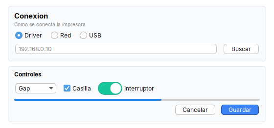
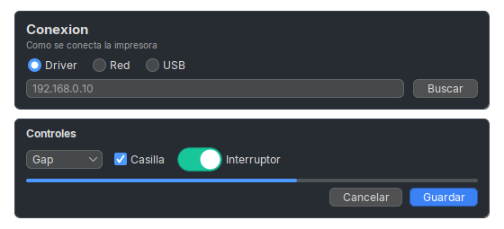
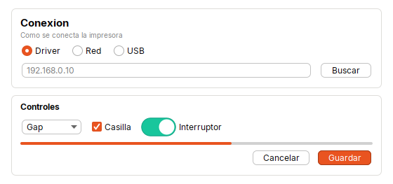
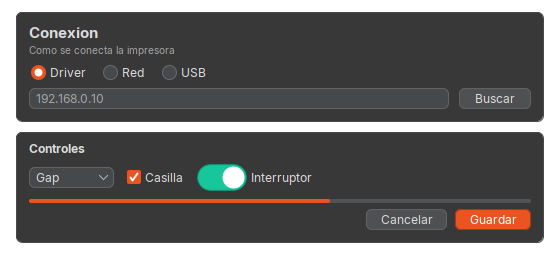
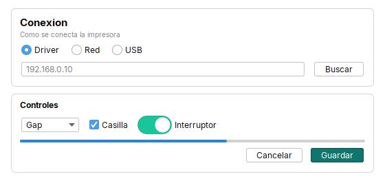

# Theme

Instala el **look and feel** (FlatLaf, claro u oscuro), la fuente **Inter** empaquetada, el color de acento, el fondo de los paneles y la paleta del kit. Hay **cuatro temas listos**
(`Theme.light()`, `dark()`, `ubuntu()`, `ubuntuDark()`) y se puede armar uno propio con el `Builder`. Se usa **una sola vez**, antes de crear cualquier ventana.

| | |
|---|---|
| **Paquete** | `tessera.theme` |
| **Clase** | `Theme` (clase final) y `Theme.Builder` |
| **Se crea con** | `Theme.light()` · `Theme.dark()` · `Theme.ubuntu()` · `Theme.ubuntuDark()` · `Theme.builder()` ... `.install()` |
| **Importar** | `import tessera.theme.Theme;` |



## Cuando usarlo

- Al iniciar la app, **antes** de crear ventanas: le da a toda la aplicacion su color de marca, su fondo y sus esquinas.
- Para cambiar la fuente de toda la interfaz.
- Para pasar a **modo oscuro** o al estilo Ubuntu: un tema listo (`Theme.dark()`, `Theme.ubuntu()`...).

**Cuando no:** para cambiar **un solo widget** usa sus metodos encadenables (`bold()`, `color(...)`, `width(...)`); para algo especifico de FlatLaf, `UIManager.put(...)`
**despues** de `install()`.

## Temas listos

Cada uno define **toda** la [paleta](palette.md) del kit y devuelve un `Builder`, asi que se puede ajustar antes de instalar:

```java
Theme.light().install();                        // claro: el de siempre (azul, fondo blanco)
Theme.dark().install();                         // oscuro: grafito y acento azul
Theme.ubuntu().install();                       // estilo Ubuntu (Yaru) claro: naranja #E95420
Theme.ubuntuDark().install();                   // estilo Ubuntu (Yaru) oscuro
Theme.dark().accent("#4F9EFF").install();       // un tema listo con un color propio
Theme.builder().palette(Palette.UBUNTU).install();   // lo mismo que Theme.ubuntu()
```

| `light()` | `dark()` | `ubuntu()` | `ubuntuDark()` |
|---|---|---|---|
|  |  |  |  |

- **Elegirlo al arrancar**: los widgets leen la paleta al crearse y no se repintan solos al cambiarla.
- **`Theme.builder()` sin tema listo** no toca la paleta: cambia solo lo que se le pide y conserva el resto del tema anterior.
- Pasar de un tema listo a otro no arrastra colores del anterior (ni las variantes).
- Los oscuros y Ubuntu activan `tintControls()`: radios, casillas, barras de progreso y la seleccion toman el acento.

## Referencia

```java
Theme.builder()
    .accent("#1976D2")           // color de acento
    .primary("#1976D2")          // botones principales
    .panelBackground("#F7F6F3")  // fondo de las pantallas
    .surface("#FFFFFF")          // relleno de Card
    .cardLine("#E4E1D9")         // borde de Card
    .arc(12)                     // esquinas de botones y campos
    .install();
```

### `Theme.Builder`

| Metodo | Que hace | Por defecto |
|---|---|---|
| `font(String familia)` | usa esa fuente **instalada en el sistema** en vez de la Inter empaquetada | Inter |
| `accent(Color)` / `accent(String hex)` | color de acento global (se lee despues con `Theme.accent()`) | `#1976D2` |
| `primary(Color)` / `primary(String hex)` | color de los botones principales (`Button.primary`) | el de `Theme.palette().primary` |
| `surface(Color)` / `surface(String hex)` | relleno de las tarjetas (`Card`) | el de `Theme.palette().surface` |
| `cardLine(Color)` / `cardLine(String hex)` | borde de las tarjetas (`Card`) | el de `Theme.palette().cardLine` |
| `success(...)` / `danger(...)` / `warning(...)` / `info(...)` / `secondary(...)` / `light(...)` / `dark(...)` (`Color` o hex) | color de esa [`Variant`](#variantes-de-color) | Bootstrap: `#198754`, `#DC3545`, `#FFC107`, `#0DCAF0`, `#6C757D`; `light` `#F8F9FA`, `dark` `#212529` |
| `variant(Variant, Color)` / `variant(Variant, String hex)` | lo mismo para cualquier variante | |
| `palette(Palette)` | toma **todos** los colores de una [`Palette`](palette.md) (un tema entero); lo que se llame despues la ajusta | |
| `darkMode(boolean)` | usa el look and feel oscuro (`FlatDarkLaf`) en vez del claro; los temas listos ya lo indican | `false` |
| `tintControls()` | radios, casillas, barras de progreso y seleccion con el acento (ver [la nota sobre el acento](../../guides/customizing.md#nota-sobre-el-acento)) | no |
| `muted(Color)` / `muted(String hex)` | texto secundario (`Label.muted`) | el del tema anterior (claro al inicio) |
| `line(Color)` / `line(String hex)` | bordes finos y separadores | idem |
| `rows(odd, even, selected)` (`Color` o hex) | filas alternas de las listas y la seleccionada (`LabelListCell`) | idem |
| `banner(fondo, texto)` (`Color` o hex) | banners y barras oscuras (`Header`) y el texto que va encima | idem |
| `panelBackground(Color)` / `panelBackground(String hex)` | fondo de paneles, scrolls y viewports (las listas y tablas siguen blancas) | blanco |
| `arc(int)` | radio (px) de las esquinas de botones, campos y barras | 12 |
| `tooltipDismissMs(int)` | cuanto dura un tooltip en pantalla | 8000 |
| `install()` | aplica el tema | |

Los metodos devuelven el `Builder`, asi que se encadenan; solo `install()` cierra la cadena.

### Variantes de color

`tessera.theme.Variant` (`PRIMARY SECONDARY SUCCESS DANGER WARNING INFO LIGHT DARK`) son los colores semanticos que usan `Button`, `Toggle`, `Label` y `Hint`
(`Button.danger(..)`, `Label.success(..)`, `.variant(v)`). `PRIMARY` sigue a `primary(...)`; los demas traen los colores de Bootstrap.
`Variant.X.color()`, `.onColor()` (texto que contrasta), `.hover()` y `.pressed()` sirven para codigo propio, y `Variant.X.setColor(c)` cambia uno en cualquier momento (antes de crear las ventanas).

```java
Theme.builder().primary("#1976D2").success("#2E7D32").danger("#C62828").install();
```

### Lectura desde tu codigo

| Metodo | Devuelve |
|---|---|
| `Theme.palette()` | la [`Palette`](palette.md) instalada: `.primary .surface .cardLine .banner .onBanner .muted .line .rowOdd .rowEven .rowSelected` (la clara hasta que se instale un tema) |
| `Theme.isDark()` | si el tema instalado es oscuro |
| `Theme.accent()` | el color de acento (foco, seleccion, enlaces) |
| `Theme.panelBackground()` | el fondo estandar de los paneles |
| `Theme.fontFamily()` | la familia de la fuente de la interfaz (para fuentes creadas a mano) |
| `Theme.DEFAULT_FONT_FAMILY` | `"Inter"` |

### Que hace `install()`

Instala FlatLaf (`FlatIntelliJLaf` claro o `FlatDarkLaf` oscuro), registra la fuente, guarda la [paleta](palette.md) resultante (la que lee `Theme.palette()`) y escribe varias claves de `UIManager` (acento, fondos, esquinas, barras de desplazamiento). Si algo
falla, queda el look and feel del sistema y se anota en el log. La lista completa de claves, con una tabla, esta en [Personalizar: el tema](../../guides/customizing.md#1-el-tema-theme).



## Errores comunes

- **Cambiar el tema con ventanas ya abiertas** no las actualiza: instalalo una sola vez, antes de crear ventanas.
- **`accent` no pinta radios, casillas ni barras de progreso** con `Theme.builder()` solo: FlatLaf ya calculo esos colores. Los temas listos lo resuelven con `tintControls()`; con el builder hay un truco, explicado en [la nota sobre el acento](../../guides/customizing.md#nota-sobre-el-acento).
- **Instalar otro tema (o cambiar un color) despues de crear widgets** no los cambia: cada widget toma el color al crearse; el tema se elige al arrancar, con `Theme.builder().primary(...)` o un tema listo.
- **Modo oscuro**: `Theme.dark()` y `Theme.ubuntuDark()` lo instalan; `Theme.builder()` instala el claro. Los colores que la app fija por su cuenta no cambian solos (ver [customizing.md](../../guides/customizing.md#temas-listos)).

## Ver tambien

- [Personalizar: colores, esquinas, fuente](../../guides/customizing.md): donde se toca cada cosa.
- [`Palette`](palette.md): los colores de cada tema, con una imagen de cada uno.
- [Referencia del kit](../kit/README.md#utilidades): `Metrics`, `Buttons` y `Layout`.
- [`Icons`](icons.md): iconos SVG.
